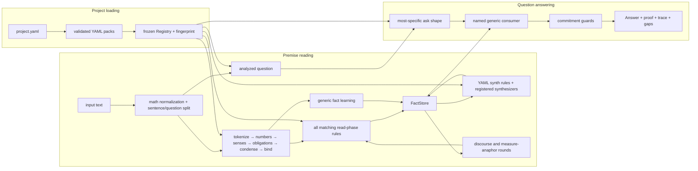

# RuleKit architecture

**Updated:** 2026-07-25
**Status:** current implementation, not a roadmap

RuleKit is a deterministic reading and reasoning engine for controlled,
ordinary English. It turns text into typed facts, closes those facts under
explicit derivations, and answers a recognized question through a named
consumer. There is no model or LLM in the runtime path.

This document describes what the repository does today. Campaign state belongs
in [`HANDOFF.md`](HANDOFF.md), evaluation policy in
[`methodology.md`](methodology.md), and project-wide engineering constraints in
[`../CLAUDE.md`](../CLAUDE.md).

## Architectural boundaries

The design is held together by five boundaries:

1. **Language knowledge is data.** Word senses, lemmas, plurals, category
   membership, polarity, conversions, formulas, and reference facts live in
   YAML packs. Python may name grammatical senses and category interfaces, but
   may not contain corpus vocabulary.
2. **Reading and answering are separate.** Premise rules emit facts. Question
   rules normalize an ask and select a generic consumer; they do not create
   premise evidence.
3. **One fact store owns commitments.** Exact facts, derived facts, and
   first-class semantic-graph facts share the same conflict and provenance
   discipline. UI projections and benchmark adapters do not form a second
   inference engine.
4. **Ambiguity fails closed.** A binding, derivation, or answer is accepted only
   when its evidence is sufficiently specific. Conflict, unresolved reference,
   incomplete structure, or an unread operative value causes a decline or
   clarification—not a guess.
5. **Evaluation is part of the architecture.** Stable partitions, protected
   aggregate-only slices, per-item snapshot diffs, and fresh-process
   determinism checks constrain how the engine is allowed to evolve.

## System map



The arrows back from discourse resolution represent a bounded rebuild, not
in-place fact repair. When a pronoun or measure anaphor becomes resolvable, the
affected sentence's rules are rerun and the complete premise store is rebuilt
and saturated from source readings.

## Configuration and compilation

### Projects

A project directory contains `project.yaml`. Loading it:

1. validates the document with `ProjectDoc`;
2. resolves pack names against the nearest repository-level `packs/`
   directory, while `./` and `../` entries resolve relative to the project;
3. loads packs in declared order and checks `requires`;
4. compiles the loaded data into one immutable `Registry`; and
5. computes a SHA-256 fingerprint from the exact pack bytes.

A project may expose:

- a small YAML `suite`;
- answer datasets backed by Parquet; or
- a semantic `projection` corpus.

Suites and answer datasets may coexist, as they do in the GSM8K project.
Projection projects cannot also declare either one. A scratch project may
declare no evaluation target. These boundaries keep graph scoring out of the
answer judge.

### Packs

Every pack has a `rulekit/pack@1` manifest. Every other YAML document
self-identifies with `format: rulekit/<kind>@1`; unknown formats fail loading.
Models reject unknown fields except where a schema deliberately defines an
open payload, such as fact-specific emission fields, reference rows, or guard
settings. The canonical schemas are the Pydantic models in
[`schemas.py`](../src/rulekit/data/schemas.py), not examples copied into
documentation.

The implemented document families are:

| Concern | Document kinds |
| --- | --- |
| language | lexicon, categories, numbers, obligations, contractions |
| reading and inference | rules/asks, synth, guards |
| domain knowledge | conversions, affine conversions, geometry, formulas, calendar, elements, reference |
| governance | quarantine, requirements, pack, project |

Compilation rejects duplicate vocabulary across packs, duplicate rule ids,
category cycles, dangling category roots, incompatible antonyms, invalid
category members, conflicting conversions or reference values, and rule gates
that name unknown categories. The resulting mappings and rule sequences are
sorted and frozen.

`quarantine.yaml` is negative knowledge: its entries are intentionally absent
from the lexicon, and compilation rejects a word that appears in both.

## Runtime reading pipeline

The core runtime function is
`rulekit.kernel.engine.solve(text, registry, tracing=True,
interpretation=None)`. The CLI obtains the registry by loading a project.

### 1. Normalize and separate the question

Recognized LaTeX math spans are conservatively transcribed before tokenization.
The text is split into premise sentences and, when identifiable, a trailing
question. A small set of structural repairs handles explicitly licensed fused
conditional/question forms; an unrecognized boundary remains unsplit and
normally declines downstream.

### 2. Analyze each sentence

`analyze()` applies the same ordered stages to every premise and the question:

1. `tokenize` creates `Word` and `Unit` objects;
2. `annotate_numbers` identifies counts, fractions, percents, tuples, dates,
   formulas, and other structured numeric forms;
3. `annotate_senses` supplies pack-backed candidate senses and lemmas;
4. `disambiguate` selects a sense only when obligation coverage licenses it;
5. `attach_obligations` gives grammatical roles their declared needs;
6. `condense` merges licensed multi-unit constructions; and
7. `bind` discharges obligations against suitable units.

Every mutating reading step records a `Decision` when tracing is enabled.
Bench runs disable the expensive reversible snapshots while keeping the same
semantic path.

### 3. Build the premise store

For each premise, every matching `phase: read` pattern rule runs. Rules match
annotated units rather than raw strings and emit typed facts with rule and
sentence provenance. Independently, `learn()` extracts general facts licensed
by the analyzed structure.

All emitted facts enter a `FactStore`, after which `saturate()` repeatedly
applies:

- declarative `rulekit/synth@1` joins; and
- the kernel's statically registered algorithmic synthesizers.

Saturation is monotone: synthesizers add facts, the store deduplicates them,
and the loop stops when a round adds nothing. A 50-round cap turns
non-termination into an error.

### 4. Resolve document context

The document loop currently resolves two cross-sentence phenomena:

- personal discourse reference against prior compatible referents; and
- measure anaphora such as a later “ones” referring to one prior counted noun
  lemma.

Resolution uses the deictic arbitration primitive and fails closed when no
candidate strictly dominates. Changed sentences have their read rules rerun;
the store is then rebuilt and saturated. The loop has a six-round cap.

Gaps are collected after the loop as unknown words, ambiguous senses, and
unmet obligations. They are diagnostic records, not instructions to an
external provider.

### 5. Interpret and answer the question

The question is analyzed separately and its pronouns are resolved against the
premise document. `match_ask()` chooses one ask by:

1. number of consumed units;
2. total category-gate depth; and
3. stable rule-id order as the final tie-break.

An ask renders a normalized query naming a consumer. An ask may instead
declare several explicit interpretations; without a caller-selected
interpretation, the result is a structured clarification request.

Consumers are Python implementations registered by name under
`kernel/consumers/`. They read only the normalized query, saturated store,
registry, arithmetic log, match metadata, and premise readings. Consumers may
return numeric answers, yes/no/undetermined verdicts, proofs, or declines.

### 6. Guard the commitment

Guards run only against a proposed commitment:

- numeric answers are checked for unread vocabulary, unused or multiply used
  operative values, unresolved derivations, and related accounting failures;
- verdict answers use a supported-fragment guard that rejects unread
  truth-scoping operators.

A veto converts the proposed answer to a decline. Guards inspect structural
state and fact use; they do not special-case rule ids.

## Core representations

| Type | Responsibility |
| --- | --- |
| `Registry` | immutable compiled pack data, rule/ask/synth sequences, and fingerprint |
| `Reading` | one sentence's units, decisions, and deficiencies |
| `Obligation` | a typed grammatical need and its binding |
| `Decision` | reversible mutation record used by tracing and the designer |
| `Fact` | immutable typed commitment with `Provenance` |
| `FactStore` | admission, agreement, collision quarantine, and fact lookup |
| `Document` | premise readings, store, arithmetic/deictic log, consumed units, rounds, and gaps |
| `Answer` | number, verdict, or decline, optionally with proof or clarification |
| `Result` | complete runtime surface: answer, readings, store, log, veto, and document |

The fact model covers arithmetic quantities and relations, membership and
logical structures, rates, prices, partitions, aliases, and explicit
`SemanticGraphNode`/`SemanticGraphEdge` facts. Specialized fact classes keep
their own identity keys and value parts; the store does not flatten all
meaning into generic triples.

## Rule execution and conflict handling

Pattern rules have no authored priority. They may use literals for grammatical
skeleton, typed or category-gated slots, optional groups, span capture,
cross-slot predicates, anchoring, and explicit value consumption.

All read-phase matches run. Before fact admission, one match may shadow another
only when it consumes a superset of the other's units and has strictly greater
computed specificity. Otherwise:

- same fact key and same value records agreement and keeps one fact;
- same key and different value quarantines both facts and records a
  `Collision`; and
- a dirty store cannot produce an answer commitment.

The store has narrowly defined structural identity handling for owners,
qualifiers, labels, and conjunct segments. These distinctions come from typed
fact fields and are independent of rule execution order.

Ask rules are different: exactly one normalized query must be selected before
consumer dispatch. Their most-specific-match rule and explicit clarification
mechanism make that selection visible.

## Semantic projection

Semantic projection is implemented in two layers:

1. runtime rules may emit first-class semantic node and edge facts into the
   ordinary store; and
2. the benchmark harness converts those facts into a normalized evaluation
   graph.

COGS logical forms and PMB SBN are parsed only by
[`harness/projection.py`](../src/rulekit/harness/projection.py). Gold adapters
must not be imported by runtime parsing. Graph comparison alpha-normalizes
references and preserves predicate, role, attachment, and status structure.

Projection outcomes are harm ordered:

- `incorrect`: at least one unsupported projected node or edge;
- `partial`: every projection is correct but required graph content is
  missing;
- `declined`: no graph commitment; and
- `exact`: the complete normalized graph matches.

The optional `legacy_bridge` exposes pre-existing `VerbalRelation` facts for
COGS compatibility. Independent PMB evaluation disables it and scores only
explicit semantic graph facts.

The semantic-projection expansion campaign is currently parked pending review
of the independent synthetic dataset. That is project status, not a missing
runtime dependency; see [`HANDOFF.md`](HANDOFF.md).

## Evaluation, snapshots, and firewall

The same `bench` command routes by project shape:

- suite and answer projects run `harness/bench.py` and the answer judge;
- projection projects run `harness/projection.py` and graph scoring.

Answer datasets use a stable MD5 partition for `dev-train` and `dev-holdout`;
a configured grouping key keeps related items on one side. The operating
policy reserves `dev-train` for tuning and treats holdout as a delta gate.
Protected TEST requires `--spend-test-look`, returns aggregates, and appends an
auditable ledger entry.

Projection projects declare each split's firewall mode. COGS test and
generalization, and PMB test, are schema-required to be aggregate-only.
Protected projection runs reject partial `--limit` looks, suppress item
results, and are ledgered.

Snapshots contain a registry fingerprint and stable per-item outcomes.
`rulekit diff` rejects:

- answer regressions from correct to non-correct or safe to wrong; and
- projection regressions from exact to non-exact or safe to incorrect.

`bench --twice` compares the current result with a fresh isolated Python
process. With `--jobs N`, the harness also compares parallel and serial
execution. Worker processes reload the project and verify the expected
registry fingerprint.

## CLI and designer

The implemented CLI is:

```text
rulekit --project P solve TEXT [--trace] [--json]
rulekit --project P diagnose TEXT
rulekit --project P bench [--slice SLICE] [--snapshot FILE] [--twice] [--jobs N]
rulekit --project P stats [--slice SLICE]
rulekit --project P lint [--category CATEGORY] [--verbose]
rulekit --project P diff BEFORE AFTER
rulekit --project P serve [--host HOST] [--port PORT]
```

The optional `server` dependencies provide a local FastAPI application and a
vanilla-JavaScript designer. The designer exposes:

- a reading decision stepper;
- fact, gap, collision, and deficiency views;
- semantic, deictic, proof, and clarification views;
- editing of existing pack YAML documents with validate-and-rollback; and
- answer-project impact baselines and firewall-aware TEST spending.

The editable-file boundary is an allowlist of the exact YAML files reported
from loaded packs. It excludes project files, datasets, snapshots, new paths,
and symlinks escaping a pack. Projection benchmarking is currently a CLI
surface; the designer's impact panel targets suites and answer datasets.

## Repository map

```text
src/rulekit/
  data/             strict schemas, pack loading, project loading, registry compilation
  kernel/           reading, facts, saturation, document context, answering, guards
  kernel/consumers/ named answer consumers
  harness/          answer/projection benches, firewalls, snapshots, diffs
  lint/             static overlap, literal, and blast-radius checks
  reference/        optional DuckDB-backed reference aggregation
  server/           FastAPI API and bundled browser UI
  cli.py            command-line surface

packs/
  core-english/     base language data
  arithmetic/       general word-problem rules, asks, and synth rules
  difg-mined/       migrated vocabulary and domain knowledge, including quarantine
  reference/        curated reference lookup data and rules

projects/           curated and corpus-specific project configurations/builders
tests/              synthetic unit and regression tests; corpus strings are forbidden
docs/               architecture, methodology, campaign records, and design notes
tools/              migration and repository utilities
```

Project-local packs are allowed when a corpus needs a narrower licence or
semantic boundary. They must remain ordinary packs; benchmark adapters do not
get to perform runtime reading.

## Where extensions belong

| Change | Primary location |
| --- | --- |
| new word, sense, morphology, category, or domain constant | a YAML pack |
| new sentence construction that emits existing facts | `rulekit/rules@1` plus synthetic tests |
| monotone join over existing fact kinds | `rulekit/synth@1` |
| genuinely algorithmic general derivation | a registered synthesizer in `saturate.py` |
| new question surface | a pack ask |
| new normalized query operation | a focused consumer under `kernel/consumers/` |
| new fact kind | model, emission table, store semantics, API/projection serialization, and tests |
| new corpus or gold representation | project builder and harness adapter, never runtime reading |

Any shared matcher, learner, fact-store, synthesizer, consumer, or guard change
has kernel-sized blast radius and must run the full standing gates.

## Declared but not implemented

Several schema fields preserve intended seams but do not yet have runtime
behavior:

- pack `activation` is validated but all project packs are loaded eagerly;
- requirement shapes are compiled but no provider loop consumes them;
- `phase: post-saturation` pattern rules are accepted but only `read` phase is
  scheduled;
- multi-sentence pattern sequences are accepted by the schema but not executed;
- the document loop has no general event-indexed provider, pack-activation, or
  provenance-retraction mechanism;
- synthesizers and consumers are in-process registries, not external plugin
  entry points; and
- the package root exposes no stable high-level library or MCP API—the CLI and
  internal Python functions are the current surfaces.

These are roadmap candidates, not capabilities callers may rely on.
