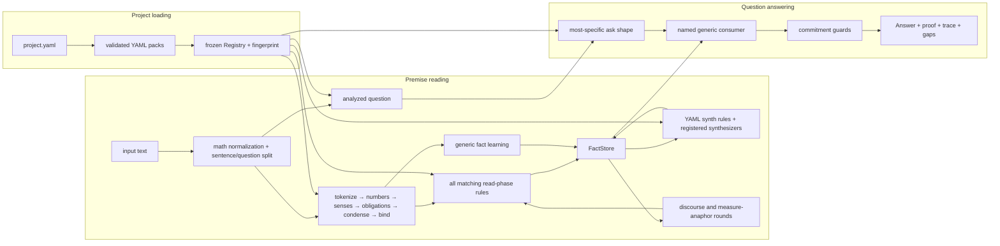

# RuleKit architecture

**Updated:** 2026-09-06
**Status:** current implementation, not a roadmap

RuleKit is a deterministic reading and reasoning engine for controlled,
ordinary English. It turns text into typed facts, closes those facts under
explicit derivations, and answers a recognized question through a named
consumer. There is no model or LLM in the runtime path.

This document describes what the repository does today. Campaign state belongs
in [`HANDOFF.md`](HANDOFF.md), evaluation policy in
[`methodology.md`](methodology.md), and project-wide engineering constraints in
[`../CLAUDE.md`](../CLAUDE.md).

The active campaign uses the deterministic generation and human-review
workbench as a promotion gate for isolated mining candidates. Its campaign
contract is [`gsm8k-mining-v2-plan.md`](gsm8k-mining-v2-plan.md); the underlying
Designer product remains specified in
[`generation-and-annotation-plan.md`](generation-and-annotation-plan.md).
G1–G7 and G6b are implemented; the milestone names below describe how the
current authoring surface was assembled, not unfinished delivery phases.
Its G1–G4 exploration loop, G5a declared-plural and G5b declared-counted
realizers, G5c bounded proper-name possessive realizer, G5d declared generic
pronoun realizer, G5e declared pronoun-category realizer, G5f aggregate-root
category realizer, G5g owned category nouns and number constraints, G6
exploration status, Reading-origin and fact-level review entries, declarative
fraction-plural morphology correction, scoped `GroupTotal` facts, and
many-to-many adjective/noun compatibility and the leading-total
scoped/existential subject split are implemented. G5h moves the seven generic
exploratory category domains found during project-empty profiling into
`core-english`, exposing five more premise rules and every compatible filler
to human review. G5i recursively realizes optional groups, including nested
groups to depth three in the current packs, and exposes every active, omitted,
or parent-inactive branch in the premise inspector. G5j extends the same
category-generic lexical realizer to comparative-rooted categories; empty
loaded categories remain blocked by their missing filler domain. G5k realizes
sentence-wide negative category premises by filtering every literal and slot
domain with the matcher's analyzed-lemma membership test; locked probes
and exploration use the same boundary. G5l maps `unbound` sentinels to their
nearest optional negative-lookahead branch, forces that branch omitted, and
keeps the omission and matcher-confirmed non-binding inspectable. Generated
G5m realizes linked `distinct_measure` predicates with the matcher's exact
`(lemma, label, qualifier)` key, including availability, locked bindings,
minimal pairs, and exploration placement. G5n admits the direct
`complementizer` lexical root to the category-generic realizer, including both
mandatory and optional occurrences and exact source evidence. G5o does the
same for direct `quantifier` slots while preserving independent blockers on
rules whose other descendants remain unrealizable. Later premise review
narrows distributive container quantifiers to the declared `each`/`every`
subset and represents the differently sensed `in all` total as its own
GroupTotal rule. G5q moves the generic age
comparatives and their core direction memberships into `core-english` while
preserving mined-only category extensions. G5r applies the same ownership
boundary to the signed physical-dimension comparative class. G5s moves the
eight generic modal forms into core and realizes both the complete modal
domain and its declared future-only subtype. G5t moves the two deictic
temporal markers into core and admits registry-backed time-rooted category
generation. G5u moves generic `currently` into core and admits the complete
loaded direct-adverb domain, bringing its checkpoint availability to 95/95.
G5v's review-led boundary passes add declarative definiteness, agreement,
appositive-role, quantitative-verb, count/mass, additive-direction,
finite/bare-form verb, complete-frame, optional-slot-coupling,
descriptor/noun compatibility, category overlap, and conditional
verb/semantic-role constraints. They also distinguish location PPs from
remnant-only PPs, require outbound transfers to take compatible quantity
objects, separate sum markers from broader aggregate operations, and retain
`GroupTotal.scope` only for surfaces that identify a real group.

Named calendar adjuncts additionally use separate governed preposition/object
categories and a category-scoped determinerless slot qualifier: ordinary
referential common nouns may still take determiners, while weekdays and month
names in the same slot stay bare. Quantitative initiation, earning, and
production verbs use positive actor/object roles rather than an arbitrary
direct-object reading. Standalone scalar numbers remain distinct from
condensed counted nouns so an elided rule
cannot double-fire on an explicit measure. Percent-change premises now split
mass currency from plural denominations, enforce agreement, and reject
decreases beyond the whole quantity. Motion comparisons reject an unstated
`as many` measure, accept explicit frequency through `as many times`, and use
a separate distance relation for `as far`; common-noun motion roles must be
declared plausible people, animals, or vehicles. Explicit count frames also
require their item to belong to the declared motion-comparison measure class,
so transported objects such as grapes do not become distance or frequency
units. The conjunct quantity family
uses the same role boundary for its common-noun subject and, where present,
its explicit standard. Its full conjunct rule also validates an optional PP
through the pack-declared preposition/noun compatibility table. This remains
conditional on the verb category: ordinary quantity verbs retain their open
count-object domain, while a motion verb activates the narrower measure role.
Comparative `as many/as much`
rules accept adverbial multipliers such as `twice`, `thrice`, and explicit
`N times`, while the pack-declared `double`/`triple` predeterminers remain
available for noun-phrase frames such as `double the amount`. The established
count-affine compatibility surface remains accepted to keep the DEV ship gate
neutral; the reviewed mass-affine and conjunct rules apply the narrower form
boundary. Adverbial age-ratio rules and demonstrative
`that/this many|much` pro-forms apply the same predeterminer subtraction,
while possessive noun-phrase ratios such as `double Cato's age` retain it.
Every anaphoric quantity-relation sibling also subtracts the declared
`non_quantity_holder` category from its subject rather than relying on
per-rule guard coverage. The same adverbial families also require a non-unit multiplier, so
factor-one `once` remains a frequency adverb rather than an `as many/as much`
ratio. The plain count equative `X VERB as many ITEM as Y` is a separate rule
that emits the same Relation with a fixed factor of 1; it does not need an
artificial multiplier token. Existential quantity rules locally exclude
temporal `times`; periodic rates require referential subjects, and sum-of-ages
owns its definite,
possessive, plural-noun, singular-copula frame. Both absolute and comparative
direct-quantity goals apply ordinary subject/verb compatibility: a singular
proper name admits `needs`, `requires`, or a number-neutral past form, not the
plural/base `need` or `require`. The comparative form also applies
`same_number` between
its standalone count and noun, admitting `1 fewer shopper` and
`2 fewer shoppers` while rejecting both mismatches. The current curated
project has 188 loaded reading rules and 490 reachable generated-filler
identities. Of those rules, 179 are ordinary selectable generated premises,
eight are explicitly fact-free safety interceptors, and one is a declared
reader-only gapped construction. Keeping those roles in the schema prevents
generation coverage from treating defensive recognition as authored English.
Reading and Generate likewise keep surviving safety consumers out of their
premise-match lists. A safety rule remains active inside the document matcher
so it can suppress an unsafe fallback fold, but the Designer renders it in a
separate, fact-free safety-interception panel and does not offer it as a
premise-review target. When a more-specific ordinary premise subsumes the same
match, the redundant safety co-match is omitted from that panel.
The
explicit `originally` ask routes through the existing start-state event
inversion; a qualified start state with differently qualified same-measure
events declines until modifier nesting is represented losslessly.
Generated defects remain visible by design: mechanical support reports that a
rule can be realized and matched, not that its premises license valid English.

### Exact adposition roles

Broad English preposition recognition is owned by `core-english`, including
eight declared multiword lexemes. The analyzer condenses the longest matching
multiword preposition before sense disambiguation and obligation attachment,
so `next to`, `out of`, `because of`, and `due to` each behave as one relation
marker. The generator admits these phrases only to preposition slots; they do
not widen unconstrained word domains.

The same early merge supports noun and adverb entries explicitly marked
`lexical_phrase: true`. Their normalized multiword key owns the whole lexical
identity; declared noun plurals preserve that identity and grammatical number.
An idiom receives fresh features, so `once again` does not retain the numeric
value of `once`, and `gummy worm` never becomes an ordinary `worm` quantity.
The generator uses the same opt-in contract in noun, plural, counted,
possessed, and qualified domains. Compositional compounds remain on the
ordinary modifier path. Quantity-determining attributes also preserve a noun
phrase boundary, preventing a destination noun from absorbing the following
`enough ...` content phrase.

An explicitly declared nonnumeric hyphenated lexeme also retains one lexical
identity, without admitting its space-separated spelling. Numeric hyphens
remain on the productive measured-compound path. Strict generation compares
the bound content units against the requested filler; it does not re-read a
display string that has lost the internal hyphen. Partial head matches still
fail that complete-binding check.
Measured-compound generation resolves declared measure/holder compatibility
once per noun pair before expanding numeric fillers. Changing the number does
not re-run the same compatibility scan, and the domain's order is unchanged.

Semantic interpretation is narrower than recognition. A frozen,
source-indexed `adposition_roles` table joins three pack-declared categories:
the preposition, its object, and the governing verb. A semantic role may
declare several alternate frames; matching any frame produces that one role,
without minting construction-specific role names. Spatial location, source,
goal, and path; temporal point, boundary, and duration; and governed
accompaniment, instrument, means, manner, cause, and purpose relations all use
that one generic join. Exactly one surviving role emits a `VerbalRelation`
whose `role`, exact `prep`, object, indefiniteness, and originating event
remain inspectable; zero or multiple roles emit nothing. The event identity
joins a spatial relation to its `EventTime` without joining unrelated events
that happen to share a verb lemma.

The arrival boundary demonstrates why alternate frames matter. General motion
goals require the ordinary `to`/`toward`/`into`/`onto` category. A second
`spatial-goal` frame joins the arrival-only verb category with the separate
`at` category, so `arrived at the garden` preserves a destination while
`walked at the garden` retains only its pre-existing locative interpretation.
Core owns `arrive`, `arrived`, and `arrives`, and the inflected forms normalize
to one lemma. These supplementary relations do not consume syntax or imply an
answer. Unsupported and overloaded forms therefore remain reviewable without
being promoted to a semantic commitment.

The logic-arithmetic PP bridge is narrower again. Its class-wide and named
membership rules require an explicit article and the declared institutional
class-restriction preposition/place categories. Its coordinated verbal rule
requires the declared subject-role predicate and the same complete PP. Broad
recognition can therefore expose `of`, `on`, and other markers without letting
an arbitrary pair mint an `Atom`, `QuantifiedQuantity`, or coordinated
`VerbalRelation`.

Entity slots can now declare `common_noun_cat` when names and common nouns
share a grammatical position but only a positive subset of common nouns is
licensed for the semantic role. Names and resolved pronouns keep the ordinary
entity path; nouns must follow the named YAML category. The arithmetic ratio
family uses `quantity_holder` on its subject, while leaving its polymorphic
standard open to measure-class nouns. Strict generation follows this role
boundary and lexical-boundary generation may relax it explicitly.
An optional animate appositive is narrower still: its conditional-category
premise requires the subject to be a declared quantity-event participant or
an explicitly permitted proper name. This keeps holder eligibility separate
from kinship/animate-role eligibility.

Cross-slot semantic-class agreement is separate from lexical identity.
`same_category_membership` requires all named slots either to belong to a
declared category or all to remain outside it. The conjunct ratio rules use
this for temporal measures, preserving both ordinary object/object and
timeperiod/timeperiod pairs without accepting a mixed pair. Matching,
generation feasibility, compatible probes, explanations, and source links
all read the same predicate.

Pronoun agreement instead requires positive lexical evidence. Core English
declares an `anaphoric_form` paradigm and allowed referent numbers on each
licensed form. Grammatical number stays separate: singular-reference `they`
still takes plural verb agreement. Absence from a gender category is never
agreement evidence, and names supply no inferred gender.

A read rule can declare `references: {poss: who, outcome: who}` when its
complete construction establishes those links. Forms sharing a target must
have a compatible declared paradigm; a repeated explicit name must have the
same exact reference identity. Missing metadata, unresolved targets, conflicting
prior bindings, group/sentinel targets, cycles and invalid slots fail closed.
Matching and emission use non-mutating projections; an accepted match records
real Unit targets and owned-noun identities in the trace. Ordinary discourse
resolution is unchanged. This is separate from `satisfies`, which can only
discharge a structural obligation without identifying its referent.

The generator uses the same form-agreement helper and prunes explicit reference
links. `owner_matches` also prunes premise generation in either binding
order. When a separate determiner already introduces the owned noun, its filler
retains the required owner but renders only the noun head. Possessive clitics
are a declared category root and attach to their preceding generated surface.

Exact written-form agreement is separate again. `same_surface` requires every
named single-unit slot to expose the same case-insensitive surface. Unlike
`same_lemma`, it does not follow a pronoun's resolved referent. This lets a
coordinated construction use repeated grammatical form as evidence—for
example, the same possessive/object form around parallel contributors—without
changing the engine's general nearest-antecedent resolver. The strict generator
intersects every participating slot domain before choosing a surface, and the
ordinary matcher remains the round-trip oracle.

Additive comparisons may omit their standard in state/ownership clauses.
`Mary has 5 more apples` carries its measure in the Relation, while
`Mary has 5 more` leaves it null. Both use the ordinary reserved elided-standard
sentinel. Saturation resolves the omission only from one unique earlier
Quantity held by another entity; the fully elided form obtains both the
standard and measure from that fact. Event verbs are excluded from these two
premise rules because `Mary buys 5 more` is a same-holder quantity change, not
an omitted cross-holder comparison. The narrower `possession_state` category
also excludes copular generations such as `Mary is 5 more apples`. Explicit
standards and conjoined
comparisons remain owned by their existing rule families.

Goal vocabulary is organized by complement grammar rather than by scenario.
`goal_predicate` is the non-actual semantic parent;
`finite_infinitival_goal_predicate` covers controlled infinitives such as
“wants/hopes/intends to buy 30 books”;
`direct_quantity_goal_predicate` covers direct quantities such as
“needs/requires 30 books” and licenses the corresponding deficit asks; and
`purpose_resource_goal_activity` covers explicitly priced purposes such as
“saving/raising money for shoes which cost $600”. The existing rule ids remain
stable for Designer evidence, but their slots draw from these shared domains.
Adding a compatible predicate therefore extends a grammatical construction
without adding another arithmetic rule. Every construction emits the same
`Goal`; its surface verb remains trace evidence and is not a consumer switch.
The shared parent inherits `non_quantity_object_verb`: a dedicated goal rule
can consume its declared quantity complement, but an ordinary event or ratio
reader cannot reinterpret a desired, required, or saved target as an actual
quantity. This inheritance makes new goal vocabulary safe by default instead
of requiring another exclusion entry beside every new surface.

Comparative relations headed by any declared `goal_predicate` are likewise
goal-scoped. The goal-relation synthesizer anchors them only on another
compatible `Goal` and emits a derived `Goal`; ordinary relation saturation
ignores them. Consequently “Fia requires 5 fewer pencils than Cato” can use
Cato's stated requirement, but it cannot turn Cato's current pencil holding
into a target or materialize a fictitious current holding for Fia.

Purpose-scoped monetary goals preserve three kinds of evidence instead of
collapsing them into one holding. A priced resource-building premise emits a
`Goal` whose optional `target` identifies the intended purchase. A statement
of current progress as a fraction of “the money needed” emits a `Relation` with
the reserved goal standard; the surface may include the productive partitive
marker in “half of the money”. The goal-progress synthesizer materializes a
state `Quantity` only when exactly one compatible goal exists. A committed
transfer emits `Contribution` facts that retain both beneficiary and
contributor rather than pretending a planned gift has already changed general
holdings. Its optional “for that purpose” tail is a bounded grammatical adjunct
licensed by declared purpose-preposition and purpose-noun categories; it does
not admit arbitrary trailing objects. Priced targets and target-qualified asks
admit singular and plural purchase objects while enforcing target/cost number
agreement. Only a purpose-qualified deficit ask opts into adding the
contributions, and its target must match the goal. Ordinary deficit asks retain
their historical single-goal, single-current-holding behavior.

Closed budget allocations are distinct from purchase goals and current
holdings. `ResourceAllocation` first records the reusable account phrase:
`a budget of $180` and `a $180 budget` have the same meaning. Its source spans
identify the precise account head and amount. This local grammar neither
asserts an owner nor consumes the surrounding activity. The former
motion-specific budget rule is retired. Generation can inspect each allocation
phrase independently; a phrase alone does not establish an opening balance.
Possessive ownership on an amount-first currency compound is retained as well
as ownership on the account head. Conflicting owners cannot yield a balance,
and a non-personal possessive cannot establish this personal-account class.

The document's resource-accounting composition step attaches the phrase to
direct possession or a uniquely governed `allocation-context` adjunct. The
latter is licensed by the existing category-level `adposition_roles` table,
not by a motion/shopping word list. A preceding or following adjunct can thus
accompany an independently read activity. Attachment must follow the bound
predicate/object structure or an exact source-linked transaction; it never
borrows the nearest person or retailer. `ResourceBalance` preserves the
participant, account head, account qualifier, explicit owner, currency, and
opening event. A closing remainder retains the same account qualifiers.

`Expenditure` records an item-qualified cost, with an event/position
identity that distinguishes equal-valued costs in a coordinated list. Its
evidence basis distinguishes a purchase from a payment. Optional fields retain
the supplier/payee, supplier qualifier, transaction channel, and explicit
account reference. `from an online retailer` qualifies the supplier; `bought
online` names a channel. Neither implies a physical destination. Supplier and
price complements may appear in either order, and payments may place the payee
before the amount. An actual unpriced purchase keeps an unknown cost; an order
or modal future purchase supplies no actual expenditure. Potentially repeated
purchase/payment descriptions are not silently debited twice.
The request exclusion remains authoritative even when a legacy pack also
classifies the same verb under acquisition or purchase.

Whole-lot prices are separate from unit prices. A measured or packaged
purchase retains its `lot_measure`, explicit `lot_quantity`, and source
position, but its stated cost already prices the complete lot. Local relative
price clauses retain an exact item/qualifier reference and a fractional or
multiplicative factor. `pricing.resolve_expenditure_prices()` resolves those
references only within the same buyer's purchases, supports anchored chains,
and declines on missing, repeated, or cyclic references. It is shared by the
budget account and the complete purchase-total consumer; neither promotes a
lot cost to a generic per-unit `Price`.

Production accounts keep fixed setup costs, unit production costs and quoted
sale prices in `CommercialTerm`, never ordinary cash holdings. A relative
sale quote preserves its raw multiplier and requires an immediately preceding
unit-cost reference. Two ordinary `Rate` facts retain units per active period
and active periods per enclosing period. The production-profit consumer uses
shared rate application, duration conversion and the resource-residual equation
to subtract unit costs and the fixed setup cost from revenue. Its first bounded
contract requires one producer and product stream, complete source-local numeric
accounting, one currency and no unread transactions or conditions. Losses are
valid results; fractional unit counts and ambiguous accounts decline.

A work and its saleable representation may share a declared child of
`commercial_product_family`. This is not global noun synonymy: the link applies
only inside the unique production account and is recorded in its answer proof.
Unrelated products cannot borrow each other's costs. All commercial terms are
use-gated, so a generic cash-total consumer cannot silently ignore them.

`AllocationRatio` records a resource, its optional source, two ordered named
participants, their raw ratio parts and the stated group size. It differs from
`RatioQuantity`, which partitions an unnamed collection: a participant's share
must not become their complete personal cash holding. The allocation-remainder
consumer anchors the ratio to one other participant's complete receipt clause,
uses the shared compound-rate calculation in either direction, and subtracts
one explicitly priced expense through the resource-residual helper. Missing or
competing receipts, different currencies, extra conditions and overspending
decline. The answer proof names the allocation and distinguishes its remainder
from total wealth. Allocation facts are use-gated for other numeric consumers.
Source-qualified and unqualified declarations share one local rule template.

`InventoryScope` marks one explicitly enumerated opening stock; ordinary
`Quantity` facts retain its subtype counts. `InventoryWithdrawal` keeps the
removing actor and either an amount or a same-actor, exact-subtype proportional
reference. The inventory consumer uses shared numeric auditing and resource
conservation, checks each bucket before summing, and requires one declared
attribute family so independent facets are not silently treated as disjoint.
Missing references, repeated competing references, extra events and overdrawn
subtypes decline. Inventory facts are use-gated. Two local templates compose
two/three-part opening lists and plain/particle, absolute/proportional removals.
A declared consequent marker can precede a conditional imperative only when
the complete suffix matches an ask; the marker remains consumed by that ask.

`JourneyLeg` records a one-way duration or distance with its actor, mode,
destination and optional destination owner. `JourneySchedule` separately
records repetitions per period and the explicit number of directional legs.
`JourneyExtra` records a complete additional journey, so it is never doubled
as another one-way commute. Local templates compose individual and coordinated
durations/schedules. The duration consumer sums exactly the requested modes;
the distance consumer combines one route schedule and any complete additional
journeys, then inverts a `JourneyPace` capability quote through the same rate
helper. The quote is deliberately not an ordinary `Rate`: it cannot supply
an actual-travel answer outside explicit question-assumption scope. Both reuse unit
conversion, rate application, logged arithmetic and source-local numeric
auditing. Every journey fact must be used. Competing routes, modes, owners,
periods, speeds, or unread events decline. Proofs explicitly report using a
stated one-way cost for both directions; the bounded workday/weekend construction
reports its weekly interpretation and takes its working-day count from text.

Lowercase comma-less conditional asks require complete declared grammars on
both sides, with an explicit `question_assumption` permission on the premise.
The existing disposable pronoun-routing probe is shared by those checks;
its targets never become document evidence. Normal solving must still resolve
real antecedents, and a travel capability is used as a speed only in question
assumption scope, not as an assertion that any journey occurred.

Count-noun/verb homographs retain both lexical senses. A possessive inside a
partitive phrase licenses the noun; an adjacent infinitival marker licenses a
bare verb when its singular noun homograph requires a determiner. Both decisions
are grammatical and category-backed; the ambiguity-search cap is unchanged.
Declared nominal-theme verb frames also resolve possessive-object homographs,
while source/goal context and possessive copular subjects resolve nominal
locations. A possessive-looking pronoun alone never licenses the noun, since
it can also be the subject of a verbal complement.

`FractionQuantity.pool_qualifier` retains explicit remainder wording. After a
fraction has depleted a pool, another unqualified fraction is ambiguous between
the original and remaining totals. It stays unresolved unless its qualifier
declares the remainder; the ordinary unresolved-derivation guard then prevents
a guessed answer. This does not change the first fraction of a definite pool.

Purchase-list completeness is retained on the expenditure records, including
unpriced or unread continuations. The purchase-total consumer requires every
line to have a known compatible-currency cost, checks shared resource issues,
and audits the original numeric mentions with multiplicity. A collective ask
such as an ingredient total needs a pack-declared collection category that
contains every purchased item. It cannot silently omit an unrelated purchase.
Nonnumeric background plans do not make an independent actual purchase
nonactual. The answer states that relative prices refer to whole purchased
lots, making this interpretation inspectable.

Counted purchases may instead retain `quantity`, `unit_price`, and the count's
source position. These are source operands, not a stated total: `3 toys at
$10 each` keeps both 3 and 10, with `value` unset until the account resolver
uses them. The reader reuses ordinary per-unit price recognition, requires a
complete local price complement, and retains supplier and account scope.
`pricing.purchase_total_expression()` supplies the same price arithmetic to
the older purchase-total path and the account calculation. Discount arithmetic
is shared, but account discounts still need an explicit transaction-scope
contract before they can be applied; an unlinked discount remains a decline.

A fronted currency amount on an actual purchase records `PurchaseTotal`, not
a budget or an individual item's price. The existing unit-price consumer can
use it as the total for one buyer's complete purchase sequence. A counted lot
with explicitly equal individual prices records an unpriced `Expenditure`
with `uniform_price` and source-local count/event positions. Exactly one such
unknown lot may be solved: subtract all known costs using the shared price
resolver and resource residual, then divide by its count. The proof states the
transaction-wide interpretation. Other buyers, incomplete purchases, extra
resource facts, currency conflicts and negative residuals decline; every
numeric mention is audited, and a separate use gate prevents another consumer
from ignoring the total. Paired goods retain both the pair unit and its item:
prices for pairs of socks and pairs of shoes cannot collide or become prices
for individual pieces.

Reference introduction is separate from this arithmetic evidence boundary.
A named participant in earlier background prose can supply the buyer, even
when that name is the object rather than the subject of its sentence. The
existing discourse binder supplies that identity; the purchase consumer does
not guess an antecedent from a shopping phrase.

For a fronted transaction total, `purchase_background_facts()` identifies
earlier non-quantitative identity/location/predicate facts and balance-only
diagnostics. These remain in the fact store and the answer proof, but are not
operands of the purchase-cost equation. `ResourceAccountingIssue.domain`
distinguishes an unquantified holding/income gap (`balance`) from potentially
relevant resource evidence (the conservative `resource` default). Closed-budget
consumers retain their existing interval and completeness checks. Unscoped
discounts, refunds, taxes and fees remain explicit blockers rather than
ordinary background nouns.

This is a bounded transaction scope, not a general licence to skip introductory
text. Unknown words, extra numeric mentions, other buyers, extra purchases and
conditions still decline; new facts inside or after the transaction do not
automatically become background. Unresolved observers remain visible as reading
gaps without being invented as participants in the purchase. Copular location
phrases retain spatial facts instead of incorrectly asserting class membership;
declared nominal modifiers and auxiliary-led verbs distinguish income nouns
from payment predicates.

Complete progressive purchase introductions reuse `QuantityEventContext`:
"Aven is buying clothes" describes an activity, not another unpriced expenditure.
One rule template covers bare plural collections and explicitly licensed mass
collections, including "buying stuff" and "purchasing merchandise". Typed terms
such as clothes or ingredients require every later item to belong to that
declared category. Generic shopping terms such as things, items, goods and
stuff instead require every item to be an `ownable_quantity_object`; they are
not global synonyms for arbitrary nouns. The shared resource checker links
one such introduction to later actual purchases by the same buyer, and the
residual-price proof retains the original collection term. Counts, prices,
definite sets, modifiers, other participants and mismatched typed collections
cannot be silently discarded. The same membership check supports scoped asks
over existing relative-price purchase ledgers; no new arithmetic is needed.
Collection vocabulary and its licences remain in YAML.

A broad spending total cannot answer a question containing an unread activity
complement or condition. Likewise, collection-scoped relative-price asks may
skip ordinary definite articles but not selectors that narrow the requested
set. Vocabulary growth must not expose those ignored-scope paths as answers.

Nominal condensation preserves the source unit of an explicit named possessor.
When neither ordinary names nor animate heads supply a prior antecedent, a
singular animate pronoun can consult preserved possessors of grammatical
subjects, not owners buried in objects or relational complements. This recovers
the sole person in an owned-store context without inventing a name or gender;
competing possessors remain ambiguous. Existing antecedent resolution has
precedence, and inanimate pronouns cannot use this fallback.

Payments retain ordinary currency events for existing consumers. Purchase
prices remain on the existing item/`Price` path: they must never become cash
acquisitions with `Quantity(verb=buy)`. A resource consumer explicitly logs the
expenditure keys it uses, licensing only those exact source numeric mentions.
Mere existence of a supplemental cost record does not bypass value accounting.
`pricing.expenditure_mentions()` is the common source-operand contract for
numeric auditing and the use gate: derived costs do not replace the original
counts, stated costs, or comparison factors.

`account_totals.resolve_account()` supplies a scoped, evidence-checked result
to the missing-cost, money-left, and affordability consumers. An account is
not projected into an ordinary cash holding. The bounded missing-cost class is
opening allocation minus closing remainder minus all stated item costs.
It requires one matching pair of endpoints and exactly one unpriced purchase
matching the ask's item and qualifier. Every original numeric mention is
accounted for with sentence-local multiplicity. Grammatical completeness is
reported by shared `ResourceAccountingIssue` facts, not by rescanning purchase
verbs inside the arithmetic consumer. Unpriced list tails, extra resource
changes, conflicting owners/accounts/currencies, conditional purchases,
multiple unknown costs, ambiguous purchase/payment identity, and negative
residuals decline. Multiple accounts remain outside this single-account
calculation even though their labels are preserved. Other consumers cannot
silently drop an allocation phrase or endpoint. Participial `using` supplements
and cross-sentence transaction settlement links are not yet supported here.
For a remainder or affordability query, all purchases must have known costs.
A separately stated closing balance must agree with the calculated remainder.
Affordability additionally requires one complete independent unit-price
statement in the account's currency; an earlier purchase total is not a price
offer. These consumers reuse the existing ask shapes. Bare money-holding asks
still cannot treat an allocation as cash owned.
`numeric_evidence` checks source-local multiplicity for account calculations
and supplies the same numeric-mention representation to repeated rates.
The total-cost ask uses `uncounted: true`
to distinguish an item reference from a counted purchase or a per-item price;
the schema rejects contradictory counted/uncounted slots.

Related reader boundaries prevent a progressive auxiliary from asserting
membership in its main verb's object class, and prevent a qualified subset
ask from borrowing an unconverted partitive count as item-level evidence.
Both remain structural checks; lexical identities, morphology, partitive
relationships, and budget categories live in core-English YAML.

Ask resolution fields are normally scalar templates, but may also be lists of
scalar templates when the question itself names an exact set. A variadic
combined-total ask captures a coordinated span and resolves it structurally
to `holders` only when every segment is one name, every coordinator is the
pack-declared additive holder-list conjunction, and the final pair is overtly
coordinated. Its trailing total marker may be one aggregate token or the
separately declared `group_total_quantifier` plus
`quantified_group_total_marker` sequence. The latter licenses conventional
“all together” without treating misspelled `alltogether` or arbitrary “all
total” pairings as aggregate markers. The combined consumer validates
uniqueness and sums only those named entities. The historical named-pair
`a`/`b` query remains backward compatible;
pronoun totals deliberately retain their different enumerate-all-holders
semantics. This keeps question scope in the ask evidence rather than trying to
reconstruct it from whichever facts happen to exist.

The same exact named-holder resolver also supports distributive answer asks:
“How many books do Ana, Ben, and Cato each have?” and “...have each?” use a
narrow quantifier category that admits `each` without admitting
container-determiner `every` in either position. “...individually have?” and
“...have individually?” use a separate adverb-rooted category, so an ordinary
manner adverb cannot acquire distributive answer scope. All four positions
route to the same `per-holder` consumer. It uses the combined consumer's
measure resolution and definitive-or-decline folds but returns a labelled
`series` rather than adding the values. Each JSON-native row retains `entity`,
canonical `measure`, and numeric `value`; source order is preserved for
display, while benchmark comparison uses the labels rather than fragile list
position. If any requested holder is unresolved, the whole ask declines
instead of returning a partial series. The Designer renders one labelled row
per holder and uses the question's captured measure surface for human-readable
units.

A located-holder ask may use a possessed, pack-declared quantitative location:
`how many ITEM are there in OWNER's PLACE?`. The place head must belong to
`quantity_location`, the preposition to `quantity_location_preposition`, and
the question verb to `state`. The place remains the query entity and its owner
is retained as an exact qualification. Only a quantity explicitly scoped to
that possessed place may answer: “Mira has 11 pens” does not entail that those
pens are in Mira's box, while “Mira's box has 11 pens” does. Unsupported heads,
prepositions, verbs, or missing owner-qualified place totals decline. A bare
proper name after `in` is not enough evidence: capitalization identifies a
name, not whether that name's stored quantity is the complete located total,
so bare-name locations remain on the entity-less safe-decline path.

Superclass totals have two explicit completeness contracts. A category marked
`superordinate: true` is a closed, author-vetted subtype family such as
`child -> {daughter, son}`; its subtype quantities may be composed across
premises. A category marked `coordinated_superordinate: true` is open-ended,
such as `animal`, and may be totalled only when all contributing quantities
share one pattern source and sentence and at least one carries a conjunct
segment marker. Thus an explicit premise that states penguins and bears
together can answer a marked `total animals` question, while independently
stated animal quantities cannot be mistaken for an exhaustive zoo inventory.
The two flags are schema-level mutually exclusive. Both paths retain the
existing safeguards: at least two distinct declared subtypes, no unrelated
held measure, and no fallback past a direct superclass fact.

The corresponding pronoun question shape is also declarative:
`how many AGGREGATE ITEM AUX PRONOUN VERB`. The aggregate marker is mandatory
and routes to the existing combined consumer; the pronoun does not select or
invent a holder. Unmarked pronoun questions remain unclaimed.

### Opt-in logic and quantified quantities

The reusable phrase-keyed FOLIO logic surface lives in top-level `packs/logic`.
Projects opt into it explicitly, while the ordinary FOLIO safety project
deliberately does not. Its boolean `Atom` and `Quantified` facts retain exact
full-phrase keys. The curated project loads the narrower
`packs/logic-arithmetic` bridge instead of the broad FOLIO reader surface, so
unrelated logic readers cannot consume arithmetic premises.

Numeric universals use a separate `QuantifiedQuantity` fact. A rule such as
“All teachers at the university have 20 students” preserves the complete class
phrase and the structured arithmetic measure/value/verb. The shared universal-
quantity materializer can produce an ordinary `Quantity` only after an exact
positive class-membership fact proves that the named entity belongs to the same
complete class. Restricted phrases use `Atom`; the existing simple copular fold
uses `Membership` with the same exact-key join. Arithmetic consumers remain
unchanged and see no special logic-only value type.

Coordinated named verbal clauses use one premise rule to emit a structured
`VerbalRelation` for each conjunct. A frozen, source-indexed
`subject_role_derivations` table then licenses exact `(verb, preposition)` to
role mappings while preserving the complete PP object. The generic kernel
synthesizer contains no lexical examples: with the current pack data,
`teach at the university` derives the exact role key
`teacher at university`. Unlicensed pairs derive no role. A rule-level
`satisfies` contract marks the finite verb's subject obligation as structurally
met by the complete coordination without binding either named conjunct as the
sole grammatical subject.

Ask rules use the same explicit `satisfies` contract when their complete
surface discharges an analyzer obligation without supplying a discourse
referent. This is used, for example, by generic first-person-plural reporting
in a conservative inference question; it does not create an entity fact or
widen ordinary pronoun resolution.

Declared subsective class relations use a separate `ClassRefinement` fact. A
pack category names which leading modifiers may create that edge; the generic
synthesizer removes exactly one declared modifier and preserves the complete
remaining phrase. Thus `head teacher at university` refines
`teacher at university` without asserting the predicate `head`. Undeclared or
negative phrases produce no edge. This ontology is deliberately distinct from
both intersective-modifier decomposition and the ordinary right-headed noun-
compound fold. A class-wide numeric fact can expose its refinement edge but is
never widened into a superclass-wide amount.

Class-wide additive comparisons use a third numeric fact,
`QuantifiedAdjustment`. “All head teachers have 5 more students” records the
complete class, measure, signed offset, and state verb; it is neither an
entity-to-entity `Relation` nor an acquisition event. The same materializer
that handles ordinary quantified quantities suppresses an inherited base when
an adjustment applies, then emits exactly one derived `Quantity` only when an
exact refining-class member and exactly one compatible base universal survive.
A base may preserve a prepositional class restriction, but arbitrary shared
prefixes do not compose. Missing or multiple baselines remain unresolved and
veto a numeric shortcut. The resulting arithmetic log names both source rules,
and the fact store still exposes the original base and adjustment constraints.

A leading conditional attached to the current question is represented as a
question-local assumption, not as an asserted project premise. The reading,
direct facts, derived adjusted quantity, diagnosis, and Designer trace expose
that scope. Each solve owns a fresh document, so the assumption cannot escape
into a later solve. Person deixis remains conservative in ordinary discourse:
without typed gender/person compatibility, several prior names stay tied. In a
question-local assumption context, sentence distance becomes available to the
same strict-dominance resolver; a uniquely re-mentioned person may win, while
two people in the same nearest sentence still decline.

A declared ask may instead own the complete conditional-first sentence. Before
splitting `If <clause>, <ask>`, the router performs an end-to-end ask-grammar
probe; only a match that consumes every meaningful unit preserves the whole
sentence as query structure. Unresolved surface pronouns receive disposable
probe antecedents solely for this pre-document routing check. The actual solve
re-analyzes the question and still requires normal definitive discourse
binding. If the complete grammar proof fails, the established question-local
premise split remains unchanged.

The same scope boundary supports a narrow location-persistence slice. A
leading `If` clause inside the question, or one detached premise immediately
before the question, may emit a `LocationConstraint`; the detached form also
requires its complete read rule to opt into `question_assumption`. A detached
conditional anywhere else remains an ordinary unread premise. Pack-declared
initiating, terminating, and holding verb categories turn event-linked spatial
relations into `LocationEvent` facts. A constraint that makes termination
impossible can preserve an earlier initiation to a later day, but it cannot create an
initial location. An observed forbidden termination creates an explicit
`LocationConstraintViolation` and vetoes the answer rather than letting the
assumption erase evidence.

An asserted “Nobody left the PLACE” has a separate meaning. Its exact
past-tense rule emits `LocationTransitionAbsence` with
`narrative-through-reference` scope: no terminating event occurred in the
current narrative up to the day selected by the question. It is evidence
about what happened, not evidence that departure was impossible. An earlier
arrival may persist through that interval; an observed same-or-earlier
departure conflicts and declines, while a future departure remains
compatible. The factual location rule admits the `left` homograph only before
a definite declared place; terminal state/remnant frames such as “are left”
and “have money left” retain the adjective reading.

“Which of them” is finite-domain deixis, not an invitation to enumerate every
known entity. For this ask only, `them` resolves to the nearest conservative
group of prior named subjects; named objects or an ambiguous group make the
ask decline. The `location-witnesses` consumer returns one ordered status per
candidate. Direct evidence or licensed persistence is `supported`; absence of
evidence is `unknown`, never false; and a direct same-day negative location
observation is `contradicted`. Conflicting direct positive and negative
observations decline. The current day-grained ask accepts
`yesterday`, `today`, or `tomorrow` and deliberately excludes instant-grained
`now`.

These are the first five semantic slices of the staged design in
[`logic-arithmetic-integration-plan.md`](logic-arithmetic-integration-plan.md).
Generation and review coverage for the new scoped behavior is the next slice.

## Architectural boundaries

The design is held together by six boundaries:

1. **Language knowledge is data.** Word senses, lemmas, plurals, category
   membership, polarity, conversions, formulas, and reference facts live in
   YAML packs. Python may name grammatical senses and category interfaces, but
   may not contain corpus vocabulary.
2. **Reading and answering are separate.** Premise rules emit facts. Question
   rules normalize an ask and select a generic consumer; they do not create
   premise evidence.
3. **One fact store owns commitments.** Exact facts, derived facts, and
   first-class semantic-graph facts share the same conflict and provenance
   discipline. UI projections and benchmark adapters do not form a second
   inference engine.
4. **Ambiguity fails closed.** A binding, derivation, or answer is accepted only
   when its evidence is sufficiently specific. Conflict, unresolved reference,
   incomplete structure, or an unread operative value causes a decline or
   clarification—not a guess.
5. **Evaluation is part of the architecture.** Stable partitions, protected
   aggregate-only slices, per-item snapshot diffs, and fresh-process
   determinism checks constrain how the engine is allowed to evolve.
6. **Authoring tools depend on the runtime, never the reverse.** Generation
   may use the ordinary analyzer and matcher as an oracle. Parsing, solving,
   benchmarks, and guards never import generation fixtures or human reviews.

## System map



The arrows back from discourse resolution represent a bounded rebuild, not
in-place fact repair. When a pronoun or measure anaphor becomes resolvable, the
affected sentence's rules are rerun and the complete premise store is rebuilt
and saturated from source readings.

### Shared dimensional algebra

`kernel/dimensions.py` is the dependency-light home of ordinary multi-hop
conversion lookup, scoped substance conversion, measure-unit recognition, and
binding a counted value to the unique dimension read by a formula. It depends
only on the compiled `Registry`; totals, learning, and consumers delegate to
it rather than maintaining local copies.

The operations retain separate evidence boundaries. Ordinary conversion can
follow declared linear pairs. A substance conversion composes exactly one
substance-scoped bridge row with at most one direct ordinary edge on either
side; multiple complete candidates must agree. Dimension binding accepts only
one reachable formula dimension and otherwise fails closed. Callers that need
stronger evidence keep it explicitly: the molar-mass weight calculation still
requires the directly declared base-mass conversion rather than treating an
arbitrary transitive graph path as chemistry evidence.

The reusable `physics` pack sits above that algebra. It owns the generic
physical-quantity ask family, the `physics_quantity` category, and the
ordinary speed, weight, momentum, gravitational-potential-energy, and power
formulas. `difg-mined` requires that pack and extends the same category and
formula registry with its advanced physics domains; it no longer carries a
second copy of the asks.

Formula chemistry is separated into the reusable `chemistry` pack. It owns
the declarative atomic-mass table, plural-only amount-of-substance vocabulary,
exact molar-mass ask shapes, and the categories needed by those asks. It
depends on `physics` for the declared weight formula and on `core-english` for
the direct gram/kilogram conversion. Both `curated` and `difg-mined` load these
packs through manifest dependencies, so the general science mechanisms are
available without importing unrelated corpus-mined vocabulary.

## Configuration and compilation

### Projects

A project directory contains `project.yaml`. Loading it:

1. validates the document with `ProjectDoc`;
2. resolves pack names against the nearest repository-level `packs/`
   directory, while `./` and `../` entries resolve relative to the project;
3. loads explicit packs and recursively resolves manifest `requires` from
   sibling pack directories in dependency order;
4. compiles the loaded data into one immutable `Registry`; and
5. computes a SHA-256 fingerprint from the exact pack bytes.

A project may expose:

- a small YAML `suite`;
- answer datasets backed by Parquet; or
- a semantic `projection` corpus.

Suites and answer datasets may coexist, as they do in the GSM8K project.
Projection projects cannot also declare either one. A scratch project may
declare no evaluation target. These boundaries keep graph scoring out of the
answer judge.

### Packs

Every pack has a `rulekit/pack@1` manifest. Every other YAML document
self-identifies with `format: rulekit/<kind>@1`; unknown formats fail loading.
Models reject unknown fields except where a schema deliberately defines an
open payload, such as fact-specific emission fields, reference rows, or guard
settings. The canonical schemas are the Pydantic models in
[`schemas.py`](../src/rulekit/data/schemas.py), not examples copied into
documentation.

The implemented document families are:

| Concern | Document kinds |
| --- | --- |
| language | lexicon, categories, numbers, obligations, contractions |
| reading and inference | rules/asks, synth, guards |
| domain knowledge | conversions, affine conversions, geometry, formulas, calendar, elements, reference |
| governance | quarantine, requirements, pack, project |

Rule documents can also declare local `templates`, premise `variants`, and
`ask_variants`. Both variant lists use the same data-only expansion mechanism.
A template has literal YAML `parameters` and one ordinary `rule` body;
`{parameter: name.path}` replaces a complete value, and a list parameter
inside a list inserts its elements. A variant supplies a stable rule `id`,
the template name and optional argument overrides. Premise variants can also
override their description. The containing list determines the validation
contract: `variants` expand to `PatternRule`, while `ask_variants` expand to
`AskRule`, including its resolution/interpretation and generation requirements.
An ask template therefore has `match.question` and `resolves` or
`interpretations` inside its `rule` body, not premise `emits`.
Expansion happens during document validation, followed by normal schema and
registry checks. Unknown or unused top-level parameters, unresolved
paths, references inside argument values and duplicate rule identities fail
loading. There is no string evaluation, recursive template inheritance or
separate matching implementation. Original declarations remain the saved
document; `compiled_rules` and `compiled_asks` expose the ordinary executable
definitions without copying expansions back into the authored lists. Public
IDs remain unique across explicit and expanded premise/ask declarations, both
within a document and across loaded packs. Registry ordering is still by ID.

The `as-many` family uses this mechanism to share its sentence structure,
optional additive discourse, factor, signed offset and Relation emission.
Its two explicit endpoint layouts compare holders of one item, or two
qualified item types under one bare holder. Equality, multiplier, fraction
and their offset forms share the structure without erasing the older forms'
individual acceptance boundaries. Same-holder comparisons retain both item
qualifiers and reject owned/modified holders that subtype inference cannot
yet identify safely. Equal-valued qualified holdings remain distinct in the
fact store; repeating the same subtype still deduplicates.

Further families reuse these local templates:

- `transfer.yaml`: two object orders share participant checks and both signed
  quantity emissions.
- `percent-change.yaml`: mass/count direction and noun slots form one bundle;
  comparative lookahead, polarity and decrease limits are shared.
- `measurement.yaml`: resulting-total and scaling word orders remain separate
  operations. The gapped form stays reader-only. Scaling and explicit addition
  share one anchored generation context through a local YAML alias.
- `as-much.yaml`: four endpoint contracts keep explicit, omitted-measure,
  omitted-standard and possessive comparisons separate. Each shares its ratio
  and offset machinery without changing historical role or PP restrictions.
- `sequences.yaml`: adjacent-carrier comparisons share their structure but
  still emit `SequenceStep`, never an ordinary holder `Relation`.
- `per-holder-asks.yaml`: named-list and discourse-group templates each share
  marker-position variants. The discourse forms retain their evidence plan;
  named forms retain standalone generation. Existing `each`/`individually`
  guard differences are explicit and were not changed by consolidation.

Stable variant IDs keep Designer reviews and generation targets linked.
Source indexing maps each compiled token and predicate to the shared template
or argument declaration that supplied it, while the rule/ask link opens its
variant. Token and predicate lookups accept both premise and ask IDs.
Generation, round-trip matching, specificity and inference all use the same
compiled definitions; template expansion is not performed per sentence.
Consolidation reduces authoring duplication, not the number of executable
rules or the evidence needed to answer a question. No rule-family-specific
runtime matching or generation branch is introduced.

Compilation rejects duplicate vocabulary across packs, duplicate rule ids,
category cycles, dangling category roots, incompatible antonyms, invalid
category members, conflicting conversions or reference values, and rule gates
that name unknown categories. Attribute-compatibility declarations must map an
adjective-rooted category to one or more distinct noun-rooted categories, and
an `attribute_compatible` rule predicate must name an adjective-rooted slot and
a noun-rooted slot. A category-owned `selectional_roles` contract is valid only
on a verb-rooted category and every role must target a noun-rooted category.
Contracts inherit through the category hierarchy; a child may add a role or
narrow an inherited target to one of its descendants, but compilation rejects
an unrelated or broader replacement. The resulting mappings and rule
sequences are sorted and frozen.

Written production narrows the general production frame to written products;
the separate output frame still permits counts of their component pages.
Inquiry and assessment predicates share an inherited participant contract.
Leading aggregate rules check the actor as well as the counted theme, even
when the surface actor slot is a generic group label. Their explicit
`allow_plural_pronoun` permission preserves a group reference without granting
all plural common nouns a role exemption. Premise and ask compilation share
the same permitted role-slot roots, and generation enforces the same role
permissions as reading.

`category_contains` is the directional noun-taxonomy predicate. Its
`collection` slot must resolve to a declared noun category and every named
member slot must belong to that category. This is intentionally stronger than
the symmetric category-overlap test: it licenses a partition such as “some of
the animals are dogs”, while refusing unrelated nouns and the reversed “some
of the dogs are animals” shape. Matching, availability, strict realization,
locked probes, and Designer explanations all use the same registry lookup.

Ask rules use the same closed, schema-validated `where` predicate model as
premise rules. In particular, `partitive_compatible` checks an overt measure
and substance against the pack-declared `partitive_measure_compatibility`
category pairs, while `bound_requires_category` governs optional ask markers
such as the conventional `in total` form. Both predicates run in the ordinary
matcher and are compile-checked against the ask's actual slots; the generator
does not carry a separate approximation of the grammar.

`quarantine.yaml` is negative knowledge: its entries are intentionally absent
from the lexicon, and compilation rejects a word that appears in both.

## Runtime reading pipeline

The core runtime function is
`rulekit.kernel.engine.solve(text, registry, tracing=True,
interpretation=None)`. The CLI obtains the registry by loading a project.

### 1. Normalize and separate the question

Recognized LaTeX math spans are conservatively transcribed before tokenization.
The text is split into premise sentences and, when identifiable, a trailing
question. A small set of structural repairs handles explicitly licensed fused
conditional/question forms; an unrecognized boundary remains unsplit and
normally declines downstream.

### 2. Analyze each sentence

`analyze()` applies the same ordered stages to every premise and the question:

1. `tokenize` creates `Word` and `Unit` objects;
2. `annotate_numbers` identifies counts, fractions, percents, tuples, dates,
   formulas, and other structured numeric forms; declared plural fraction
   forms remain incomplete until merged with an explicit word count;
3. `annotate_senses` supplies pack-backed candidate senses and lemmas;
4. `disambiguate` selects a sense only when obligation coverage licenses it;
5. `attach_obligations` gives grammatical roles their declared needs;
6. `condense` merges licensed multi-unit constructions; and
7. `bind` discharges obligations against suitable units.

Every mutating reading step records a `Decision` when tracing is enabled.
Bench runs disable the expensive reversible snapshots while keeping the same
semantic path.

### 3. Build the premise store

For each premise, every matching `phase: read` pattern rule runs. Rules match
annotated units rather than raw strings and emit typed facts with rule and
sentence provenance. Independently, `learn()` extracts general facts licensed
by the analyzed structure.

All emitted facts enter a `FactStore`, after which `saturate()` repeatedly
applies:

- declarative `rulekit/synth@1` joins; and
- the kernel's statically registered algorithmic synthesizers.

Saturation is monotone: synthesizers add facts, the store deduplicates them,
and the loop stops when a round adds nothing. A 50-round cap turns
non-termination into an error.

### 4. Resolve document context

The document loop currently resolves four contextual phenomena:

- personal discourse reference against prior compatible referents; and
- externally deictic possessive determiners such as `my` and `your`, whose
  owner comes from the speech situation rather than an earlier noun phrase;
  their `refers` obligation becomes optional but deliberately stays unbound,
  so the form cannot satisfy an ordinary entity slot; and
- measure anaphora such as a later “ones” referring to one prior counted noun
  lemma; and
- an exact plural subject group for aggregate, per-holder, age, and
  “which of them” questions. Only prior entity-bearing subject mentions enter
  that group; incidental objects do not.

Resolution uses the deictic arbitration primitive and fails closed when no
candidate strictly dominates. Changed sentences have their read rules rerun;
the store is then rebuilt and saturated. The loop has a six-round cap.

Gaps are collected after the loop as unknown words, ambiguous senses, and
unmet obligations. They are diagnostic records, not instructions to an
external provider.

### 5. Interpret and answer the question

The question is analyzed separately and its pronouns are resolved against the
premise document. `match_ask()` chooses one ask by:

1. number of consumed units;
2. total category-gate depth; and
3. stable rule-id order as the final tie-break.

An ask renders a normalized query naming a consumer. An ask may instead
declare several explicit interpretations; without a caller-selected
interpretation, the result is a structured clarification request.

Consumers are Python implementations registered by name under
`kernel/consumers/`. They read only the normalized query, saturated store,
registry, arithmetic log, match metadata, and premise readings. Consumers may
return numeric answers, labelled series, finite witness-status lists,
yes/no/undetermined verdicts, proofs, or declines.

### 6. Guard the commitment

Guards run only against a proposed commitment:

- numeric scalar and labelled-series answers are checked for unread
  vocabulary, unused or multiply used operative values, unresolved
  derivations, and related accounting failures;
- witness-status answers are checked for unread vocabulary, unmet grammatical
  obligations, and unsupported truth-scoping operators; and
- verdict answers use a supported-fragment guard that rejects unread
  truth-scoping operators.

A veto converts the proposed answer to a decline. Guards inspect structural
state and fact use; they do not special-case rule ids.

## Core representations

| Type | Responsibility |
| --- | --- |
| `Registry` | immutable compiled pack data, rule/ask/synth sequences, and fingerprint |
| `Reading` | one sentence's units, decisions, and deficiencies |
| `Obligation` | a typed grammatical need and its binding |
| `Decision` | reversible mutation record used by tracing and the designer |
| `Fact` | immutable typed commitment with `Provenance` |
| `ReferenceIdentity` | nominal head, recursive owner, label, qualifiers, and resolution state |
| `FactStore` | admission, agreement, collision quarantine, and fact lookup |
| `Document` | premise readings, store, arithmetic/deictic log, consumed units, rounds, and gaps |
| `Answer` | number, labelled numeric series, witness statuses, verdict, or decline, optionally with proof or clarification |
| `Result` | complete runtime surface: answer, readings, store, log, veto, and document |

A question-local plural pronoun may carry an exact `referent_group` synthesized
from prior linguistic mentions backed by entity-bearing facts. Quantity
holders, quantitative relation subjects and standards, dated entities, and
referential common-noun holders can therefore participate; an incidental
object with no such fact does not become a numeric group member. Repeated
mentions are deduplicated in discourse order, and one noun declared as a
person-group can represent a collective such as a crew. Aggregate and
per-holder ask rules project this tuple into an explicit `holders` query field,
including any measure qualifier. Consumers therefore sum or list the denoted
group and decline when no definitive group exists; they do not discard `they`
and enumerate every fact with a matching measure.

The fact model covers arithmetic quantities and relations, membership and
logical structures, rates, prices, partitions, aliases, event-linked location
changes and constraints, dated ages, and explicit
`SemanticGraphNode`/`SemanticGraphEdge` facts. Specialized fact classes keep
their own identity keys and value parts; the store does not flatten all
meaning into generic triples.

### Shared participant identity

`kernel/reference_identity.py` is the shared contract for existing
single-participant quantities and comparisons. `Quantity.entity_ref`,
`Predication.subject_ref`, and both `Relation` role references preserve the
complete nominal structure from condensation and discourse binding. Ask rules
for single-entity quantities carry the same structure in
`evidence_entity_reference`. Ownership traversal is bounded; unresolved owners
remain unresolved rather than becoming bare evidence. An isolated possessive
may retain one unnamed owner through an explicit document-local first-mention
anchor. Repeating that same possessor can query the same owned object without
inventing a named antecedent. Different possessors, competing antecedents and
explicit named owners cannot borrow that evidence. Only the governed noun is
anchored: the pronoun itself remains unbound for ordinary entity slots.

Explicit owner, label, and qualifier constraints intersect. A bare reference
may select one uniquely compatible observed identity, but cannot choose among
rivals. Resolution considers ordinary participant mentions before filtering
amounts, measures, or predicates: a rival with a different item or no stated
count still matters. Compatible descriptions are not automatically merged.
Different adjective constraints do not prove two role bindings distinct;
comparison rules still require explicit distinguishing identity evidence.
Actor qualifiers remain separate from item/subtype qualifiers, and identity
does not replace verb, time, occurrence, or provenance checks.

Answer dispatch, numeric-use accounting, forward/inverse relation anchors,
and existing quantity-total helpers use this resolver. Legacy consumers receive
nonmutating scoped views; original facts retain their references and other
heads retain their amount-free reference inventories. Existing
counted-container and explicitly declared owned-location fallbacks still need
their own evidence. Untyped numeric evidence cannot bypass a genuinely
ambiguous participant head.
Same-holder item-subtype classification also uses typed owners and labels;
an owned or labelled comparison participant cannot become an item merely
because its legacy flat descriptor was omitted.

Flat entity fields and bracketed keys remain compatibility/display projections,
not parsable identity proofs. Described references use structural deictic keys.
When display keys change, exact retained agreement provenance follows the
surviving quantity; a conflict, quarantine, or mismatched value cannot account
for a discarded repeated premise. New event occurrences remain additive, while
identical state restatements remain idempotent.

When both participants already have quantities under an activity comparison's
predicate, the contradiction guard checks their complete event totals using
the existing verb-total fold. It does not compare individual occurrences or
derive the same total again. A matching subtotal is insufficient when another
positive event leaves its amount unstated, with or without an explicit
quantifier. Explicit item qualifiers select their own variants. Only a legacy
derived quantity's missing modifier may alias uniquely observed qualified
evidence; a requested qualifier alone is not evidence. A directly stated bare
event amount cannot establish a qualified amount or be ignored beside counted
events of the requested variant.
An unconstrained item retains the ordinary whole-measure total. Comparisons
without a modeled event period cannot equate dated
subtotals or shifted times; incompatible temporal evidence declines. State
comparisons keep their existing snapshot and temporal-offset contract.
For omitted measures, saturation and validation share one resolver over the
complete standard identity's inventory. A unique measure may be recovered;
multiple plausible measures cannot be selected merely to fit the equation.
When the item itself is omitted, that shared resolution also retains a unique
observed standard-side modifier on the effective relation and its derived
quantity. The original relation still records the omission. Competing modifiers
do not select a subset, and an explicitly bare item never inherits a modifier
through this elision path. Derivation and contradiction validation use the same
effective item identity.
State and event anchors also share one item-evidence projection. An explicit
item modifier applies on both participant sides and remains on the derived
quantity. A directly stated bare whole does not establish a qualified part;
a legacy derived bare projection cannot replace directly stated qualified
evidence. State validation compares snapshots, not later activity balances.
For `Relation.measure_qualifier`, dataclass `qualifier_for` metadata retains the
modifier of a directly bound measure slot when the emitted field is absent or
literal null. Non-null YAML values and templates, including an empty string,
remain authoritative; no modifier is inferred from composite text or constants.

This migration covers `Quantity`, `Relation`, their `Predication` safety
evidence, and the existing single-entity ask/total paths. It does not migrate
every specialized fact family or add account/text features from rejected
candidate branches. Those adapters must adopt the same contract separately.
Saved premise reviews may replay when only dataclass-declared reference metadata
is added, the added references have nonblank heads and are resolved (including
every recursively nested owner), and all
captured facts/fields remain exact, including multiplicity and any previously
recorded identity. That reconfirms the old captured contract;
it is not human approval of newly exposed identity information.
New item qualifiers are semantic changes, not reference-only review enrichment.

Comparison-connected item-class anaphora is a separate forward-only contract.
An earlier actual comparison can establish a qualified item class for its two
fully identified participants and predicate. A later bare counted direct
object with the same head may refer to that class only when the earlier
compatible inventory is unique. All candidate classes are considered with a
constant deictic distance; neither numerical fit nor the nearest mention breaks
a tie. Unrelated participants, predicates and item roles cannot establish the
link. An earlier bare amount is never upgraded by a later modifier or an ask.
Explicit qualifiers remain authoritative. The initial class excludes explicit
whole/total markers, modal or conditional clauses and explicit temporal scope;
it is not universal noun coreference.

`Quantity.item_reference` records the selected structured item identity,
participant, predicate, target provenance and establishing provenances. The
literal measure, qualifier, value and provenance remain unchanged. The reader
also rebuilds a transient eligible-clause index in `FactStore`. Scoped arithmetic
views project a modifier only after checking this index and the current typed
antecedent/rival inventory. Missing, stale or malformed links fail closed.
State restatements and event accumulation still use their existing arithmetic
contracts. This item-scope change is not eligible for saved-review's
reference-only enrichment exception; a newly linked premise needs review.
Typed qualified single-entity asks use the same item-evidence projection as
comparisons, so an ask-only adjective cannot turn a whole amount into a subset.
Start-state ambiguity checks still inspect the original evidence before that
projection; aggregate totals cannot bypass an explicit item constraint.

Same-holder subtype comparisons retain `Relation.measure_qualifier` and
`standard_qualifier`, including a fractional factor plus a signed offset. The
head measures must agree while the qualifiers differ. Existing relation
synthesis supplies the missing subtype quantity. Both ordinary holder totals
and qualified-variant totals require every declared sibling relation to be
resolved: a missing anchor or an impossible negative result cannot yield a
misleading sum of only the known subset.
This new shape requires a bare holder identity. The `bare` slot contract also
checks a pronoun's resolved antecedent and excludes owners, modifiers, and
instance labels; they cannot disappear merely because a pronoun was used.
The purchase ledger likewise refuses to calculate across buyer identities
that its bare participant key cannot distinguish.

A coordinated pair can share its holder and activity while naming a separate
signed comparison in each half: “Cato bought 6 more truck cards than flower
cards, and 8 fewer rose cards than truck cards.” It emits two ordinary
`Relation` facts, not a special solver. The shared subtype lookup selects the
exact item modifier before folding events; the second comparison cannot use
the sum of earlier classes as its anchor. Synthesis and contradiction checks
use that same lookup. Bare activity totals include all qualified item keys,
but require every same-activity comparison to resolve first.
The pair template also accepts an initial counted item in the same sentence.
An expanded standard clause may repeat the actor and activity; repeated slots
must retain their exact reference and predicate. An incomplete comparison
cannot fall back to treating that clause's actor as a different standard.

`CollectionAttribute` preserves uncounted nominal descriptions such as “some
of the cards had a flower design.” Local templates cover one, two, or three
coordinated descriptions. The facts retain collection, attribute, modifier,
quantifier, and provenance; they neither invent counts nor assert an exhaustive
partition. Whole-item answers decline if a described subset lacks a compatible
positive count, or if competing attribute facets could overlap. Multi-holder
description binding remains unsupported. A `class_only` slot permits item
modifiers but rejects owners and instance labels which these class facts
cannot preserve. Compound condensation retains an owner's identity, and a
noun/verb homograph selected as a nominal modifier retains its noun lemma.
Shared-head lists such as “flower, truck, and rose designs” retain each
descriptor. Two-to-four-member lists have explicit template variants; longer
recognized lists remain visible to the accounting guard and decline instead
of disappearing. Sense arbitration applies its ambiguity cap after structural
licenses, so repeated unambiguous nominal roles do not create a false overflow.
Declared nominal-attribute PPs also condense onto the host item: “cards with a
flower design” retains the same item qualifier as “flower cards.” The
preposition and both modifier/host compatibility checks are pack-owned;
the host's count and ownership survive the merge.

`QuantityEventContext` records a located, uncounted activity introduction,
not an amount. Activity totals may elaborate one document-leading context
from later compatible undated counts. A later or repeated context cannot be
silently absorbed, nor can an explicitly unknown additional event. Qualified
asks keep the ordinary exact-item evidence projection.

Single-holder “total number” asks bind their actor and activity explicitly.
The collective siblings require a complete question, so a named trailing
clause cannot be ignored. Collective-pronoun surface rules require plural
pronouns without outranking the existing exact-group rule; singular pronouns
continue through resolved single-entity asks even with a total marker.

Nominal modifier compatibility uses the existing many-to-many
`attribute_compatibility` table. For example, `depictable_noun` can modify a
`depiction_bearing_noun`; the same declarations supply generator fillers and
help the reader recognize a noun phrase across an article and its modifier.
No pictured subject or object vocabulary is embedded in a rule or the kernel.

Qualified package contents stay inside the ordinary quantity model. A generic
class statement such as “a large crate has 40 beads” emits a size-qualified
`Quantity` whose provenance explicitly marks it distributive; a definite
individual crate emits no such rate. The container-content synthesizer may
therefore multiply and sum several compatible qualified package counts for
one holder without treating distinct package sizes as conflicting rates. The
same facts can be read from an inline pair such as a counted qualified package
followed by `with` or `of` and its per-package content count; the two package
qualifiers must be distinct and both branches must agree on package and
content lemmas. `sized_content_bearing_whole` owns this reusable arithmetic
shape: portable containers and portioned wholes may both carry size-qualified
per-whole rates without claiming that food is a container. The narrower
`sized_quantity_container` and `quantity_interior_location` categories still
control physical package and destination roles independently.

A bounded activity inquiry is also distinct from an asserted quantity.
`BoundedActivityInquiry` records the participant, activity, decomposable
content whole, and stated interval; it does not invent a rate or amount. The
grammar accepts any quantity-event verb whose most-specific category-owned
frame accepts both participant and whole, rather than naming an activity
family in the rule. A later explicit `TotalityEvent` may materialize the one
uniquely compatible held/acquired whole total and its declared per-whole
component totals under that activity and interval. Prior same-activity events,
missing inquiry context, undeclared frames, or ambiguous compatible measures
decline. A category-scoped ask resolves the one compatible component measure
in that event, so “pieces” may read a stated slice total when the verb accepts
both while `piece` and `slice` remain distinct in ordinary questions.

Moving the complete previously mentioned collection into a destination is a
separate commitment. `TotalityTransfer` records the resolved source,
destination, placement verb, occurrence, and—when the surface says `both`
package groups—the required number of distinct qualified package classes.
An explicit package or content head is retained separately and filters the
eligible source facts; neither field invents an amount. A pronoun-only form
leaves those fields open rather than guessing its measure. Saturation acts
only when that source has exactly one compatible non-package content measure,
then emits a stative destination `Quantity` and
an inspectable `ContainerContent(operation="transfer_all")`. Multiple content
measures, multiple total transfers, a missing totality marker, or a
non-container destination decline. The normal `single-entity` consumer then
answers a definite container-content ask; no container-specific arithmetic
consumer is needed.

Container capacity is kept separate from container contents.
`ContainerCapacityInquiry` records who is assessing one container and may
retain the named content; assessment-only frames can leave the content open
for a later compatible observation. `ContainerCapacityObservation` records
either that all available content fitted or that a stated remainder stayed
outside after the container was explicitly full. The former proves only a
confirmed lower bound and answers only an ask that says so; the latter proves
the exact capacity as `available - remainder`. The capacity consumer requires
one compatible inquiry, one compatible observation, and one complete total
for the inquirer's content. It declines missing, competing, impossible, or
semantically weaker evidence instead of treating an ordinary contents total
as the container's maximum capacity.

Aggregate instrument readings keep three representations distinct.
`SpatialPlacement` records that a measured container is supported by an
instrument, including the spatial relation; it does not assign the
container's dimension to the instrument. `MeasuredContentChange` records an
ordered content event as a resulting-total anchor, a total multiplier, or a
measured addition. The named content is retained even when its independent
amount is unknown, so “enough material to bring the weight to N” never becomes
a false claim that the material itself weighs N. A saturation step resolves a
uniquely active stream into `ContainerContent` events with the concrete
container and narration coordinate. The `measurement-reading` consumer then
selects one container/instrument/anchor chain and applies every compatible
change in sentence order, converting units only through pack data. Multiple
active streams, missing placement, incompatible dimensions, unordered
updates, or any stated number outside the selected stream decline.
The resulting-total grammar permits destination-before-content order, and a
causative infinitive can state a multiplicative result. A repetition adverb
marks the one narrated update, never an extra multiplication. Final-reading
asks may identify the measured container instead of the instrument; the same
unique placement/anchor proof is still required. A collective contents label
does not select an ingredient, and an explicit output unit requires a declared
same-dimension conversion. The container ask must reach the question boundary
so an unsupported unit or contents restriction cannot be silently dropped.

`AgeAtYear` records one entity's age at an integral absolute calendar-year
coordinate. It is intentionally separate from `Quantity.time`: a dated age
may be projected one-for-one with elapsed years, while an arbitrary dated
population, balance, or holding may not. Its identity retains owner,
qualifier, and label fields so same-headed people remain distinct. The
`age-at-year` consumer accepts either one entity with an explicit target year
or one exact discourse group. A group can be projected to a current-moment
marker with an explicit caller-supplied reference year, or to an explicit
target year. The group path projects every member or declines the whole query.
It returns a labelled series by default; an ask that explicitly requests a
combined or total age sums the successfully projected members only after the
all-or-nothing projection succeeds. Both paths require every matching source
coordinate to project to the same non-negative age and decline on fractional
coordinates, impossible projections, ambiguous identities, or inconsistent
timelines. The kernel never consults the wall clock: the Designer sends its
current year, the CLI exposes `--reference-year`, and a replay without that
context declines. A dated age never becomes a timeless `Quantity`, so an
undated “how old” question cannot silently borrow it.

Finite age statements use a separate temporal-evidence contract when no
absolute year is present. A rule emission may attach a literal or slot-derived
`temporal_perspective` to `Provenance`; category-backed normalization maps the
surface to present, past, or future without putting vocabulary in Python. An
ask opts in by declaring both `evidence_temporal_perspective` and the measure
category to scope. Evidence in that category with an unknown or different
perspective is removed before its generic consumer runs. Age relation and
sum-constraint synthesis preserve this provenance, and a temporally declared
relation refuses an anchor from another perspective. Thus “was” can use past
age evidence, projected “will … after N years” requires a present base, and a
future-offset premise that derives a present age cannot answer an unanchored
past ask. This mechanism compares perspectives only; elapsed time still
requires an explicit offset rule or `AgeAtYear` coordinate.

Static location asks use static prepositions, not directional goals. Owned
locations require exact owner evidence; owner, location qualifier and content
qualifier restrictions intersect. A generic small-container rate cannot prove
the contents of a named person's container. The existing explicit
subject-owned-location fallback remains a separate opt-in path and does not
apply to a question naming only the container.

These asks also declare `evidence_reference_time_required`. If the question
names a time, the shared temporal lookup excludes undated quantities. A
relative marker may reuse an existing `EventTime` only through an exact
same-sentence actor/predicate/object match. This proves equality at the stated
moment, not persistence of container contents. Unsupported temporal partition
questions decline; they cannot fall through to an unqualified location total.
The complete possessed-location holding premise exposes this existing fact
shape to generation. Evidence search inverts its owner and qualifier templates
into ordinary filler surface locks, so an answerable ask gets the right
instance rather than a randomly owned or generic class premise.

`GroupTotal` has an optional exact `scope`. A leading total construction that
binds a subject retains its normalized identity, so blue and red totals for
the same measure have distinct keys and may coexist. Tail-only and synthesized
totals remain unscoped because no group identity is mechanically available.
Leading existential totals are also unscoped: their literal `there` is a
construction marker rather than an entity. They require an agreeing copula
and normalize to holding semantics; arbitrary verbs on an existential surface
do not emit a total.
Located existential quantities additionally distinguish state locations from
directional goals, and reuse modifier-host compatibility for scoped modifiers
such as `about`: a topical preposition requires a declared topical counted
host. Abstract and mass nouns that cannot be enumerated stay outside the
counted population route. In a bare `N containers of CONTENT` form, the
optional tail activates ordinary partitive compatibility. Transferable
contents and nested containers preserve the stated container count; an
unrelated tail cannot disappear while the prefix still emits a fact.
Same-scope disagreement still quarantines both facts. Entity-aware consumers
accept only unscoped or exact-scope-compatible totals; entity-less consumers
cannot silently widen a named group into a scene-wide total.
The two-holder sum-constraint synthesizer likewise accepts only an unscoped
total or one scoped by a plural discourse-group pronoun. A named scoped total
cannot be borrowed to solve an unrelated relation merely because its measure
matches.

## Rule execution and conflict handling

Pattern rules have no authored priority. They may use literals for grammatical
skeleton, typed or category-gated slots, optional groups, span capture,
cross-slot predicates, anchoring, and explicit value consumption.

All read-phase matches run. Before fact admission, one match may shadow another
only when it consumes a superset of the other's units and has strictly greater
computed specificity. Otherwise:

- same fact key and same value records agreement and keeps one fact;
- same key and different value quarantines both facts and records a
  `Collision`; and
- a dirty store cannot produce an answer commitment.

The store has narrowly defined structural identity handling for owners,
qualifiers, labels, and conjunct segments. These distinctions come from typed
fact fields and are independent of rule execution order.

Ask rules are different: exactly one normalized query must be selected before
consumer dispatch. Their most-specific-match rule and explicit clarification
mechanism make that selection visible.

## Semantic projection

Semantic projection is implemented in two layers:

1. runtime rules may emit first-class semantic node and edge facts into the
   ordinary store; and
2. the benchmark harness converts those facts into a normalized evaluation
   graph.

COGS logical forms and PMB SBN are parsed only by
[`harness/projection.py`](../src/rulekit/harness/projection.py). Gold adapters
must not be imported by runtime parsing. Graph comparison alpha-normalizes
references and preserves predicate, role, attachment, and status structure.

Projection outcomes are harm ordered:

- `incorrect`: at least one unsupported projected node or edge;
- `partial`: every projection is correct but required graph content is
  missing;
- `declined`: no graph commitment; and
- `exact`: the complete normalized graph matches.

The optional `legacy_bridge` exposes pre-existing `VerbalRelation` facts for
COGS compatibility. Independent PMB evaluation disables it and scores only
explicit semantic graph facts.

The semantic-projection expansion campaign is currently parked pending review
of the independent synthetic dataset. That is project status, not a missing
runtime dependency; see [`HANDOFF.md`](HANDOFF.md).

## Evaluation, snapshots, and firewall

The same `bench` command routes by project shape:

- suite and answer projects run `harness/bench.py` and the answer judge;
- projection projects run `harness/projection.py` and graph scoring.

Answer datasets use a stable MD5 partition for `dev-train` and `dev-holdout`;
a configured grouping key keeps related items on one side. The operating
policy reserves `dev-train` for tuning and treats holdout as a delta gate.
Protected TEST requires `--spend-test-look`, returns aggregates, and appends an
auditable ledger entry.

Projection projects declare each split's firewall mode. COGS test and
generalization, and PMB test, are schema-required to be aggregate-only.
Protected projection runs reject partial `--limit` looks, suppress item
results, and are ledgered.

Snapshots contain a registry fingerprint and stable per-item outcomes.
`rulekit diff` rejects:

- answer regressions from correct to non-correct or safe to wrong; and
- projection regressions from exact to non-exact or safe to incorrect.

`bench --twice` compares the current result with a fresh isolated Python
process. With `--jobs N`, the harness also compares parallel and serial
execution. Worker processes reload the project and verify the expected
registry fingerprint.

## CLI and designer

The implemented CLI is:

```text
rulekit --project P solve TEXT [--trace] [--json] [--reference-year YEAR]
rulekit --project P diagnose TEXT
rulekit --project P bench [--slice SLICE] [--snapshot FILE] [--twice] [--jobs N]
rulekit --project P stats [--slice SLICE]
rulekit --project P lint [--category CATEGORY] [--verbose]
rulekit --project P diff BEFORE AFTER
rulekit --project P campaign-trace ...
rulekit --project P campaign-publish MANIFEST
rulekit --project P campaign-queue
rulekit --project P campaign-land LANDING
rulekit --project P serve [--host HOST] [--port PORT]
```

The optional `server` dependencies provide a local FastAPI application and a
vanilla-JavaScript designer. The designer exposes:

- a Generate mode for seeded rule realization and human review;
- separate exact ask, answerable-scenario, and missing-evidence generation;
- least-human-validated ask and ask-branch selection backed by folded review
  evidence;
- structural exploration objectives, conjunctive grammar/category/fact
  filters, and a generation-health panel;
- an explicit Reading-sentence handoff into that same review workbench;
- targetless Reading reviews for intended interpretations and missing-rule
  suggestions;
- a campaign promotion queue for immutable candidate manifests and
  fingerprint-pinned, append-only human decisions;
- a reading decision stepper;
- fact, gap, collision, and deficiency views;
- semantic, deictic, proof, and clarification views;
- editing of existing pack YAML documents with validate-and-rollback; and
- answer-project impact baselines and firewall-aware TEST spending.

The editable-file boundary is an allowlist of the exact YAML files reported
from loaded packs. It excludes project files, datasets, snapshots, new paths,
and symlinks escaping a pack. Projection benchmarking is currently a CLI
surface; the designer's impact panel targets suites and answer datasets.

### Generation and review workbench

`rulekit.generation` is an authoring layer outside the runtime kernel. Its
implemented G1–G7 data flow is:

```text
loaded Project + project generation fixtures
        ↓
enumerate every premise rule with supported/blocker status + source index
        ↓
either seeded realization of one flat read-phase rule in strict-positive
or one-slot lexical-boundary mode
or exact Reading sentence + explicitly selected actual premise-rule match
or exact Reading sentence with no target-rule claim
        ↓
ordinary analyze() + run_document()
        ↓
source-backed premise reasons + target status + specificity + consumed units
        ↓
actual matches + facts + collisions + deficiencies
        ↓
human Valid / Invalid / Unclear + attached defects
        ↓
optional intended interpretation + missing-rule suggestion
        ↓
deterministic evidence-to-hypothesis rules (targeted premise reviews only)
        ↓
source-linked advisory cards + human-controlled status
        ↓
projects/<project>/generation/reviews.jsonl

fresh strict-positive realization only
        ↓
schema-bounded rule + normalized lexicon filler + structural observation
        ↓
projects/<project>/generation/exploration.jsonl
        ↓
fold with current availability + live reviews
        ↓
blocked / untouched / generated-unreviewed / reviewed navigation
        +
current-fingerprint optional/literal/fact-shape coverage and failure health

one selected slot → exclude its current filler
        ↓
lock every other slot → seeded realization + ordinary round trip
        ↓
side-by-side sentence, premise, and mechanical-result comparison

allowlisted YAML edit → compile/reload or rollback
        ↓
retest identical pinned sentence (no realization pass)
        ↓
before/after behavior diff

loaded ask contracts + the same project-backed lexical domains
        ↓
supported/blocker status per ask and scenario mode
        ↓
seeded question realization → ordinary analyze() + match_ask()
        ↓
ask only or deliberate missing evidence
        OR
generic emit-field inversion → supported premise generation
        OR
declared evidence rules + query-field-to-premise-slot bindings
        OR
one ordinary premise embedded as a conditional clause
        ↓
ordinary solve() as the sole answer oracle
        ↓
exact target-ask recheck + bounded search + removal minimality
        ↓
question + normalized query + generated evidence + answer shape
        ↓
append-only premise or ask judgment + optional interpretation/result/naturalness grades
        ↓
clean-evidence gate: valid verdict + no defect or incorrect/unclear secondary judgment
        ↓
vocabulary-independent structural coverage groups
        ↓
canonical positive replay against current premise/fact or ask/query/result contracts
```

Availability is intentionally structural. A rule is supported when the
generator has a realizer for every declared token and predicate and at least
one project-backed filler survives its constraints. The subsequent ordinary
round trip reports whether the existing matcher accepts the specimen. Neither
condition asserts that the prose is grammatical, the premises are well
scoped, or the emitted facts are useful; those are the human review questions.
This separation lets missing definiteness, agreement, and other bad
commitments become inspectable evidence instead of hidden prerequisites.

Ask availability is a separate, scenario-aware contract. `supported` retains
its strict historical meaning: the ask can be realized independently, with a
project-backed value for every token, and wins the ordinary ask-specificity
comparison after round-trip analysis. `supported_modes` additionally reports
whether answerable, validated-premise, or missing-evidence generation can
supply the declared context. Declared plural noun surfaces and the matcher's
factual-auxiliary/future-modal union are both visible. Bounded name-list spans
are composed from project fixtures and the pack-declared holder conjunction.
A discourse-group ask therefore remains blocked independently, but can be
available to a scenario that establishes its antecedent in real premises.

Context requirements are pack data. `generation.context_strategy: evidence`
keeps the question intact and uses `evidence_rules` to name ordinary premise
rules; each binding maps a premise slot to a scalar normalized query path,
including indexed paths such as `holders.0`. `conditional` embeds one
independently generated premise as `If <premise>, <question>` so uninverted
indirect syntax is never emitted as a standalone question. Evidence plans
contain no sentence templates or expected answers. Numeric query locks, such
as a caller-supplied reference year, still pass through the premise slot's
ordinary range and integer constraints. The candidate records that reference
year so replay remains explicit.

Premise generation can likewise declare `generation: contextual` and provide
ordinary tokenized `before` or `after` sentences. A `target_identity_links`
mapping links a context slot to the semantic identity of an already realized
target slot while leaving count, qualifier, ownership, and surface morphology
for the context realizer to choose. This is how a target referring to “both
bags” can generate two distinct size-qualified bag groups without copying the
target surface or hard-coding a noun. The composed text must still produce the
declared fact counts and round-trip through the ordinary reader.

Discourse-group asks need a group merely to plan their query-bound evidence.
The generator may provisionally attach two project fixture identities during
surface search, but that mutation is never evidence and is never returned.
The composed document must rebuild the group through ordinary discourse
resolution, commit through `solve()`, and activate the exact intended ask id;
otherwise the branch is rejected. This final target check also protects
conditional and measurement scenarios from committing through a nearby ask.

Reader acceptance and generated vocabulary deliberately have different
widths. Some established ask rules are recognition interceptors: they retain
a broad surface long enough to route an unresolved or malformed question to
the correct consumer, which then produces a specific safe decline. Narrowing
those reader slots would lose that diagnostic boundary. Their `generation`
contract may instead declare narrower `slot_categories`, so strict generation
uses plausible vocabulary without rewriting what the reader recognizes.
Category overrides preserve structural morphology from the reader slot—such
as plural, counted, possessed, or qualified form—rather than replacing it
with an uninflected category member.

Premise rules have the same separation through `generation_where`. These
predicates use the ordinary declarative constraint vocabulary to shape authored
surfaces, but are not matcher predicates. They are reserved for generation
quality such as agreement when a reviewed marginal surface must remain
readable; semantic acceptance boundaries still belong in ordinary `where`.

A number-neutral noun-category slot normally generates its canonical lexicon
entries, even though the reader may also accept declared plurals. A rule whose
construction genuinely supports both numbers can opt into
`generation_all_numbers`; realization then exposes both singular and declared
plural surfaces without adding a matching restriction. Agreement predicates
still prune incompatible surrounding verbs. This keeps authoring coverage
complete for constructions such as singular priced targets and plural priced
targets without duplicating the grammar rule.

Optional branches may exist solely to prevent prefix acceptance. For example,
an imperative single-holder ask captures a coordinated second holder so the
consumer can decline the unsupported multi-holder interpretation. Such a slot
is listed in `generation.omit_slots`: it remains part of reading, cannot be
locked by an authoring request, and is never selected by independent ask
generation. Alternate optional realizations can also declare
`mutually_exclusive` slots. The matcher and generator then share the same
at-most-one constraint instead of relying on seeded luck.

Realization prunes a candidate filler when the Ask's already-bound slots make
a shared `where` predicate decidable. This covers exclusions, agreement,
distinctness, conditional categories, attribute/noun compatibility,
measure/holder roles, verb/object roles, adverb/verb compatibility, and
partitive pairs. Undecidable
predicates remain untouched until their other slot is chosen. A possessive
determiner similarly selects the bare rendering of its following referential
common noun, preventing surfaces such as `his the book`. Without such a
determiner, ask realization removes that generation-only bare alternative and
retains a definite rendering unless the pack explicitly licenses the noun as
a bare reference. A normalized identity lock such as `guardian` can therefore
realize as `the guardian` instead of exhausting the retry budget on a surface
the referential matcher must reject. This is only bounded search pruning:
every completed surface still passes the ordinary analyzer, `match_ask`,
predicate checks, and specificity comparison, so generation does not acquire
a parallel grammar.

An answerable ask scenario never uses a consumer-specific sentence template.
The authoring layer compares normalized query fields with whole-slot emitted
fact templates to propose semantic-identity locks for ordinary premise
generation, then calls the normal solver on each bounded combination. An
identity lock constrains the meaning while leaving the realizer to select a
compatible surface, number, morphology, and numeric value. A commitment is
accepted only from the normal solver. Candidate sets are searched in
cardinality order and each returned premise is removed in turn to prove
irreducibility. Within one cardinality, premise plans preserve query-field
coverage first and then prefer fewer emitted facts and shorter declared rule
shapes. This is a readability ordering, not another answer oracle: every plan
still has to generate normally and commit through the ordinary solver.
Random answerable generation advances deterministically past
an ask whose bounded search finds no scenario; an explicitly selected ask
reports that limitation. Pathological generated combinations are failed
search branches rather than request-level crashes. Ask-only,
generated-answerable, validated-premise-answerable, and deliberate
missing-evidence records remain distinct from the
premise exploration ledger. Their answer projection preserves number, series,
witnesses, verdict, clarification, and decline shapes.

Non-deleted premise and ask reviews form an authoring-only conformance index.
Resolved rows remain evidence; tombstoning explicitly excludes them. Premise
rows are grouped by target rule, generation mode, binding-field shape,
context shape, and emitted fact types. Ask rows are grouped by target ask,
scenario mode, consumer, answer shape, query/binding field shape, and generated
premise rules; exact filler words do not create new structural coverage. New
premise reviews pin target status and bindings, co-firing rules, facts,
collisions, and deficiencies. Replay rejects any newly introduced deficiency;
removing a previously recorded deficiency is a monotone diagnostic improvement
rather than a regression. Legacy premise reviews replay the target and its
collision-free fact production without inventing a historical snapshot that
was never recorded. Every row remains in the append-only ledger. A valid
verdict with an attached defect or an incorrect/unclear interpretation or
result stays in the action queue and is excluded from confidence counts and
canonical selection. From the remaining clean evidence, one preferred,
acceptable, unrated, or finally marginal representative is selected per group
for replay. Premise replay requires the same pinned
mechanical contract; ask replay requires the same winning ask, normalized
query, answer/decline kind and value, and commitment status. An
older registry fingerprint that still passes is machine-reconfirmed; a
mismatch becomes a visible regression requiring attention. Replay is
Designer evidence only and does not authorize a runtime commitment.

Ask replay uses the scenario's complete reviewed text, not an isolated
re-analysis of its final question. The ordinary document loop therefore
reconstructs discourse-bound features—especially an exact pronoun
`referent_group`—before `match_ask` checks the pinned target and normalized
query. Independent asks behave identically because their complete text is the
question itself. The same solved result supplies the answer contract, avoiding
two divergent replay paths.

The Reviews view separates unresolved invalid/unclear judgments,
defect-bearing valid judgments, and regressed positive premise or ask evidence
from a grouped Validated Coverage view and a paginated Evidence Archive.
Resolution closes inbox work without removing
evidence; the destructive control is labelled “Exclude evidence”. Repeated
clean-valid surfaces increase confidence counts but do not multiply canonical replay
work. Premise generation exposes a least-human-validated rule objective.
Random ask generation first advances the least human-validated supported ask,
then prefers an unseen vocabulary-independent surface branch within that ask.

The `validated_premises` ask scenario reverses that direction: it starts from
one-to-three canonical, strict, replay-valid premise reviews, derives only
identity locks shared by their surviving fact fields and the declared ask
query, then realizes the ask through its normal data-backed generator. The
normal solver must commit on those exact reviewed premise sentences, and
premise removal proves the returned evidence set minimal. It neither treats a
valid rule id as permission to generate arbitrary fresh evidence nor bypasses
the ordinary answer consumer. A pack may additionally declare a
`validated_slot_bindings` identity field and optional numeric value field for
one ask slot. This lets a counted duration reuse a reviewed rate's `per` and
`denominator` fields, for example, rather than sampling a projection that
would produce a fractional count. The binding still selects one ordinary
project-backed slot filler and the completed ask must pass normal matching and
solving. A pack may separately declare `validated_source_bindings` when an ask
slot must preserve a surface carried only by the reviewed rule derivation,
rather than a normalized fact field. This is used for modality: a reviewed
“should” rate can generate a matching “should” ask, but cannot silently become
a past “did” question. An incompatible source/ask pairing is removed from the
search rather than weakened. Search ranks the complete replay-valid pool for
the selected ask before applying its fixed premise bound; ledger order cannot
hide relevant later evidence. Its random frontier is independently counted by
scenario mode and advances the least-used validated premise-rule family, then
the least-reviewed semantic consumer and ask target; fact/query overlap breaks
only the remaining ties and never acts as proof. This prevents one
well-supported age family from hiding a reviewed rate, partition, or relation
premise. The frontier considers up to 32 ask targets with eight evidence plans
each, while an explicitly selected ask retains the full search budget. Random
selection, premise combinations, and ask-surface retries therefore remain
separately bounded. Generation fixtures are parsed once per exact file
revision and reused across those retries, while an on-disk edit changes the
revision key and is visible without a server restart.

Ask evidence preserves the aligned premise rule ids and, where available, the
exact canonical premise-review ids. In the Designer's generated-answerable
mode, each generated premise has an explicit, initially unchecked “Validate
as reusable premise evidence” control. Selecting it writes an ordinary clean
premise review through the same append-only endpoint and links that new review
back into the ask record; simply approving an ask never silently promotes its
premises. This supplies compatible evidence bundles incrementally without
turning ask judgments into implicit training labels.

Question structure that carries semantic scope stays in the query. A
partitive membership ask therefore carries both its complement label and its
named collection; the unique-holder consumer commits only when that holder
also has evidence for the collection. The grammar separately requires a
declared exhaustive complement-label category. A noun that merely fits the
surface cannot turn an unrelated quantity into an answer.

Generated candidates carry an explicit authoring mode. `strict` draws every
slot from its complete declared domain and retries until the ordinary matcher
retains the target. `lexical_boundary` chooses at most one active category or
narrow typed slot, draws it from the broader declared root sense, and leaves
all other morphology, agreement, absence, and cross-slot constraints intact.
The candidate records the widened slot, chosen surface, original requirement,
and broader domain. An absent target is therefore useful boundary evidence,
not a generation error. Boundary specimens can be reviewed and pinned for
retest, but never enter the strict exploration or coverage ledgers.

Authoring-domain, availability, and compatible-probe catalogs are bounded
in-memory indexes keyed by the compiled registry fingerprint and generation
fixtures. They are invalidated naturally by any semantic project edit. The
Designer exploration endpoint omits per-filler placement expansions that the
UI does not consume; direct authoring callers can still request the complete
catalog. These indexes affect only generation latency and never the runtime
reader, matcher, or benchmark path.

Project `generation.yaml` files may also declare bounded
`structural_values` for non-lexical matcher types such as ISO dates,
coordinate points, and chemical formulae. These are authoring witnesses, not
runtime vocabulary. The generator sends each value through the ordinary
reader and keeps it only when the resulting unit has the value kind required
by the ask slot; an invalid or unavailable structural value therefore cannot
make an ask appear supported. Keeping the values in the project fixture lets
different projects expose only the structural domains they intend to review.

The current realization boundary covers literals, project-fixture names,
simple nouns/verbs/adjectives/prepositions/words, declared multiword
prepositions and explicitly atomic noun/adverb phrases, shared finite-versus-bare verb morphology, opt-in present- and
past-participle surface morphology over pack-declared lemmas, scalar number forms,
compatible category gates, declared single-token or atomic plural nouns, declared
integer-count-plus-noun compositions, bounded proper-name possessive noun
phrases, declared single-token generic pronouns, loaded direct-modal,
future-modal, direct-adverb, and time-rooted category domains, and the
`distinct`/`same_lemma`/`same_number`/`distinct_owner`/`distinct_measure`
constraints plus `number_compatible`, conditional `bound_requires_type` and
`bound_requires_category` and `bound_requires_form`, optional-slot
`same_presence` and `mutually_exclusive`, pack-declared descriptor/noun
compatibility, conditional positive or negative `verb_role_compatible`, category-owned
`verb_roles_compatible` frames, referential noun-phrase
qualification, category-scoped `determinerless_category`, and negative
slot-category constraints. A number slot may
declare `standalone: true` when a condensed counted noun is not grammatical in
that position. Arbitrarily nested optional groups compose those same token
realizers. Each active group makes a seeded include/omit choice; all descendants
must be supported before the containing rule is available. Locked or excluded
child bindings force their ancestor groups to be included.
Generated `a`/`an` literals agree with the following realized word using the
ordinary initial-letter rule plus pack-declared pronunciation exceptions.
This allomorph check shapes authored English only; the reader remains able to
expose and review a mismatched article.
Plural and counted fillers come
only from loaded numeric and singular/plural declarations. Count
`1` selects the singular noun surface and every other admitted non-negative
integer selects the declared plural; both retain the singular noun lemma as
identity. A slot may require both `counted` and `qualified`; realization then
builds one number plus one compatible attributive descriptor plus the
number-agreeing noun, preserving the same lemma/qualifier identity the matcher
uses. A composed count is not advertised when its selected noun surface is
also the declared multiplication operator marker: the ordinary number pass
folds that complete surface into one multiplier unit, so it cannot satisfy a
`counted` slot. The number pass derives that marker from the registry's
operator declaration rather than naming its English surface in Python.

Numeric hyphen compounds retain a separate structural boundary. Tokenization
annotates the source join without creating a punctuation unit, so condensation
can distinguish `a 100-page book` from `100 page books`. The first becomes a
qualified `book` whose `page` modifier carries `value_kind:
attributive_count`; an outer count in `16 three-minute songs` still quantifies
the completed head and preserves the inner value separately. A rule must opt
in with `attributive_counted: true`, may constrain the modifier with
`qualifier_cat`, and is accepted only when `measure_holder_compatibility`
licenses that modifier measure for the head. Generation uses the same compiled
relationship to construct `COUNT-MEASURE HEAD` fillers.

Sense-specific lexical domains also respect the analyzer's structural numeric
precedence. If a surface is declared as a number, fraction, or multiplier, the
ordinary reader commits that numeric interpretation before lexical sense
selection; generation therefore does not advertise the same surface through a
conflicting verb, noun, or category-rooted lexical placement. Broad `word`
exploration and the explicit numeric slot domains remain unchanged, so the
entry is still inspectable wherever the runtime can actually realize it.

Explicit multiword verb entries can also enter lexical domains when the
ordinary analyzer condenses their complete surface into exactly one verb.
This reuses the auxiliary/perfect reader rather than adding a parallel phrase
parser. Arbitrary multiword entries remain excluded. The merged verb retains
the auxiliary's agreement; a plural auxiliary must not inherit a participle's
default singular feature.

Generation also caches the most-specific verb frames by registry fingerprint,
verb identity, and requested frame-category restriction. The cache is bounded
and follows the existing authoring cache pattern. It avoids repeating the same
category traversal for every candidate noun, but never caches away the role
assignment checks: changed fillers are still checked, and project edits select
a new fingerprint.

Fraction fillers also follow declared morphology. `fraction_plurals` maps a
count-requiring plural surface to its singular fraction lemma. A bare mapped
surface such as `fifths` is annotated but cannot satisfy `type: fraction`;
the existing word-count merge turns `two fifths` into one complete fraction
unit. Generation therefore admits singular or already-complete fraction
surfaces directly and composes mapped plurals only with declared
non-negative word counts other than one. The singular lemma remains filler
identity, and count, fraction value, and plural mapping remain separate
source evidence.

The possessed domain is exactly `OWNER's HEAD`, where `OWNER` is a declared
single-token project generation fixture and `HEAD` is a canonical
single-token or explicitly atomic phrase entry with the sole sense `noun`,
optionally using its declared plural. Admission also requires the loaded contraction
mapping to preserve `'s` and the lexicon to declare its possessive sense.
Filler identity remains the singular head lemma; the owner fixture,
contraction, possessive declaration, noun declaration, and conditional plural
morphology remain separately inspectable evidence. No fixture owner is
counted as lexicon exploration.

Runtime reading also preserves ownership in the ordinary two-unit
possessive-determiner form. A declared `possessive_determiner` immediately
governing an uncounted noun stays visible as its own unit, while condensation
attaches the owner identity and determiner reference to the noun. This does
not mistake an object pronoun followed by a counted phrase (`gives her 3
dollars`) for possession. A pack-declared third-person subset may resolve to
the one preceding clause subject; that subject is followed through an already
resolved pronoun (`He ... his sister` therefore records the named antecedent,
not the surface `he`). The nearest resolved repetition of the same possessed
noun can carry that owner into a later sentence. Otherwise the explicit
determiner identity is retained rather than guessed.

`Quantity.owner`, `Relation.subject_owner`, and `Relation.standard_owner`
carry this identity separately from the noun head. The fact store splits
different owners before agreement deduplication, so `Mary's child` and
`John's child` remain distinct even when both ages are 10. Relation saturation
uses an exact `(entity, owner, measure)` index and will not borrow another
owner's same-headed quantity. Owner-aware asks route the same owner field to
the ordinary single-entity consumer. Unowned and single-owner legacy facts
retain their bare entity key, preserving established cross-mention folding.

Owned textual attributes use the same reference and affine-relation machinery.
`TextValue` preserves a literal spelling, its owned attribute, and its declared
counting measure. `synth/text-evidence` normalizes Unicode to NFC and derives
ordinary `Quantity` facts by counting alphabetic characters, excluding spaces
and hyphens. The text rules emit `{text.written}`, not the historical
token-space `{text.surface}` projection. Immutable words retain their source
spelling and separators through condensation; grammar surfaces, token indexes
and reference keys remain unchanged. Unparsed trailing punctuation is preserved
too, so a malformed terminal hyphen cannot silently disappear from a literal.
It does not infer a spelling from a person's name or manufacture an alias.
An explicit `TextPrefixSplit` declares a component layout, with the original
bounded `two-part` layout retained as the default. The full-name rule opts into
`capitalized-tail`: the first part must match the independently named owner;
uppercase-initial middle names precede zero or more lowercase-initial prefixes
and one final uppercase-initial surname part. Prefixes belong to the surname;
middle names do not. Alphabetic parts may contain single ASCII, Unicode or
nonbreaking hyphens. Spelling and internal spacing remain in the derived
`TextValue`, and prefix letters count toward its extent. This is an explicit
capitalization convention, not a universal personal-name parser or a list of
known prefixes. Mismatched owners, a capitalized intervening name after a
lowercase prefix, missing terminal names, digits and malformed joins reject.

The shared `text_prefix_split` where predicate validates the literal's complete
source spelling before a rule can bind. `{text.written}` supports spans as well
as single units, so a literal may include lowercase components without any
change to ordinary name condensation. Only an accepted declaration annotates
its source units as literal text, clearing their prose obligations and unknown
flags in an inspectable trace. They do not introduce discourse entities.
Unknown-word checks elsewhere remain unchanged. Matching, synthesis and the
consumer use the same layout helper, and the answer proof states the convention
and extracted component. The existing full-name rule ID is retained for source
and review continuity, despite now admitting more than two whitespace parts.

Letter-count differences and hypothetical removal/ratio clauses emit ordinary
owned `Relation` facts. The latter constrains the original extent as
`original = factor * standard + removed`; it does not assert an actual edit,
an event quantity, or a changed spelling. Shared saturation supplies chained
lengths. The `text-extent` consumer requires complete source coverage, exact
owned anchors, consistent equations, valid component evidence and nonnegative
integer letter counts. Its proof exposes the literal counts, the bounded split
interpretation and each affine step. These mechanisms also cover directly
stated surname, first-name and nickname text or counts.

Shared local templates compose letter-count differences with longer/shorter
wording and explicit or elided owned standards. Hypothetical edits compose
take-off/remove-from wording with length-ratio/as-many-letter results and
pronoun or repeated-name outcomes. Consistent feminine, masculine and neutral
pronoun paradigms are accepted by the same generic reference contract; unknown
or conflicting references cannot supply an equation. No hypothetical edit is
converted into an actual change event.

The thirteen ordinary text-value/count/comparison/hypothetical premise shapes
are generatable and round-trip through the reader. A full-name literal tied to its
owner remains explicitly `reader-only`: the current generator has no fixture
contract for constructing that linked literal. Three owned-text ask shapes
cover letters-in, have/contain, and explicit length-in-letters wording. This is
a declared generation limitation, not an unavailable reasoning path.

An owner-plus-owned-location count ask keeps both identities. It first queries
facts keyed to the exact owner-qualified place, so quantities from another
person's same-headed location or from the owner's holdings elsewhere cannot be
added. If that location representation has no usable quantity, one explicit
fallback reads the grammatical subject's older locative holding facts; this
retains established readings whose premise PP predates location-keyed facts.
The fallback never runs when exact place evidence exists.

Plural collection anaphors are a category-owned pool surface rather than one
fixed word. `them` and demonstrative `those` can occupy the two mentions in a
single proportional-partition clause because both are resolved through the
same unique prior collection context. Singular anaphors governed by a declared
location preposition use a separate place dimension: one prior
`quantity_location` binds, while zero or several locations decline instead of
falling through to the proper-name pool. Counted attribute-class descriptions
such as “three different colors” are consumed without inventing an object
quantity. The rule retains a `Predication` with `dobj_unquantified: true`:
the activity occurred, but its amount is unknown. Entity and same-activity
total folds decline instead of treating that missing amount as zero; unrelated
holders, measures, and separately asked activities remain independent.
Agreement deduplication preserves the uncertainty flag even when an earlier
mention of the same predicate did not carry it.
This construction uses a finite
quantity predicate and plural objects, requiring one declared actor/theme
frame to accept both roles. Generation reuses the target object's identity in
its collection context. Verb-specific restrictions remain in Core English:
the cultivation child frame links planting predicates to plantable themes,
while production, transfer, consumption, and finding use their own frames
without separate versions of this grammar.

A category-gated noun slot may additionally declare `possessed: true`. This
does not create a second possessive representation: it filters the same
merged `OWNER's HEAD` units by the head lemma's exact category membership.
Registry compilation rejects the qualifier on non-noun-rooted categories.
The optional `number: singular|plural` slot qualifier then constrains the
unit's declared grammatical number; it does not generate or infer morphology.
Together these qualifiers let an age rule require a singular owned
`age_noun` without admitting bare `age` or plural `ages`.

Direct pronoun fillers are every loaded single-token lexicon surface carrying
the `pronoun` sense, with exact case-folded surface identity. The realizer
does not add unexpressed case, person, number, definiteness, possessive, or
reference-resolution constraints; unsuitable surfaces accepted by a broad
rule premise remain visible for human review. Generic pronoun declarations
live in `core-english`: the 18 formerly stored in `difg-mined` were relocated
without changing the compiled inventory of projects that load both packs.
The pool-denoting membership of `them` moved with its declaration.

Category-gated pronouns use the same declared-category mechanism as the
existing noun-, verb-, adjective-, and preposition-rooted categories. A
pronoun-rooted category admits only loaded single-token lexicon surfaces that
both carry the `pronoun` sense and belong to that exact category. Identity
remains the surface; evidence includes the lexical declaration, exact
membership, and category ancestry. This does not infer a discourse referent
or widen the category to every pronoun.

Direct complementizer slots use that same lexical-domain machinery with the
`complementizer` sense as their root gate. The current registry treats this as
a direct root-sense category rather than a declared hierarchy: any loaded
single-token entry carrying the sense is eligible, and no surface is embedded
in Python. Optional complementizer branches retain the normal include/omit
state. Included premises expose the lexical declaration and rule token; an
omitted branch remains explicitly inactive rather than silently consuming a
clause marker.

Direct quantifier slots also draw from the loaded lexical sense rather than a
generation-only word list. Every eligible surface remains explorable even when
the rule description suggests a narrower semantic subclass: the workbench must
expose a broad declared premise for review, not silently repair it. A rule
whose quantifier slot is fillable but whose other token is unsupported remains
blocked as a whole, and exploration does not advertise the otherwise viable
quantifier placement.

Direct modal slots likewise draw every loaded single-token entry carrying the
`modal` sense. `future_modal` is a strict category-filtered subtype, so its
domain contains only modal-sensed words with that declared membership.
Evidence retains both the lexical source and the exact
`word → subtype → modal` path. Locked bindings pass through the same domain;
an ordinary capacity modal cannot enter a future-only slot.

Time-rooted category slots use the same registry-backed mechanism. The core
`temporal_marker` category deliberately selects `now` and `today` from the
broader `time` sense, and premise evidence retains
`word → temporal_marker → time` ancestry. No deictic surface is embedded in
the generator; another loaded time category and member are immediately
eligible under the same contract.

Direct adverb slots expose every loaded single-token entry carrying the
`adverb` sense. The optional conjoined-anchor placement therefore has one
curated filler, `currently`, while projects loading the mining extension see
all 45 of their declared adverbs. This breadth is the rule's actual premise
contract: generation may produce awkward or failed round trips, but it does
not substitute a hidden anchor-only vocabulary. The human review loop is
where a narrower declarative category may be proposed and tested.

Generation availability is project-relative, including pack ownership. A
category declared in `core-english` may intentionally remain empty there and
receive members only from an extension pack; a project that does not load that
extension must see an honest filler gap. Moving a generally useful lexical
entry between packs is therefore an architectural change even when projects
loading both packs compile to identical semantic tables: core-only projects
gain parser and generation vocabulary. Ownership increments must preserve all
extension memberships, measure the newly reachable rules and fillers, and
must not load an unrelated pack merely to make an availability count rise.

Core also owns a small category-aware exploration vocabulary for ordinary
arithmetic premises. It includes countable objects and produce, people,
animals, quantitative locations, mass materials, and colours. These are not a
fallback word list in the generator: every word is an ordinary lexicon entry
with declared morphology, and every narrower use comes from explicit category
membership such as `animate`, `mass_quantity_noun`, `quantity_location`, or
`color_attribute`. Consequently a new word becomes reachable only where its
loaded grammar licenses it; broad noun or adjective senses alone do not make
all generated combinations acceptable.

The age-comparative move demonstrates that contract. `older` and `younger`
are core lexical entries and core members of `age_comparative`; their
`more_dir`/`less_dir` memberships also live there because additive age
comparisons are general grammar. A project that additionally loads
`difg-mined` extends the same identities with its `higher`/`lower` categories.
There is still one compiled word and one combined membership set—pack
ownership changes availability, not identity.

The dimension-comparative class follows the same layout.
`dimension_more` and `dimension_less` own the nine generic signed forms in
core. Projects loading `difg-mined` may add broader `higher`/`lower`
memberships to those same identities. Generation uses the declared category
polarity and ancestry; it does not carry a second sign table.

The modal class uses the same ownership contract. All eight generic modal
lexicon entries live in `core-english`; six belong to `capacity_modal` and
`will`/`would` belong to `future_modal`. Extension packs may add unrelated
memberships to those identities—`difg-mined` adds `litter` to noun-sensed
`can`—without duplicating their lexical declarations or changing the broad
modal generation domain.

Temporal markers follow the same ownership rule. The generally useful
time-sensed words `yesterday`, `now`, `today`, and `tomorrow`, their broader
`deictic_temporal_marker` memberships, and their signed `temporal_offsets`
live in core. The narrower `temporal_marker` remains exactly `now` and
`today`: rules that require a current-moment standard must not silently admit
past or future markers merely because the event fold can order them. The
generic fold uses the broader coordinates only when exactly one marker can
attach to exactly one predicate with a bound subject. It emits an `EventTime`
fact keyed to that predicate occurrence; the document derives a `Before` fact
for every pair with strictly different offsets. Equal offsets produce no
direction, and competing markers or predicates produce no event time rather
than guessing scope. The deictic field draws this ordered relative axis while
keeping legacy `Quantity.time` labels visibly opaque. Extension packs may
contribute other time vocabulary, but a category slot receives only members
of its declared category rather than every word sharing the root sense.
The narrower `day_deictic_marker` contains `yesterday`, `today`, and
`tomorrow` for asks that compare whole relative days; `now` is excluded
because it names an instant rather than a day. One such ask can select
location witnesses at a declared day. A second narrow ask projects an explicit
`AgeAtYear` between two absolute integral years. Its group siblings can
project an exact prior subject group to `now`/`today` only when the caller
provides the absolute reference year, or project that group to an explicit
year and sum it when the question explicitly asks for a combined or total age.
They do not create a general temporal-query consumer or make arbitrary dated
quantities trendable.

The core adverb ownership move is intentionally smaller. Only generally useful
`currently` moved with the grammar that needs at least one ordinary anchor;
the 44 other adverbs remain extension vocabulary. A combined project compiles
the same 45-word adverb inventory as before, while a core-only project gains
one reviewable filler instead of importing corpus-specific vocabulary.

Core also owns the generic age-frame literals `ago`, `be`, and `old`. The
arithmetic grammar uses those words as genuine literal skeletons in age
premises and asks, so a core-only project must not report them as unknown after
the declared rule matches. Their ordinary adverb, verb, and adjective senses
remain pack data, and `be` belongs to `non_event_verb` so direct verb domains
do not reinterpret the infinitive as an event. `difg-mined` retains `been` and
`being` plus their extension membership; projects loading both packs compile
the same semantic registry as the former mining-owned layout.

Category slots may additionally declare `counted: true`. The ordinary
counted-unit machinery still supplies the numeric value and noun agreement,
while the slot's category independently restricts the noun lemma. This is how
`arithmetic/stated-age` accepts counted `age_measure` units such as
`4 years` without accepting every counted noun. Compilation refuses this
qualifier on a category that does not root at `noun`.

The `count_aggregate_noun` category owns nominal count frames separately from
mass-noun frames. Core currently declares both `amount` and `number`; rules
using the category also require a plural item, so accepted established
language such as `the amount of frogs` does not reopen the reviewed incomplete
`number of coin` surface. The frame vocabulary remains pack data.

When a fraction count frame binds the paired destination prepositions, its
plural measure must belong to the existing `quantity_location` class and its
subject and standard must satisfy the shared referential and motion-role
predicates. Direct frames remain unaffected. Location vocabulary stays in the
owning packs: core supplies the general witness `garden`, while mined
vocabulary extends the class with `city` and `country`.

Explicit remainder-membership clauses use two other noun categories:
`membership_collection_noun` for the stated superclass and
`membership_member_noun` for its predicate member. The condition is attached
only when the optional collection phrase is present. The subject uses the
narrower `partition_remnant` category and is referential, so the plural subset
surface is definite `the rest`; bare `Rest ...` and singular `remainder` do
not enter this rule. `membership_predicate_incompatible_noun` locally keeps
temporal `times` from becoming a member label without removing it from
explicit frequency comparisons.

Rules may declare `same_number` across bound slots. Count-valued units derive
singular only from value 1 and plural otherwise; lexical units use their
pack-declared grammatical number. The matcher and generator share that
predicate, so agreement such as `1 of them is red` versus
`3 of them are red` is a rule premise rather than a word-specific repair.

`number_compatible: [SUBJECT, VERB]` is the less restrictive agreement
predicate for ordinary clauses. It refuses an explicit singular/plural
conflict while allowing a number-neutral form, such as a past-tense verb, to
pass. An absent optional member contributes no conflicting evidence, which
also permits `number_compatible: [COUNT, OPTIONAL_NOUN]` to constrain an
item echo only when it is present. Neither matcher nor generator guesses a
missing grammatical number.

`polarity_compatible: {slots: [SLOT_A, SLOT_B, ...], categories:
[SCOPE_A, SCOPE_B, ...]}` compares lexical polarity only inside the category
scope paired with each slot. A filler with no polarity inside its scope is
neutral even if it carries polarity in another category family. The predicate
rejects two or more explicit, conflicting polarities; it does not manufacture
direction for a neutral word. Registry compilation requires equal-length,
distinct slots with compatible category roots and a real polarity-bearing
descendant in every scope. The percent-change event rule uses this to reject
`rose ... fewer` while retaining both `rose ... more` and a neutral
`had ... fewer`. Matcher, availability, locked probes, realization, and
premise evidence use the same scoped calculation.

`proportional_delta_compatible: {fraction: FRACTION_SLOT, direction:
DIRECTION_SLOT, direction_cat: DIRECTION_CATEGORY}` is the value-aware
boundary for relations that emit `1 + fraction * sign(direction)`. The
direction category must expose declared polarity. Positive deltas are
unbounded; negative deltas require a fraction between zero and one, so the
resulting relation factor cannot become negative. Registry compilation checks
the slot and category roots, while matching, availability, locked generation,
ordinary realization, and premise explanations use the same magnitude and
scoped-polarity calculation.

A fraction token may opt into `fraction_within_whole: true` when its emitted
value denotes a part of one finite whole. The qualifier accepts only declared
fraction values in the closed interval `[0, 1]`; matcher and generator use the
same unit/filler value, so locked improper-fraction probes fail at the filler
boundary and an analyzed improper fraction cannot match. The qualifier is not
the default: ratio, affine, and proportional-increase positions remain
unbounded unless their own authored semantics say otherwise. The reviewed
`fraction-as-many` frame opts in because a ratio greater than one belongs in
the multiplier family rather than this part-of-whole surface.

A fraction token may independently opt into `fraction_positive: true` when
its numeric value supplies a comparison or change magnitude. The matcher and
generator then require a value strictly greater than zero, including locked
probes and availability analysis. All fraction-valued `Relation` and
percent-change premise rules declare this boundary: a zero factor would erase
the standard, while a zero proportional delta would contradict its stated
direction by reducing to equality. `FractionQuantity` and partition rules do
not declare it, so zero remains available when the fact itself meaningfully
states that none of a pool or collection participates. The qualifier does not
impose an upper bound; positive improper fractions remain valid in authored
unbounded ratio and affine positions.

A verb token may declare `bare_form: true`. The matcher and generator share
one lemma-aware morphology check: the lemma itself and declared non-third-
person surface are admitted, while a third-person singular inflection is not.
This supports infinitival complements such as `to travel` without silently
turning every verb slot into an unrestricted surface domain.

A verb token may instead declare `finite_form: true`. This admits the
registered base, finite present, and simple-past surfaces while refusing a
productive `-ing` form whose surface differs from its lemma. It is separate
from `bare_form`: a matrix infinitival-goal predicate may be finite as `wants`,
`hopes`, `intends`, or their simple-past forms while its `to` complement must
remain bare. Registry compilation requires
both qualifiers to sit on verb-rooted scalar slots and rejects the
contradictory combination.

A slot may opt into `referential: true`. Names, resolved pronouns, possessed
nouns, counted nouns, and bare plurals are already complete arguments; an
otherwise bare singular common noun requires a preceding member of the
pack-declared `definite_article` or `possessive_determiner` category. This
preserves ordinary comparison classes such as "twice as many nickels as
dimes" while rejecting a floating singular such as "as pencil".
`bare_reference_category` provides an exact pack-owned exception for
independently licensed bare adjuncts such as temporal PP objects. Generation
realizes and explains the same determiner boundary.

`bound_requires_type: {bound: PREFIX_SLOT, slot: TARGET, type: TYPE}` makes an
optional prefix constrain what follows only when that prefix actually matched.
The comparative appositive family uses it to require a proper name after a
possessive role phrase, while retaining ordinary entity standards when the
prefix is absent.

`bound_requires_category: {bound: CONTROL_SLOT, slot: TARGET, cat: CATEGORY}`
is the category-backed sibling. It applies the target membership premise only
when the controlling slot bound. The fraction-frame relation uses this to
require a prepositional frame verb only when its optional destination
preposition is present.

`bound_requires_form: {bound: CONTROL_SLOT, slot: TARGET, form: bare|finite}`
is the morphology-backed sibling. When the optional controller binds, the
target must have the declared verb form; without the controller the predicate
is neutral. Periodic rates use it to require a bare lexical verb after a
modal while preserving an ordinary finite verb when the modal branch is
absent. Registry compilation requires the target to be verb-rooted, and the
matcher and generator share the same morphology helpers.

`verb_role_compatible: {verb: TRIGGER_SLOT, roles: [...], verb_cat: TRIGGER_CAT,
role_cat: ROLE_CAT}` is another conditional category boundary. Its positive
mode requires every named role to be a proper name or belong to `ROLE_CAT`
when the selected trigger belongs to `TRIGGER_CAT`. The historical field
names reflect its usual verb trigger, but registry compilation permits any
trigger slot whose root sense matches the declared trigger category. This
supports optional possessive-determiner ownership boundaries without a
word-specific kernel branch. `allow_unbound_trigger: true` makes such an
optional trigger neutral when its grammar branch is omitted. Its mutually exclusive
`excluded_role_cat: ROLE_CAT` mode instead rejects roles in that category;
proper names receive no special bypass in the negative mode. Verbs outside
the triggering class are unchanged. The matcher, availability solver, locked
probes, and generator share the same predicate. This represents agentivity
and object-role exclusions in pack data—for example, spending requires
animate actors and selling refuses declared remnants—without embedding a verb
or noun inventory in Python.

For extensible positive event frames, a verb category may instead own its
semantic role contract directly:

```yaml
consumption_quantity_verb:
  parent: lose
  selectional_roles:
    actor: quantity_event_participant
    theme: consumable_quantity_object

eating_quantity_verb:
  parent: consumption_quantity_verb
  selectional_roles:
    theme: edible_quantity_object
```

The child inherits `actor` and narrows `theme`; `edible_quantity_object` must
therefore descend from `consumable_quantity_object`. A rule then declares only
how its grammatical slots fill those semantic roles:

```yaml
verb_roles_compatible:
  verb: verb
  roles:
    actor: [who, std]
    theme: [item, item2]
  allow_proper_name: [who, std]
  allow_plural_class: [std]
```

A frame may also refine one of its roles with
`selectional_role_numbers: {ROLE: singular|plural}`. The number requirement is
category-owned lexical grammar, inherited beside the role target, and cannot
be replaced by a conflicting child requirement. It is checked before the
construction's proper-name or plural-class permissions. Sibling frames remain
alternatives, so one surface verb can expose a plural collection sense and a
separate mass-material sense without weakening either. The matcher,
availability analysis, and realizer all consult the same role-number table.

The registry selects the most-specific applicable verb category. Sibling
categories are alternative complete frames for polysemous verbs: one frame
must accept every mapped role, so the actor constraint from one sense cannot
be combined with the theme constraint from another. An ancestor frame cannot
bypass a child's narrower target. A verb with no declared selectional frame
remains open, preserving the historical conditional behavior while categories
are migrated incrementally. Proper-name and plural-class exceptions stay on
the construction because they describe its surface reference policy, not the
verb's lexical meaning. Matching, ask and premise realization, availability,
locked probes, and Designer explanations all consume the same compiled frame.
Frame lookup starts from the bound surface form and lets the registry follow
its declared lemma. This matters when a category deliberately owns only
finite forms such as `drops`/`dropped`; reducing the bound unit to the bare
lemma before lookup would silently make that category contract disappear.

Ask and premise filler pruning share `_selectional_assignment_compatible`,
including role-number requirements, proper-name/plural-pronoun permissions,
complete sibling frames, and `require_declared_frame`. Its bounded cache is
keyed by registry fingerprint, verb surface and frame-category restriction;
project edits cannot reuse stale frame data. Unknown role assignments remain
undecided until another filler is chosen; the ordinary reader still performs
the final round trip.

A construction that is genuinely complete only with lexical role evidence may
set `require_declared_frame: true` on `verb_roles_compatible`. Zero applicable
frames then reject instead of taking the historical open path. Optional
`frame_categories` can restrict that requirement to one named family. This is
an opt-in construction contract; it is not a reason to add artificial child
frames to common verbs, because frame specificity is global lexical meaning
and would narrow unrelated constructions too.

Positive construction vocabulary remains a separate tool. The `as many` and
`as much` relation families gate their finite verb through the shared
`quantity_comparison_verb` hierarchy, excluding unrelated cognition and
generic activity predicates before role checking. Existing complete frames
then narrow only the senses that need object evidence: eating selects edible
objects, enrollment selects enrollable objects, completion selects finishable
tasks, and transfer selects declared transferable objects. Transferable
materials and resources extend that object category alongside counted items;
the abstract remnant `rest` remains outside it. Elided amount constructions
can therefore retain a contextual completion reading without licensing the
direct nonsense “finished half as much water.”

Task-completion duration rules use this same frame rather than admitting any
referential actor and task noun. Both the single and coordinated constructions
map their subject to the completion frame's actor and their repeated object to
its theme. Proper names remain a construction-level actor exception; common
nouns must be quantity-event participants and the theme must descend from
`finishable_quantity_object`. Packs extend that object class with their own
lexically owned nouns, so adding `project` does not require another grammar
rule.

The arithmetic migration deliberately leaves two kinds of positive
`verb_role_compatible` clauses behind. Generic facets such as
`quantity_event_verb`, `animate_subject_verb`, and `animate_object_verb` may
overlap rather than form one sense hierarchy, so their conjunction must not
be recast as alternative frames. A few constructions also map the comparison
standard to an actor for motion or completion but not for transfer. Until a
structural predicate can express that category-dependent slot mapping, those
clauses are construction knowledge rather than duplicated vocabulary. The
negative `excluded_role_cat` form likewise remains rule-local.

The migration audit covers premise and ask collections. Every positive clause
that exactly restated a coherent category-owned role target now uses
`verb_roles_compatible`; a regression test scans both collections to prevent
that duplication from returning. Duration-totality asks consequently map
`who` and `item` to actor and theme once instead of naming separate dropping,
eating, completion, enrollment, transfer, initiation, earning, and production
category pairs. Teaching now follows the same category-owned contract: its
actor is animate and its theme is a declared teaching quantity object, so ask
and premise rules no longer name that vocabulary pair. Spending, generic
overlapping facets, negative exclusions, and category-dependent
comparison-standard mappings remain explicit because they are construction
semantics rather than a single lexical frame.

Noun measures use a separate additive relationship because one measure family
may apply to several independent holder families. Category documents declare:

```yaml
measure_holder_compatibility:
  student_quantity_measure: [student_quantity_holder]
```

`measure_holder_compatible: {measure: item, holders: [who]}` then maps only
the construction slots; it does not repeat either lexical category. The
registry searches the measure category's ancestors and tests the holder
against the declared target including its descendants. Consequently a child
measure and child holder inherit the relationship, while another pack can add
members to either category without editing the rule. Multiple packs may also
add independent target categories to the same source relationship.

The predicate may also name an `attribute` slot. In that form, its
measure-category licence is restricted to the noun category selected by the
ordinary `attribute_compatibility` pair. This is required for polysemous
measures: `year` belongs to both age and duration, but `older` selects
`age_measure` while `longer` selects `duration_measure`. Proper-name exceptions
are checked against that selected route, so an age licence cannot leak into a
duration comparison. Matching, availability, realization, and Designer source
explanations all use the same composed relationship.

Constructions apply these relationships according to the semantic role played
by a surface slot. The full times-as-many conjunct, for example, maps its two
count nouns through measure/holder compatibility and requires a positive
common-noun comparison standard. It maps those nouns to a verb `theme` only
for an explicitly selected frame family such as consumption. In a motion
comparison, `inches` is the event's distance measure rather than its theme; a
blanket theme mapping would therefore reject a valid distance clause. Length
measures apply to `motion_participant` as well as intrinsic linear-dimension
holders, while the independent actor frame still rejects an entity that
cannot perform the motion.

The same relationship licenses measured products such as `page -> book`.
`arithmetic/periodic-output-per-unit` converts a singular product made every
bare duration unit into an ordinary `Rate`; the matching ask then reuses the
generic `rate-span` consumer. Conventional annualization is authored as a
`scope: cadence` conversion. Cadence-scoped pairs are visible only to that
rate projection path, so the elementary convention `year -> 52 weeks` cannot
silently become an exact elapsed-time conversion in duration comparisons.

Counted-recipient output is a separate opt-in frame rather than a general
property of production verbs. `unit_recipient_output_verb` declares actor,
product theme, and animate recipient roles, while
`unit_recipient_output_product` identifies products for which an explicitly
counted audience means one product per recipient. The periodic recipient rule
multiplies the measured product extent, recipient count, and stated frequency
into the same ordinary `Rate`. Thus adding a compatible correspondence product
extends the construction through category data, while books and uncounted
audiences remain outside it. The annual output ask permits an optional
structural `in` before its single duration span; both surfaces resolve through
the same `rate-span` consumer.

Explicit per-member period rates use ordinary `Rate` facts with distributive
provenance. Local templates cover single and two/three coordinated clauses,
including shared trailing or fronted periods, daily adverbs, and explicit
per-member indefinite or postpositive forms. A passive premise retains the
distributive agent. Separated statements can form longer chains. Bare plural
subjects alone do not establish distributivity. Verb-category role frames own
actor/object compatibility, so no animal or activity vocabulary is embedded in
the grammar or consumer. Complete existential, containment and residence
population statements emit an ordinary `Quantity`, including question-local
assumptions. Located populations and asks use containment prepositions; mere
proximity does not establish an inside count.

Active and passive per-period asks use `per-member-rate-chain`: one population
anchors a unique acyclic path of explicitly per-member rates. Each link must
have the same rate period and a compatible activity. Predicate synonyms apply
only through a declared object-category gate, never global normalization.
The complete connected chain is validated before selecting the requested prefix;
downstream rates outside an intermediate ask are explicitly accounted for in
the proof. Disconnected rates, branches, cycles and competing roots still decline.
The ordinary `rate-span` ask preserves grammatical subject number and participant
restrictions. With explicit dependency chains it delegates to this same chain
consumer: a singular subject requests one member's quota, while a plural subject
requires a stated or chain-derived group requirement. Neither path silently
defaults an unresolved plural group to one. Location and modifier restrictions
cannot disappear from the calculation.
An ordinary rate stated for an explicitly plural subject retains its collective
reading; it does not require an invented per-member population. Simple rates
can still sum explicit same-class holdings across holders, while an owned ask
selects only its matching holder. Ask generation enforces required verb frames
before selecting a filler, matching the reader's category contract.

Legacy forward/modal and inverse-duration asks are authored through the local
`rate-asks.yaml` template families, retaining public IDs and generation settings.
The remaining wage/output asks carry the same structural evidence fields.
`rate_query.py` normalizes those fields without mutating saved review queries,
and shares activity/measure selection, nominal restriction checks and collective
subject evidence between forward and inverse consumers. An individual cannot
borrow a collective rate, an unresolved group cannot default to one member, and
a collective rate cannot be multiplied by a population as if it were per-member.
Inverse asks retain their requested activity rather than borrowing an arbitrary
same-item rate. Missing owner or modifier evidence still declines.

`predicate_compatibility.py` owns object-category-gated predicate lookup for
rate selection, dependency chains and ordered sequences. Pairwise compatibility
requires exact identity or a shared declared group; it does not take a transitive
closure. Sequences retain their stronger requirement of exactly one shared
meaning. Monetary `earn`/`make` compatibility is declared in the English pack,
not a global production/earning synonym. Rate-span population and active-period
bridge calculations use `apply_rate`, retaining compound numerator/denominator
operands for the same numeric accounting as ordinary forward/inverse rates.

The consumer reuses logged rate arithmetic and source-local numeric auditing,
requires complete language coverage, and rejects multiple populations, missing
links, qualified or dated populations, and fractional discrete counts. The proof explicitly
states the closed-chain interpretation: each required member contributes its
full period quota at the next level. These intermediate requirements never
become population holdings, and this is not dimensional cancellation of
multiple time-denominated rates. A longer requested duration is converted using
the shared duration tables and scales the complete per-period result **once**,
not each edge. Only complete periods are supported; mixed-period links, partial
period extrapolation and branched demand networks remain outside the contract.

Closed-source consumers share `source_coverage.py`: unread units remain
inspectable, and question coverage cannot cover a premise's sentence-local unit
IDs. Chains, sequences, journeys and accounts use the document check; allocation
receipts and repeated-rate policies retain their explicit fold footprints through
the per-reading check. This does not merge their permitted fact kinds, assumption
policies, numeric audits or mathematical interpretations.

Activity-scoped wages preserve one more boundary than an ordinary rate.
`arithmetic/activity-scoped-wage-rate` emits the numeric `Rate` and a separate
`RateScope` for the participant, wage verb, and activity named by the `for`
phrase. `arithmetic/performed-activity-duration` records a dated
`ActivityDuration` with its participant, activity, amount, and unit; it is not
an ordinary quantity holding. When an earnings ask names no span, `rate-span`
uses this duration only when exactly one rate scope and exactly one matching
participant/activity duration exist. A scoped rate never falls back to an
unqualified time quantity, so tutoring time cannot satisfy a gardening wage.
Ordinary compensated activity vocabulary is core-owned and extensible through
`compensated_activity`; gardening, tutoring, and babysitting all use this one
construction and consumer without activity-specific arithmetic rules.
The pack-declared restrictive focus adverbs may appear immediately before the
activity verb or its measured duration (`only/just did 50 minutes` / `did
only/just 50 minutes`); they preserve the stated duration and do not widen the
slot to ordinary manner or temporal adverbs. Both focus positions at once are
rejected.
The existing unscoped `Rate` plus standalone duration-quantity path remains
unchanged. Unit normalization still comes from the pack conversion graph.

Repeated work periods preserve the threshold-reset boundary. `RateThreshold`
records a participant's duration limit per session and the named excess tier;
`RatePremium` records that tier's explicit additive fraction of the base rate.
Neither is performed work. `RepeatedActivityDuration` separately records the
duration per period and the number of periods. The shared repeated-rate
calculation splits each period into regular and excess duration before
multiplying by the repeat count. It never applies a per-session limit once to
the grand total. Ordinary earnings asks reuse this path only when structured
rate evidence exists; ordinary earned-event totals keep their previous route.

`rate_calculation` shares forward/inverse rate arithmetic, duration conversion,
and activity identity between ordinary and repeated rate consumers. Compound
rates keep their original numerator and denominator in the arithmetic trace.
The repeated path now accepts such rates, including an explicit excess tier.
`arithmetic/repeated-scoped-activity-duration` also reads a named activity's
repeated duration, such as `does 3 hours of tutoring every day for 4 days`.
It emits the existing `RepeatedActivityDuration`; a `RateScope` must name that
same activity. Generic working time cannot satisfy a different activity's
rate, and a work-session policy is not silently rebound to a named activity.
Calendar cadence conventions remain opt-in to the existing projection path,
never exact conversions in the repeated-duration calculation.

The first supported policy grammar links eligibility to a relative rate
definition in the same sentence. A generic second-person possessive inside
that definition is template syntax, not a discourse owner. Unit-descriptor
compatibility is category data, and arithmetic operators remain visible
tokens; a missing plus or a different operator cannot mean addition. The
generator can realize operator-rooted categories and all three fact shapes.

An explicit repeated shift needs no calendar inference. The daily work
schedule also permits the declared one-session-per-day interpretation, which
is reported in the answer explanation; this is not a conversion equating a
shift to a calendar day. Multiple sessions per day, weekly thresholds,
multiple tiers, and separately stated policy definitions remain unsupported.
The consumer requires one participant, one base rate, a complete matching
policy, compatible units, and integral repetitions. It audits every numeric
mention by source sentence and refuses extra facts or unread conditions.
All three structured fact kinds require explicit use in answer accounting, so
an unrelated consumer cannot silently ignore a policy and return flat pay.

### Bounded savings and piece-rate work

`AccumulationWindow` records a participant's saving interval and cadence,
without inventing a starting balance. `EarningRate` distinguishes periodic
income from per-object service quotes; neither is cash already earned.
`ServiceScope` links an offered activity to its object, allowing an omitted
tariff object to resolve only from one compatible declaration. Actor/theme
compatibility belongs to category-owned frames, not activity-specific rules.
These declarations are habitual present predicates; uncounted past work is
not reclassified as a service offer. Category matching accepts lemmas as well
as surfaces, so explicit past-form exclusions enforce that boundary rather
than relying on a positive present-form category alone.
`PurchaseEndpoint` keeps a quoted whole-target cost separate from cash left
after that target's completed purchase. A pair price retains its source unit
and is never doubled into two purchases.

The ordinary single-entity count ask can use this evidence to recover one
unknown service count. Forward rates, exact duration conversion and inverse
rates reuse `rate_calculation`; `resource_equations.resource_residual` is
shared with existing budget accounting. The consumer requires one participant,
currency, saving window and completed purchase, complete source-local numeric
and linguistic coverage, and exactly one unknown work amount. Independent
service declarations and quotes support more than two activities. Extra
income/spending, competing quotes, ambiguous elision, fractional service
counts, or unsupported qualified scopes decline.

The answer explicitly states its closed-savings interpretation: the named
income is all money saved, with no initial savings or other income or spending.
This is an interpretation of the bounded word problem, not a general rule
that people start with no money. Conditional work counts remain question-local;
the saving interval, tariffs and purchase must be asserted. All four structured
fact kinds are use-gated so unrelated consumers cannot discard them.

### Bounded ordered carrier sequences

Variable amounts across recurring events are not constant rates.
`EventCadence` records the participant, event, carrier class, and interval;
`SequenceTotal` records the same event's measured total over an observation
span; `SequenceStep` relates adjacent, distinct occurrences through
`next = factor * previous + offset`. No anonymous holders or self-relations
are inserted into the ordinary quantity/relation solver.

The `ordered-sequence` consumer reuses duration conversion, source-local
numeric auditing, logged arithmetic, and structured answer proofs. It
represents each term as `a*x+b`, sums the coefficients and offsets, and solves
for the unknown first term. Growing or shrinking ratios, fixed increases or
decreases, and constant sequences share that calculation. Current asks select
the first or last carrier, optionally identifying the matching event and
cadence interval. Ordinal meanings and category-gated event synonyms are YAML
data; consumption synonyms never globally rewrite event predicates.

The current class requires one carrier event per complete interval, one
cadence, total, and adjacent-term relation, matching participants and content
measures, and at most 1,000 terms. Discrete contents must remain nonnegative
integers. Extra events, unread conditions, partial intervals, conflicting
facts, and mismatched asked periods decline. A unique preceding cadence may
resolve a category-declared neutral subject locally; it does not turn an
unresolved pronoun into a global discourse fact. Participant qualifiers remain
part of the check.

The proof explicitly reports the bounded interpretation: each event covers
one whole carrier, and the observed total covers those carriers' contents.
This is not a general claim that consuming from a carrier consumes everything
inside it. Structured sequence facts are use-gated, so unrelated flat-total
consumers cannot silently discard the recurrence or observation span.
All eight premise shapes generate through the existing authoring machinery;
the neutral-subject total uses its declarative preceding-cadence context.
The number reader also accepts bare declared scales through the existing
scale table, preserving explicit count-times-scale behavior.

Measured content progress keeps a product's extent separate from completed
events. `arithmetic/content-progress-measured-product` reads a numeric hyphen
compound such as a 60-page book as a state of the book and records the
participant's activity independently; it does not assert that the participant
has completed all 60 pages. A bounded coordinated construction may then emit
two same-verb progress events at distinct relative periods when the second is
an explicitly local multiplier of the first. The earlier coordinate may be a
qualified duration (`last week`) or a pack-declared bare past-day marker
(`yesterday`); separate grammars keep those nominal shapes explicit. The bare
day construction also has an explicit-standard sibling whose repeated marker
must be the same earlier coordinate. The
ordinary event-total consumer
sums those events for a present-perfect ask. Consume-only safety siblings own
nearby capacity, actor-mismatch, and named-standard surfaces so an unresolved
second clause cannot leak the first event as a partial answer. Irregular
perfect morphology remains pack data, while fixed `has` and subject number are
question grammar; past perfect stays unsupported without a reference time.

Qualified relative periods are also nominal boundaries. Once an attribute
from `relative_period_attribute` has restricted a declared duration or
timeperiod noun, the resulting unit cannot become the right-hand head of a
preceding noun compound. Thus `cars last month` remains an object plus a bare
temporal adjunct instead of collapsing into a counted `month`. The learner
may stamp exactly one such postverbal, same-clause adjunct on its event facts;
zero, competing, or cross-clause labels remain unstamped. If a coordinated
quantitative event exposes a later bare count but its verb has no declared
event polarity, the fold withholds the easy first count as well rather than
publishing a partial clause. Comparative tails such as `four more` are not
bare counts and remain for value-accounting to reject.

The contextual planning consumer extends that product/progress split without
minting a future fact. Its ask binds one participant, progress verb, measure,
positive future marker, and bounded fraction. The consumer follows the one
positive participant–verb–product predication, reads the product's one state
capacity, totals only completed matching events, and evaluates
`(capacity - completed) × fraction`. Missing or competing products and
capacities, indeterminate progress, nonfuture markers, and negative remainders
all decline. The common no-partitive idiom is deliberately limited to `half
the remaining measure`; other fractions require `of`, keeping generated
surfaces grammatical. A conditional-first sibling uses the productive
partitive form and is retained intact by the complete-ask routing proof. All
three asks declare evidence context, so standalone ask generation reports
them as contextual blockers rather than fabricating an answerless question.
Answerable generation follows their declared measured-product and progress
premise plan, retries bounded independently sampled values when the history is
inconsistent, and accepts only the ordinary solver's result. The same boundary
applies to asks whose normalized query depends on an exact antecedent discourse
group or a measured-container history: they are context-only surfaces even
though an answerable scenario can now synthesize and replay that context.

The predicate is strict by default: a measure without a declared relationship
fails. A broad grammar containing both relationship-sensitive measures and
ordinary count nouns may opt into `when_declared: true`. In that mode a
declared measure category activates and enforces the boundary, while an
unrelated measure remains neutral. This replaces historical uses of
`verb_role_compatible` that treated a measure noun as though it were a verb.
Proper-name permission remains an explicit construction-level option.

`determinerless_category: CATEGORY` is an opt-in qualifier on a referential
noun slot. A filler in `CATEGORY` must have no article or possessive
determiner, in both matching and generation; fillers outside it retain the
ordinary referential behavior. Named calendar periods use this to distinguish
`in April` from `in the April` without making every PP object bare.

Object slots use the same role predicate. Fractional delta comparisons require
an `item` governed by `spend_verb` to belong to `currency`; this keeps
`spend less money` and `spend fewer dollars` while rejecting `spend less
rest`. The item slot's own noun grammar remains independent, so the role
boundary does not turn currency membership into a general object allowlist.

A positive role boundary may add `allow_plural_class: true` when that role can
instead name a measured comparison class. This is intended for a standard
slot such as `toy soldiers as toy cars`: a plural standard is not being asked
to act as the event's recipient. Subject and standard premises are declared
separately so this exception cannot make a plural subject bypass its actor
category. The option is invalid with negative role boundaries.

`same_presence: [SLOT_A, SLOT_B, ...]` requires linked optional slots to be
either all bound or all absent. This describes paired surface structure
without making either branch mandatory. The matcher checks the final bindings,
and the generator coordinates the corresponding optional choices before it
selects fillers.

A `type: number` token may add `standalone: true` to exclude a condensed
counted-noun unit. Both plain `6` and condensed `6 marbles` intentionally carry
`value_kind: count`; the opt-in sense check separates them without rejecting
multiword scalars such as `twenty three`.

Rules may also declare `distinct_owner` across possessed slots. Every named
slot must carry a non-empty owner and the owners must be pairwise distinct.
This is separate from `distinct`, which compares noun identity: two valid
phrases such as `Aven's age` and `Bira's age` intentionally share the lemma
`age` while denoting different standards. The generator filters candidate
owners by the same predicate before the ordinary matcher verifies the result.

`distinct_measure` is a separate linked-slot predicate. It compares the
ordinary matcher's complete `(lemma, label, qualifier)` measure key, not the
surface or lemma alone. Generation fillers preserve all three fields even
though current single-token domains normally leave label and qualifier null.
Availability solves every linked group together, realization accounts for
already chosen and future locked keys, and minimal-pair and exploration
queries use the same satisfiability boundary. This permits two measures with
the same lemma but different labels or qualifiers while rejecting an exact
key collision. A passed premise reports the actual compared triples returned
by the ordinary matcher.

An explicit-noun descriptor rule may declare
`attribute_compatible: {attribute: ATTR_SLOT, noun: NOUN_SLOT}`. Category
documents separately declare `attribute_compatibility` as an adjective-,
comparative-, or preposition-rooted descriptor category mapped to a list of
noun categories. This is many-to-many rather than a word-pair table: either
word may belong to several categories, and the match succeeds when any
declared category pair covers both lemmas. One descriptor category can
therefore target physical-size and magnitude nouns without collapsing those
noun categories into one semantic class. The same mechanism can separate
linear, mass, and duration comparatives or constrain an optional preposition
to compatible object categories. Packs extend memberships or add another
compatible target beside the vocabulary they own.

The matcher and realizer call the same frozen registry predicate. Generation
filters both normal and locked/minimal-pair fillers, including a noun selected
before a later locked adjective. A passed premise names the exact category
pair and source-links the compatibility declaration, both category
definitions, and both memberships. Pronoun attribute rules do not use this
predicate because their antecedent noun is not bound in the same premise
match. If either named slot belongs to an omitted optional branch, the
predicate is neutral: it constrains an explicit descriptor/noun pair rather
than making optional syntax mandatory. This lets `Rest were small` remain
discourse-backed while `Rest of the ages were small` is rejected.

Temporal and aspectual adverbs use the parallel category-owned
`adverb_verb_compatibility` relation and the rule predicate
`adverb_verb_compatible`. The relation maps an adverb category to compatible
verb categories and is inherited on both sides, so packs can distinguish a
present-only anchor from an adverb that applies to a broader state family.
Compatibility is checked against the finite verb's analyzed surface, not only
its lemma: otherwise `has` and `had` would both collapse to `have` and erase
the tense boundary. An omitted optional adverb is neutral. Matching,
availability, strict realization, locked fillers, and source evidence all use
the same registry relation; generation therefore cannot manufacture a pair
that the ordinary matcher would reject.

A rule may declare
`slot_not_category: {slot: SLOT, cat: CATEGORY}` to subtract a semantic
category from an otherwise broad slot. The matcher, availability analysis, and
realizer use the same registry membership predicate; locked and minimal-pair
fillers cannot bypass it. The premise explanation records the chosen identity
and excluded category. Static overlap analysis applies the same subtraction
when an aligned literal or narrower category is wholly excluded, avoiding
impossible overlap witnesses. This is how leading action totals retain a broad
`who: type word` domain while existential `there` routes only to its dedicated
copular siblings.

A rule may instead declare `absent: {cat: CATEGORY}` as a sentence-wide
negative premise. Unlike `slot_not_category`, this has no named slot: the
ordinary matcher scans every analyzed unit and rejects the rule if any lemma
belongs to the category. Availability and realization therefore filter every
literal and slot filler by the canonical identity that the analyzer will
expose as its lemma (or fold when no lemma exists). Locked bindings and
exploration probes pass through the same filter. If any declared leaf has no
safe project-backed filler, the rule stays
blocked with an exact diagnostic. A passed premise row records that no
analyzed unit belonged to the category and links the rule predicate and
available category declaration.

The generator does not infer productive morphology, articles, nested
genitives, common-noun or pronoun owners, or agreement that a rule did not
declare. Unsupported spans, other structured nominals, morphology, category
roots, and predicates remain visible with exact blockers. A realized sentence
that does not survive the round trip remains an inspectable candidate with
status `absent` and explicit `unverified` premise rows.

If the ordinary document run cannot complete because sampled numeric values
produce an arithmetic error, there is no coherent reading to inspect.
Generation records the reason against that deterministic attempt and
resamples within the existing bounded attempt budget. Exhaustion raises a
`GenerationError`; it never emits a partially evaluated candidate or changes
the runtime's arithmetic semantics.

Optional-group inspection retains the complete recursive declaration. A group
row reports `included`, `omitted`, or `inactive`; descendants of an omitted
group remain visible as unverified rows. `SourceIndex.rule_token_paths` maps
each recursive integer path to its exact YAML line while the original
top-level token index remains available for compatibility.

An `unbound: [SLOT, ...]` predicate turns the optional structure containing
each named sentinel into a positional negative lookahead. Availability
requires every sentinel to exist only under optional structure. Realization
forces its nearest optional ancestor omitted, preserving wider valid branches
when the sentinel is nested. A locked or excluded binding that requires the
same branch is rejected explicitly, and exploration does not advertise
fillers reachable only through it. The premise inspector retains the omitted
branch and descendants and records a passed `where` row only after the
ordinary matcher confirms the named slots are genuinely unbound.

Reading exposes the ordinary document matcher's deduplicated premise-rule
results beside each non-question sentence. `/api/generation/from-reading`
accepts the exact sentence plus either a user-selected target rule or no
target, derives a stable identity seed, and reruns that sentence without
realization or rewriting. A targeted candidate records `origin: reading` and
uses its actual target bindings for premise inspection. A targetless candidate
records `target_rule: null`, retains incidental matches and facts as evidence,
and exposes intended-interpretation and missing-rule fields instead of
pretending an existing premise was reviewed.

Source navigation is also available directly in Reading. The trace projection
attaches authoring-only source references to matched premise choices,
rule-backed decisions, emitted and semantic facts, and recognized ask rules.
Their compact controls reuse the same editable pack-document allowlist and
line jump as Generate mode. An identifier produced only by kernel code or an
unindexed derivation remains visible as plain text rather than gaining a
fabricated source.

G6 keeps generation observations separate from human judgment. Successful
fresh candidates and single-slot minimal pairs append candidate id, rule,
seed, registry fingerprint, and the lexicon-backed filler identities,
surfaces, slots, and declaration sources actually sampled to the one fixed
`exploration.jsonl` path. Reading promotion and pinned retest append nothing.
Fresh strict rows also retain the exploration objective, conjunctive filters,
targeted structural signature, observed optional/literal/fact-shape
signatures, and rule phenomena. Older rows remain schema-valid through empty
defaults. Because an edit may redefine a branch or emit shape, structural
coverage counts only rows carrying the current registry fingerprint; the
older append-only rule and filler history remains available separately.
The status endpoint folds those events with current rule availability and the
live append-only review history. A pre-G6 or targeted Reading-origin review may
therefore mark its rule reviewed without claiming any normalized filler
history that was never recorded. Targetless sentence reviews count only
toward the overall live-review total; they cannot mark a rule or lexicon entry
reviewed.

The reachable filler universe is derived only from current supported-rule
domains and lexicon source entries; fixture names, literals, and numeric
surfaces are excluded. Generate next can choose the least-attempted,
least-generated, least-reviewed, least-structurally-covered, review-attention,
or seeded-random rule within all selected phenomenon/category/fact/slot
filters. The structural objective forces an optional include/omit or literal
alternative when that is the selected atomic gap; automatic lexical probing
is kept independent so an unrelated filler lock cannot make the branch
unreachable. An explicitly selected filler may still be combined deliberately.
The selected entry's existing `SourceIndex`
location opens through the same editable-document allowlist. Exploration
counts never enter candidate retesting or hypothesis evidence.

Pack loading also retains an authoring-only `SourceIndex` on `Project`. It maps
rules, asks, premise tokens and predicates, lexicon entries, category
definitions and memberships, attribute/noun and adverb/verb compatibility
pairs, morphology declarations, contraction declarations, and numeric
declarations to exact file/line coordinates from ruamel's round-trip YAML
nodes. It does not enter `Registry`, its fingerprint, or inference. Generate
mode turns those
coordinates into source controls only when the path appears in the existing
editable pack-document allowlist; a control opens the document and selects
the declaration line in the editor.

G3 keeps the candidate only in browser session state. Save + retest first calls
the ordinary `/api/doc` write, so invalid YAML is rolled back before any
retest. On success, `/api/generation/retest` sends the pinned sentence through
the ordinary analyzer and document matcher against the reloaded Project. It
does not accept a source path or mutate files. The browser compares the prior
and current registry fingerprints, target result, premise explanations,
co-firing rules, facts, collisions, and deficiencies; the sentence and seed
remain unchanged.

G4 keeps human judgment and mechanical inference separate. A defect record
names the reviewer's concern and attaches it to the whole sentence or one
premise row. `/api/generation/hypotheses` first replays the pinned sentence
against the current Project, then applies a closed set of evidence rules for
category/type breadth, absent targets, duplicate role fillers, shadowing,
co-firing collisions, morphology, lexical senses, and realizer boundaries.
Every returned hypothesis names its observations and carries source-index
locations; it never drafts or applies YAML. If the selected defect lacks
supporting matcher evidence, the API returns no cards and an explicit
no-mechanical-hypothesis explanation.

Single-slot minimal pairs use the same realizer rather than a parallel
generator. The selected slot excludes its original surface, every other slot
binding is locked, and `distinct`/`same_lemma`/adjective-compatibility
constraints still run before the ordinary reader validates the alternative.
A slot with no compatible project-backed alternative fails explicitly. The
derived pair seed includes
the registry fingerprint, original seed, rule, slot, and bindings, so the same
request is reproducible across fresh project loads.

`projects/<project>/generation.yaml` is read only by this authoring layer.
The review and exploration APIs accept no output path; each appends only to
its project-owned JSONL location above. Reviews retain candidate origin, slot
bindings, structured defects, source-linked hypotheses, notes, and hypothesis
statuses. Premise and ask reviews may separately record whether the normalized
interpretation is correct, whether the answer or decline is correct, and
whether the wording is preferred, acceptable, or marginal; the original
valid/invalid/unclear verdict remains the wording and overall triage signal.
Targetless Reading reviews additionally retain their intended
interpretation and optional missing-rule suggestion, with append-only
corrections for both. Defects may attach to the whole sentence, an exact
rule/token/`where` premise, or a numbered surviving fact. A fact attachment
carries an immutable bounded snapshot of its type, fields, provenance rule,
sentence index, and optional indexed emitting-rule source, so append-only
history does not
reduce “fact 1” to an unstable display position. The three fact-specific
defect kinds separate an unjustified emission, an incorrect type/field/value,
and missing identity or other downstream context. Hypotheses remain advisory
and link back to the emitting rule; this annotation does not alter the runtime
fact schema.
When one authored emit unambiguously explains a generated fact, the
authoring projection additionally carries that emit's expression templates
and resolved slot bindings. The Designer exposes this as a collapsible
derivation explanation, and review snapshots preserve it as metadata; fact
identity and runtime fact models remain unchanged.
Corrections append a superseding record and may change statuses without
rewriting history. Once a candidate review is recorded, its review controls
lock in Generate mode;
further changes use Review History → Edit so every correction is durable
rather than browser-local. Neither authoring ledger contributes to `Registry`,
its fingerprint, or runtime results.

Mining-campaign review is a third authoring ledger with a different ownership
boundary. An orchestrator publishes one immutable JSON manifest per candidate
id and commit under
`generation/campaign/candidates/<candidate>/<commit>.json`. The manifest
uses `rulekit/campaign-review@2`. It contains a bounded class/yield claim,
premise/ask mechanisms, vocabulary quarantine and collision evidence,
generation targets, expected files and synthetic tests, class justification,
a passing read-only constitution verdict, risks, explicit relevant review ids,
and strict-positive, boundary, answerable, or deliberate-decline specimens
with canonical traces and the candidate registry fingerprint. Re-publishing identical content is
idempotent; changing content at the same candidate/commit path is rejected.

The central Designer alone appends promotion decisions to
`generation/campaign/reviews.jsonl`. Approval requires every manifest
specimen to be reviewed `valid`; changes requested requires an invalid
specimen, and an unclear decision requires an unclear specimen. A decision is
pinned to candidate id, commit, and registry fingerprint. Publishing a later
candidate revision leaves older decisions recoverable but marks them stale;
they cannot approve the new revision. The queue displays captured evidence
without importing candidate code into the central process.

For a foreign candidate, the Designer can own one isolated on-demand runner.
The runner resolves an exact registered Git worktree by branch, expands and
checks the manifest commit, refuses the main checkout and dirty worktrees,
requires the candidate worktree's own `.venv/bin/rulekit`, and serves the same
project-relative path on an ephemeral loopback port. Startup succeeds only if
the candidate reports the manifest registry fingerprint and every editable
document and indexed rule/ask source resolves inside that worktree. A source
symlink or project configuration therefore cannot turn the proxy into access
to the main checkout.

The central API exposes no generic candidate proxy. Its allowlist is project
metadata, Reading trace, exact editable YAML read/write, and deterministic
pinned generation retest. Benchmark, impact, baseline, TEST, and campaign
review-ledger endpoints are absent. The central Designer remains the only
writer of durable promotion decisions; a candidate edit makes the worktree
dirty and mechanically blocks approval until a new commit, gate, fingerprint,
and manifest exist. Switching first validates the replacement, so an invalid
candidate does not evict a healthy runner. Stopping or application shutdown
terminates only the owned candidate child, never another Designer server.

The machine promotion gate adds a fourth, central append-only record at
`generation/campaign/gates.jsonl`. Each specimen manifest carries canonical
trace evidence, including exact ordinary matches and bindings, facts,
collisions, deficiencies, ask bindings, answer shape/value/commitment,
clarification, and proof. The gate replays that evidence in the isolated
candidate runtime and names every changed section. It also replays explicit
review ids plus every live non-tombstoned review whose target rule intersects
the manifest. Review replay is mechanical: it reports the current trace and
whether the target is present but never guesses whether a human semantic
defect has been resolved.

One shared benchmark lock serializes the expensive gate. The central checkout
at `HEAD` supplies fresh baseline snapshots and the exact clean candidate
worktree supplies fresh candidate snapshots for every standing inspectable
answer and projection DEV slice. The same run executes
`pytest -q -n 4 --dist=worksteal`, curated lint, and FOLIO's zero-numeric-
commitment assertion. Curated correctness is derived from the emitted item set;
there is no historical suite-size constant. Protected ledgers and
TEST/generalization files are never parsed: before/after byte digests only
prove they were unchanged. Candidate proxy mutations are held during the run,
both Git identities are revalidated afterward, and approval requires the
latest passing gate for the exact candidate commit and registry fingerprint.

Mining orchestration has one behavioral source of truth:
`.agents/protocols/`. Codex TOML roles and Claude Markdown roles only launch an
agent and direct it to the matching canonical protocol. The Codex `mine` skill
scouts GSM8K DEV-train, runs independent implementations in parallel, performs
read-only constitution review, publishes manifests, and then deliberately
stops. Human review and the exact machine gate happen in the existing Designer.
`/mine --integrate-approved` is a separate resume path; it selects only exact
approved/machine-passed queue records and sends them through one sequential
integrator. The workflow stops at its staging branch before protected TEST.

Four non-HTTP CLI seams make that pause durable and independently testable:
`campaign-trace` captures one canonical specimen through the same function as
`POST /api/trace`; `campaign-publish` validates and centrally publishes a
constitution-passed immutable manifest; `campaign-queue` returns exact human,
machine, and staging-landing state for a resume; and `campaign-land` appends an
idempotent record only when the latest exact human decision is approved and the
latest exact machine gate passes. That final ledger freezes the authorizing
decision and prevents the same candidate revision from being integrated twice.
No orchestration path contains a fixed suite cardinality.

Class evidence distinguishes automatic `coverage`, explicit `product`, and
pipeline-only `smoke` modes. Product mode is available only for a human-chosen
manual class: it requires a rationale and mechanically forbids corpus pool or
solved-item claims. It changes candidate selection, not promotion strength;
the full specimen, constitution, human, machine, and landing contracts remain
identical.

This is process/import, project-root, and HTTP-route isolation for locally
authored candidate code; it is not an operating-system sandbox for hostile
code. A future untrusted-code threat model would require a separate OS or
container boundary.

The implemented endpoints are:

```text
GET  /api/generation/rules
GET  /api/generation/asks
GET  /api/generation/exploration
POST /api/generation/candidate
POST /api/generation/ask
POST /api/generation/from-reading
POST /api/generation/retest
POST /api/generation/minimal-pair
POST /api/generation/hypotheses
POST /api/generation/review
GET  /api/generation/history
GET  /api/generation/review-evidence
PATCH /api/generation/review/{review_id}
DELETE /api/generation/review/{review_id}
GET  /api/campaign/reviews
POST /api/campaign/reviews/candidate
POST /api/campaign/reviews/{candidate_id}
GET  /api/campaign/gates/{candidate_id}
POST /api/campaign/gates/{candidate_id}
GET  /api/campaign/runner
POST /api/campaign/runner/{candidate_id}/start
POST /api/campaign/runner/stop
GET  /api/campaign/runner/{candidate_id}/project
POST /api/campaign/runner/{candidate_id}/trace
GET  /api/campaign/runner/{candidate_id}/doc
PUT  /api/campaign/runner/{candidate_id}/doc
POST /api/campaign/runner/{candidate_id}/retest
```

Supported generator category roots now include noun, verb, adjective,
preposition, pronoun, comparative, aggregate, quantifier, complementizer,
time, and adverb. Named categories contribute their declaration, membership,
and ancestry sources. A direct degenerate root such as `aggregate` still
draws from loaded single-token lexicon entries carrying that sense and reports
the path `surface → aggregate`; a named aggregate-rooted subset such as
`group_total_marker` instead reports its membership and full ancestry. This
lets packs distinguish sums from averages without adding a second ambiguous
lexical sense. Direct modal and future-modal slot types, qualified and
participial forms, recursive optional groups, and counted category slots are
also implemented.

## Repository map

```text
src/rulekit/
  data/             strict schemas, pack loading, project loading, registry compilation
  generation/       designer-only realization, review history, and campaign promotion evidence
  kernel/           reading, facts, saturation, document context, answering, guards
  kernel/consumers/ named answer consumers
  harness/          answer/projection benches, firewalls, snapshots, diffs
  lint/             static overlap, literal, and blast-radius checks
  reference/        optional DuckDB-backed reference aggregation
  server/           FastAPI API and bundled browser UI
  cli.py            command-line surface

packs/
  core-english/     base language data
  arithmetic/       general word-problem rules, asks, and synth rules
  physics/          reusable dimension-bound physical quantities and asks
  chemistry/        reusable formula chemistry and atomic-mass data
  logic/            opt-in phrase-keyed first-order logic reading
  logic-arithmetic/ narrow quantified-quantity and class-refinement bridge
  difg-mined/       migrated vocabulary and domain knowledge, including quarantine
  reference/        curated reference lookup data and rules

projects/           curated and corpus-specific project configurations/builders
tests/              synthetic unit and regression tests; corpus strings are forbidden
docs/               architecture, methodology, campaign records, and design notes
tools/              migration and repository utilities
```

Project-local packs are allowed when a corpus needs a narrower licence or
semantic boundary. They must remain ordinary packs; benchmark adapters do not
get to perform runtime reading.

## Where extensions belong

| Change | Primary location |
| --- | --- |
| new word, sense, morphology, category, or domain constant | a YAML pack |
| new sentence construction that emits existing facts | `rulekit/rules@1` plus synthetic tests |
| monotone join over existing fact kinds | `rulekit/synth@1` |
| genuinely algorithmic general derivation | a registered synthesizer in `saturate.py` |
| new question surface | a pack ask |
| new normalized query operation | a focused consumer under `kernel/consumers/` |
| new fact kind | model, emission table, store semantics, API/projection serialization, and tests |
| new corpus or gold representation | project builder and harness adapter, never runtime reading |
| new generation realizer or review behavior | `generation/` and project fixtures, never `kernel/` |

Any shared matcher, learner, fact-store, synthesizer, consumer, or guard change
has kernel-sized blast radius and must run the full standing gates.

## Declared but not implemented

Several schema fields preserve intended seams but do not yet have runtime
behavior:

- pack `activation` is validated but all project packs are loaded eagerly;
- requirement shapes are compiled but no provider loop consumes them;
- `phase: post-saturation` pattern rules are accepted but only `read` phase is
  scheduled;
- multi-sentence pattern sequences are accepted by the schema but not executed;
- the document loop has no general event-indexed provider, pack-activation, or
  provenance-retraction mechanism;
- synthesizers and consumers are in-process registries, not external plugin
  entry points; and
- the package root exposes no stable high-level library or MCP API—the CLI and
  internal Python functions are the current surfaces.

These are roadmap candidates, not capabilities callers may rely on.
