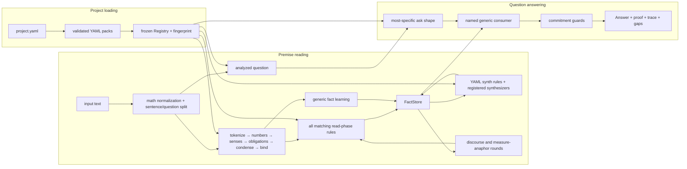

# RuleKit architecture

**Updated:** 2026-08-08
**Status:** current implementation, not a roadmap

RuleKit is a deterministic reading and reasoning engine for controlled,
ordinary English. It turns text into typed facts, closes those facts under
explicit derivations, and answers a recognized question through a named
consumer. There is no model or LLM in the runtime path.

This document describes what the repository does today. Campaign state belongs
in [`HANDOFF.md`](HANDOFF.md), evaluation policy in
[`methodology.md`](methodology.md), and project-wide engineering constraints in
[`../CLAUDE.md`](../CLAUDE.md).

The active campaign uses the deterministic generation and human-review
workbench as a promotion gate for isolated mining candidates. Its campaign
contract is [`gsm8k-mining-v2-plan.md`](gsm8k-mining-v2-plan.md); the underlying
Designer product remains specified in
[`generation-and-annotation-plan.md`](generation-and-annotation-plan.md).
Its G1–G4 exploration loop, G5a declared-plural and G5b declared-counted
realizers, G5c bounded proper-name possessive realizer, G5d declared generic
pronoun realizer, G5e declared pronoun-category realizer, G5f aggregate-root
category realizer, G5g owned category nouns and number constraints, G6
exploration status, Reading-origin and fact-level review entries, declarative
fraction-plural morphology correction, scoped `GroupTotal` facts, and
many-to-many adjective/noun compatibility and the leading-total
scoped/existential subject split are implemented. G5h moves the seven generic
exploratory category domains found during project-empty profiling into
`core-english`, exposing five more premise rules and every compatible filler
to human review. G5i recursively realizes optional groups, including nested
groups to depth three in the current packs, and exposes every active, omitted,
or parent-inactive branch in the premise inspector. G5j extends the same
category-generic lexical realizer to comparative-rooted categories; empty
loaded categories remain blocked by their missing filler domain. G5k realizes
sentence-wide negative category premises by filtering every literal and slot
domain with the matcher's analyzed-lemma membership test; locked probes
and exploration use the same boundary. G5l maps `unbound` sentinels to their
nearest optional negative-lookahead branch, forces that branch omitted, and
keeps the omission and matcher-confirmed non-binding inspectable. Generated
G5m realizes linked `distinct_measure` predicates with the matcher's exact
`(lemma, label, qualifier)` key, including availability, locked bindings,
minimal pairs, and exploration placement. G5n admits the direct
`complementizer` lexical root to the category-generic realizer, including both
mandatory and optional occurrences and exact source evidence. G5o does the
same for direct `quantifier` slots while preserving independent blockers on
rules whose other descendants remain unrealizable. Later premise review
narrows distributive container quantifiers to the declared `each`/`every`
subset and represents the differently sensed `in all` total as its own
GroupTotal rule. G5q moves the generic age
comparatives and their core direction memberships into `core-english` while
preserving mined-only category extensions. G5r applies the same ownership
boundary to the signed physical-dimension comparative class. G5s moves the
eight generic modal forms into core and realizes both the complete modal
domain and its declared future-only subtype. G5t moves the two deictic
temporal markers into core and admits registry-backed time-rooted category
generation. G5u moves generic `currently` into core and admits the complete
loaded direct-adverb domain, bringing its checkpoint availability to 95/95.
G5v's review-led boundary passes add declarative definiteness, agreement,
appositive-role, quantitative-verb, count/mass, additive-direction,
finite/bare-form verb, complete-frame, optional-slot-coupling,
descriptor/noun compatibility, category overlap, and conditional
verb/semantic-role constraints. They also distinguish location PPs from
remnant-only PPs, require outbound transfers to take compatible quantity
objects, separate sum markers from broader aggregate operations, and retain
`GroupTotal.scope` only for surfaces that identify a real group. Standalone
scalar numbers remain distinct from condensed counted nouns so an elided rule
cannot double-fire on an explicit measure. Percent-change premises now split
mass currency from plural denominations, enforce agreement, and reject
decreases beyond the whole quantity. Motion comparisons reject an unstated
`as many` measure, accept explicit frequency through `as many times`, and use
a separate distance relation for `as far`; common-noun motion roles must be
declared plausible people, animals, or vehicles. Explicit count frames also
require their item to belong to the declared motion-comparison measure class,
so transported objects such as grapes do not become distance or frequency
units. The conjunct quantity family
uses the same role boundary for its common-noun subject and, where present,
its explicit standard. Its full conjunct rule also validates an optional PP
through the pack-declared preposition/noun compatibility table. This remains
conditional on the verb category: ordinary quantity verbs retain their open
count-object domain, while a motion verb activates the narrower measure role.
Comparative `as many/as much`
rules accept adverbial multipliers such as `twice`, `thrice`, and explicit
`N times`, while the pack-declared `double`/`triple` predeterminers remain
available for noun-phrase frames such as `double the amount`. The established
count-affine compatibility surface remains accepted to keep the DEV ship gate
neutral; the reviewed mass-affine and conjunct rules apply the narrower form
boundary. Adverbial age-ratio rules and demonstrative
`that/this many|much` pro-forms apply the same predeterminer subtraction,
while possessive noun-phrase ratios such as `double Cato's age` retain it.
Every anaphoric quantity-relation sibling also subtracts the declared
`non_quantity_holder` category from its subject rather than relying on
per-rule guard coverage. The same adverbial families also require a non-unit multiplier, so
factor-one `once` remains a frequency adverb rather than an `as many/as much`
ratio. The plain count equative `X VERB as many ITEM as Y` is a separate rule
that emits the same Relation with a fixed factor of 1; it does not need an
artificial multiplier token. Existential quantity rules locally exclude
temporal `times`; periodic rates require referential subjects, and sum-of-ages
owns its definite,
possessive, plural-noun, singular-copula frame. Both absolute and
comparative stated-need goals apply ordinary subject/verb compatibility: a
singular proper name admits `needs` or a number-neutral past form, not the
plural/base `need`. The comparative form also applies `same_number` between
its standalone count and noun, admitting `1 fewer shopper` and
`2 fewer shoppers` while rejecting both mismatches. The current curated
project has 118 loaded reading rules and 267 reachable lexicon identities.
Of those rules, 116 are selectable generated premises; one narrow legacy
frame is explicitly reader-only and one broad fallback is explicitly a
fact-free safety consumer. Keeping those roles in the schema prevents
generation coverage from treating defensive recognition as authored English.
Reading and Generate likewise keep surviving safety consumers out of their
premise-match lists. A safety rule remains active inside the document matcher
so it can suppress an unsafe fallback fold, but the Designer renders it in a
separate, fact-free safety-interception panel and does not offer it as a
premise-review target. When a more-specific ordinary premise subsumes the same
match, the redundant safety co-match is omitted from that panel.
The
explicit `originally` ask routes through the existing start-state event
inversion; a qualified start state with differently qualified same-measure
events declines until modifier nesting is represented losslessly.
Generated defects remain visible by design: mechanical support reports that a
rule can be realized and matched, not that its premises license valid English.

### Exact adposition roles

Broad English preposition recognition is owned by `core-english`, including
eight declared multiword lexemes. The analyzer condenses the longest matching
multiword preposition before sense disambiguation and obligation attachment,
so `next to`, `out of`, `because of`, and `due to` each behave as one relation
marker. The generator admits these phrases only to preposition slots; they do
not widen unconstrained word domains.

Semantic interpretation is narrower than recognition. A frozen,
source-indexed `adposition_roles` table joins three pack-declared categories:
the preposition, its object, and the governing verb. A semantic role may
declare several alternate frames; matching any frame produces that one role,
without minting construction-specific role names. Spatial location, source,
goal, and path; temporal point, boundary, and duration; and governed
accompaniment, instrument, means, manner, cause, and purpose relations all use
that one generic join. Exactly one surviving role emits a `VerbalRelation`
whose `role`, exact `prep`, object, indefiniteness, and originating event
remain inspectable; zero or multiple roles emit nothing. The event identity
joins a spatial relation to its `EventTime` without joining unrelated events
that happen to share a verb lemma.

The arrival boundary demonstrates why alternate frames matter. General motion
goals require the ordinary `to`/`toward`/`into`/`onto` category. A second
`spatial-goal` frame joins the arrival-only verb category with the separate
`at` category, so `arrived at the garden` preserves a destination while
`walked at the garden` retains only its pre-existing locative interpretation.
Core owns `arrive`, `arrived`, and `arrives`, and the inflected forms normalize
to one lemma. These supplementary relations do not consume syntax or imply an
answer. Unsupported and overloaded forms therefore remain reviewable without
being promoted to a semantic commitment.

The logic-arithmetic PP bridge is narrower again. Its class-wide and named
membership rules require an explicit article and the declared institutional
class-restriction preposition/place categories. Its coordinated verbal rule
requires the declared subject-role predicate and the same complete PP. Broad
recognition can therefore expose `of`, `on`, and other markers without letting
an arbitrary pair mint an `Atom`, `QuantifiedQuantity`, or coordinated
`VerbalRelation`.

Entity slots can now declare `common_noun_cat` when names and common nouns
share a grammatical position but only a positive subset of common nouns is
licensed for the semantic role. Names and resolved pronouns keep the ordinary
entity path; nouns must follow the named YAML category. The arithmetic ratio
family uses `quantity_holder` on its subject, while leaving its polymorphic
standard open to measure-class nouns. Strict generation follows this role
boundary and lexical-boundary generation may relax it explicitly.
An optional animate appositive is narrower still: its conditional-category
premise requires the subject to be a declared quantity-event participant or
an explicitly permitted proper name. This keeps holder eligibility separate
from kinship/animate-role eligibility.

Cross-slot semantic-class agreement is separate from lexical identity.
`same_category_membership` requires all named slots either to belong to a
declared category or all to remain outside it. The conjunct ratio rules use
this for temporal measures, preserving both ordinary object/object and
timeperiod/timeperiod pairs without accepting a mixed pair. Matching,
generation feasibility, compatible probes, explanations, and source links
all read the same predicate.

Additive comparisons may omit their standard in state/ownership clauses.
`Mary has 5 more apples` carries its measure in the Relation, while
`Mary has 5 more` leaves it null. Both use the ordinary reserved elided-standard
sentinel. Saturation resolves the omission only from one unique earlier
Quantity held by another entity; the fully elided form obtains both the
standard and measure from that fact. Event verbs are excluded from these two
premise rules because `Mary buys 5 more` is a same-holder quantity change, not
an omitted cross-holder comparison. The narrower `possession_state` category
also excludes copular generations such as `Mary is 5 more apples`. Explicit
standards and conjoined
comparisons remain owned by their existing rule families.

Ask resolution fields are normally scalar templates, but may also be lists of
scalar templates when the question itself names an exact set. A variadic
combined-total ask captures a coordinated span and resolves it structurally
to `holders` only when every segment is one name, every coordinator is the
pack-declared additive holder-list conjunction, and the final pair is overtly
coordinated. Its trailing total marker may be one aggregate token or the
separately declared `group_total_quantifier` plus
`quantified_group_total_marker` sequence. The latter licenses conventional
“all together” without treating misspelled `alltogether` or arbitrary “all
total” pairings as aggregate markers. The combined consumer validates
uniqueness and sums only those named entities. The historical named-pair
`a`/`b` query remains backward compatible;
pronoun totals deliberately retain their different enumerate-all-holders
semantics. This keeps question scope in the ask evidence rather than trying to
reconstruct it from whichever facts happen to exist.

The same exact named-holder resolver also supports distributive answer asks:
“How many books do Ana, Ben, and Cato each have?” and “...have each?” use a
narrow quantifier category that admits `each` without admitting
container-determiner `every` in either position. “...individually have?” and
“...have individually?” use a separate adverb-rooted category, so an ordinary
manner adverb cannot acquire distributive answer scope. All four positions
route to the same `per-holder` consumer. It uses the combined consumer's
measure resolution and definitive-or-decline folds but returns a labelled
`series` rather than adding the values. Each JSON-native row retains `entity`,
canonical `measure`, and numeric `value`; source order is preserved for
display, while benchmark comparison uses the labels rather than fragile list
position. If any requested holder is unresolved, the whole ask declines
instead of returning a partial series. The Designer renders one labelled row
per holder and uses the question's captured measure surface for human-readable
units.

A located-holder ask may use a possessed, pack-declared quantitative location:
`how many ITEM are there in OWNER's PLACE?`. The place head must belong to
`quantity_location`, the preposition to `quantity_location_preposition`, and
the question verb to `state`. The ask then routes the explicit possessive owner
to the ordinary `single-entity` consumer; unsupported heads, prepositions,
verbs, or missing owner totals decline. A bare proper name after `in` is not
enough evidence: capitalization identifies a name, not whether that name's
stored quantity is the complete located total, so bare-name locations remain
on the entity-less safe-decline path.

Superclass totals have two explicit completeness contracts. A category marked
`superordinate: true` is a closed, author-vetted subtype family such as
`child -> {daughter, son}`; its subtype quantities may be composed across
premises. A category marked `coordinated_superordinate: true` is open-ended,
such as `animal`, and may be totalled only when all contributing quantities
share one pattern source and sentence and at least one carries a conjunct
segment marker. Thus an explicit premise that states penguins and bears
together can answer a marked `total animals` question, while independently
stated animal quantities cannot be mistaken for an exhaustive zoo inventory.
The two flags are schema-level mutually exclusive. Both paths retain the
existing safeguards: at least two distinct declared subtypes, no unrelated
held measure, and no fallback past a direct superclass fact.

The corresponding pronoun question shape is also declarative:
`how many AGGREGATE ITEM AUX PRONOUN VERB`. The aggregate marker is mandatory
and routes to the existing combined consumer; the pronoun does not select or
invent a holder. Unmarked pronoun questions remain unclaimed.

### Opt-in logic and quantified quantities

The reusable phrase-keyed FOLIO logic surface lives in top-level `packs/logic`.
Projects opt into it explicitly, while the ordinary FOLIO safety project
deliberately does not. Its boolean `Atom` and `Quantified` facts retain exact
full-phrase keys. The curated project loads the narrower
`packs/logic-arithmetic` bridge instead of the broad FOLIO reader surface, so
unrelated logic readers cannot consume arithmetic premises.

Numeric universals use a separate `QuantifiedQuantity` fact. A rule such as
“All teachers at the university have 20 students” preserves the complete class
phrase and the structured arithmetic measure/value/verb. The shared universal-
quantity materializer can produce an ordinary `Quantity` only after an exact
positive class-membership fact proves that the named entity belongs to the same
complete class. Restricted phrases use `Atom`; the existing simple copular fold
uses `Membership` with the same exact-key join. Arithmetic consumers remain
unchanged and see no special logic-only value type.

Coordinated named verbal clauses use one premise rule to emit a structured
`VerbalRelation` for each conjunct. A frozen, source-indexed
`subject_role_derivations` table then licenses exact `(verb, preposition)` to
role mappings while preserving the complete PP object. The generic kernel
synthesizer contains no lexical examples: with the current pack data,
`teach at the university` derives the exact role key
`teacher at university`. Unlicensed pairs derive no role. A rule-level
`satisfies` contract marks the finite verb's subject obligation as structurally
met by the complete coordination without binding either named conjunct as the
sole grammatical subject.

Declared subsective class relations use a separate `ClassRefinement` fact. A
pack category names which leading modifiers may create that edge; the generic
synthesizer removes exactly one declared modifier and preserves the complete
remaining phrase. Thus `head teacher at university` refines
`teacher at university` without asserting the predicate `head`. Undeclared or
negative phrases produce no edge. This ontology is deliberately distinct from
both intersective-modifier decomposition and the ordinary right-headed noun-
compound fold. A class-wide numeric fact can expose its refinement edge but is
never widened into a superclass-wide amount.

Class-wide additive comparisons use a third numeric fact,
`QuantifiedAdjustment`. “All head teachers have 5 more students” records the
complete class, measure, signed offset, and state verb; it is neither an
entity-to-entity `Relation` nor an acquisition event. The same materializer
that handles ordinary quantified quantities suppresses an inherited base when
an adjustment applies, then emits exactly one derived `Quantity` only when an
exact refining-class member and exactly one compatible base universal survive.
A base may preserve a prepositional class restriction, but arbitrary shared
prefixes do not compose. Missing or multiple baselines remain unresolved and
veto a numeric shortcut. The resulting arithmetic log names both source rules,
and the fact store still exposes the original base and adjustment constraints.

A leading conditional attached to the current question is represented as a
question-local assumption, not as an asserted project premise. The reading,
direct facts, derived adjusted quantity, diagnosis, and Designer trace expose
that scope. Each solve owns a fresh document, so the assumption cannot escape
into a later solve. Person deixis remains conservative in ordinary discourse:
without typed gender/person compatibility, several prior names stay tied. In a
question-local assumption context, sentence distance becomes available to the
same strict-dominance resolver; a uniquely re-mentioned person may win, while
two people in the same nearest sentence still decline.

The same scope boundary supports a narrow location-persistence slice. A
leading `If` clause inside the question, or one detached premise immediately
before the question, may emit a `LocationConstraint`; the detached form also
requires its complete read rule to opt into `question_assumption`. A detached
conditional anywhere else remains an ordinary unread premise. Pack-declared
initiating, terminating, and holding verb categories turn event-linked spatial
relations into `LocationEvent` facts. A constraint that makes termination
impossible can preserve an earlier initiation to a later day, but it cannot create an
initial location. An observed forbidden termination creates an explicit
`LocationConstraintViolation` and vetoes the answer rather than letting the
assumption erase evidence.

An asserted “Nobody left the PLACE” has a separate meaning. Its exact
past-tense rule emits `LocationTransitionAbsence` with
`narrative-through-reference` scope: no terminating event occurred in the
current narrative up to the day selected by the question. It is evidence
about what happened, not evidence that departure was impossible. An earlier
arrival may persist through that interval; an observed same-or-earlier
departure conflicts and declines, while a future departure remains
compatible. The factual location rule admits the `left` homograph only before
a definite declared place; terminal state/remnant frames such as “are left”
and “have money left” retain the adjective reading.

“Which of them” is finite-domain deixis, not an invitation to enumerate every
known entity. For this ask only, `them` resolves to the nearest conservative
group of prior named subjects; named objects or an ambiguous group make the
ask decline. The `location-witnesses` consumer returns one ordered status per
candidate. Direct evidence or licensed persistence is `supported`; absence of
evidence is `unknown`, never false; and a direct same-day negative location
observation is `contradicted`. Conflicting direct positive and negative
observations decline. The current day-grained ask accepts
`yesterday`, `today`, or `tomorrow` and deliberately excludes instant-grained
`now`.

These are the first five semantic slices of the staged design in
[`logic-arithmetic-integration-plan.md`](logic-arithmetic-integration-plan.md).
Generation and review coverage for the new scoped behavior is the next slice.

## Architectural boundaries

The design is held together by six boundaries:

1. **Language knowledge is data.** Word senses, lemmas, plurals, category
   membership, polarity, conversions, formulas, and reference facts live in
   YAML packs. Python may name grammatical senses and category interfaces, but
   may not contain corpus vocabulary.
2. **Reading and answering are separate.** Premise rules emit facts. Question
   rules normalize an ask and select a generic consumer; they do not create
   premise evidence.
3. **One fact store owns commitments.** Exact facts, derived facts, and
   first-class semantic-graph facts share the same conflict and provenance
   discipline. UI projections and benchmark adapters do not form a second
   inference engine.
4. **Ambiguity fails closed.** A binding, derivation, or answer is accepted only
   when its evidence is sufficiently specific. Conflict, unresolved reference,
   incomplete structure, or an unread operative value causes a decline or
   clarification—not a guess.
5. **Evaluation is part of the architecture.** Stable partitions, protected
   aggregate-only slices, per-item snapshot diffs, and fresh-process
   determinism checks constrain how the engine is allowed to evolve.
6. **Authoring tools depend on the runtime, never the reverse.** Generation
   may use the ordinary analyzer and matcher as an oracle. Parsing, solving,
   benchmarks, and guards never import generation fixtures or human reviews.

## System map



The arrows back from discourse resolution represent a bounded rebuild, not
in-place fact repair. When a pronoun or measure anaphor becomes resolvable, the
affected sentence's rules are rerun and the complete premise store is rebuilt
and saturated from source readings.

## Configuration and compilation

### Projects

A project directory contains `project.yaml`. Loading it:

1. validates the document with `ProjectDoc`;
2. resolves pack names against the nearest repository-level `packs/`
   directory, while `./` and `../` entries resolve relative to the project;
3. loads packs in declared order and checks `requires`;
4. compiles the loaded data into one immutable `Registry`; and
5. computes a SHA-256 fingerprint from the exact pack bytes.

A project may expose:

- a small YAML `suite`;
- answer datasets backed by Parquet; or
- a semantic `projection` corpus.

Suites and answer datasets may coexist, as they do in the GSM8K project.
Projection projects cannot also declare either one. A scratch project may
declare no evaluation target. These boundaries keep graph scoring out of the
answer judge.

### Packs

Every pack has a `rulekit/pack@1` manifest. Every other YAML document
self-identifies with `format: rulekit/<kind>@1`; unknown formats fail loading.
Models reject unknown fields except where a schema deliberately defines an
open payload, such as fact-specific emission fields, reference rows, or guard
settings. The canonical schemas are the Pydantic models in
[`schemas.py`](../src/rulekit/data/schemas.py), not examples copied into
documentation.

The implemented document families are:

| Concern | Document kinds |
| --- | --- |
| language | lexicon, categories, numbers, obligations, contractions |
| reading and inference | rules/asks, synth, guards |
| domain knowledge | conversions, affine conversions, geometry, formulas, calendar, elements, reference |
| governance | quarantine, requirements, pack, project |

Compilation rejects duplicate vocabulary across packs, duplicate rule ids,
category cycles, dangling category roots, incompatible antonyms, invalid
category members, conflicting conversions or reference values, and rule gates
that name unknown categories. Attribute-compatibility declarations must map an
adjective-rooted category to one or more distinct noun-rooted categories, and
an `attribute_compatible` rule predicate must name an adjective-rooted slot and
a noun-rooted slot. The resulting mappings and rule sequences are sorted and
frozen.

`quarantine.yaml` is negative knowledge: its entries are intentionally absent
from the lexicon, and compilation rejects a word that appears in both.

## Runtime reading pipeline

The core runtime function is
`rulekit.kernel.engine.solve(text, registry, tracing=True,
interpretation=None)`. The CLI obtains the registry by loading a project.

### 1. Normalize and separate the question

Recognized LaTeX math spans are conservatively transcribed before tokenization.
The text is split into premise sentences and, when identifiable, a trailing
question. A small set of structural repairs handles explicitly licensed fused
conditional/question forms; an unrecognized boundary remains unsplit and
normally declines downstream.

### 2. Analyze each sentence

`analyze()` applies the same ordered stages to every premise and the question:

1. `tokenize` creates `Word` and `Unit` objects;
2. `annotate_numbers` identifies counts, fractions, percents, tuples, dates,
   formulas, and other structured numeric forms; declared plural fraction
   forms remain incomplete until merged with an explicit word count;
3. `annotate_senses` supplies pack-backed candidate senses and lemmas;
4. `disambiguate` selects a sense only when obligation coverage licenses it;
5. `attach_obligations` gives grammatical roles their declared needs;
6. `condense` merges licensed multi-unit constructions; and
7. `bind` discharges obligations against suitable units.

Every mutating reading step records a `Decision` when tracing is enabled.
Bench runs disable the expensive reversible snapshots while keeping the same
semantic path.

### 3. Build the premise store

For each premise, every matching `phase: read` pattern rule runs. Rules match
annotated units rather than raw strings and emit typed facts with rule and
sentence provenance. Independently, `learn()` extracts general facts licensed
by the analyzed structure.

All emitted facts enter a `FactStore`, after which `saturate()` repeatedly
applies:

- declarative `rulekit/synth@1` joins; and
- the kernel's statically registered algorithmic synthesizers.

Saturation is monotone: synthesizers add facts, the store deduplicates them,
and the loop stops when a round adds nothing. A 50-round cap turns
non-termination into an error.

### 4. Resolve document context

The document loop currently resolves three cross-sentence phenomena:

- personal discourse reference against prior compatible referents; and
- measure anaphora such as a later “ones” referring to one prior counted noun
  lemma; and
- a question-only plural group referent for the exact “which of them” location
  ask.

Resolution uses the deictic arbitration primitive and fails closed when no
candidate strictly dominates. Changed sentences have their read rules rerun;
the store is then rebuilt and saturated. The loop has a six-round cap.

Gaps are collected after the loop as unknown words, ambiguous senses, and
unmet obligations. They are diagnostic records, not instructions to an
external provider.

### 5. Interpret and answer the question

The question is analyzed separately and its pronouns are resolved against the
premise document. `match_ask()` chooses one ask by:

1. number of consumed units;
2. total category-gate depth; and
3. stable rule-id order as the final tie-break.

An ask renders a normalized query naming a consumer. An ask may instead
declare several explicit interpretations; without a caller-selected
interpretation, the result is a structured clarification request.

Consumers are Python implementations registered by name under
`kernel/consumers/`. They read only the normalized query, saturated store,
registry, arithmetic log, match metadata, and premise readings. Consumers may
return numeric answers, labelled series, finite witness-status lists,
yes/no/undetermined verdicts, proofs, or declines.

### 6. Guard the commitment

Guards run only against a proposed commitment:

- numeric scalar and labelled-series answers are checked for unread
  vocabulary, unused or multiply used operative values, unresolved
  derivations, and related accounting failures;
- witness-status answers are checked for unread vocabulary, unmet grammatical
  obligations, and unsupported truth-scoping operators; and
- verdict answers use a supported-fragment guard that rejects unread
  truth-scoping operators.

A veto converts the proposed answer to a decline. Guards inspect structural
state and fact use; they do not special-case rule ids.

## Core representations

| Type | Responsibility |
| --- | --- |
| `Registry` | immutable compiled pack data, rule/ask/synth sequences, and fingerprint |
| `Reading` | one sentence's units, decisions, and deficiencies |
| `Obligation` | a typed grammatical need and its binding |
| `Decision` | reversible mutation record used by tracing and the designer |
| `Fact` | immutable typed commitment with `Provenance` |
| `FactStore` | admission, agreement, collision quarantine, and fact lookup |
| `Document` | premise readings, store, arithmetic/deictic log, consumed units, rounds, and gaps |
| `Answer` | number, labelled numeric series, witness statuses, verdict, or decline, optionally with proof or clarification |
| `Result` | complete runtime surface: answer, readings, store, log, veto, and document |

The fact model covers arithmetic quantities and relations, membership and
logical structures, rates, prices, partitions, aliases, event-linked location
changes and constraints, dated ages, and explicit
`SemanticGraphNode`/`SemanticGraphEdge` facts. Specialized fact classes keep
their own identity keys and value parts; the store does not flatten all
meaning into generic triples.

`AgeAtYear` records one entity's age at an integral absolute calendar-year
coordinate. It is intentionally separate from `Quantity.time`: a dated age
may be projected one-for-one with elapsed years, while an arbitrary dated
population, balance, or holding may not. Its identity retains owner,
qualifier, and label fields so same-headed people remain distinct. The
`age-at-year` consumer accepts either one entity with an explicit target year
or one exact discourse group. A group can be projected to a current-moment
marker with an explicit caller-supplied reference year, or to an explicit
target year. The group path projects every member or declines the whole query.
It returns a labelled series by default; an ask that explicitly requests a
combined or total age sums the successfully projected members only after the
all-or-nothing projection succeeds. Both paths require every matching source
coordinate to project to the same non-negative age and decline on fractional
coordinates, impossible projections, ambiguous identities, or inconsistent
timelines. The kernel never consults the wall clock: the Designer sends its
current year, the CLI exposes `--reference-year`, and a replay without that
context declines. A dated age never becomes a timeless `Quantity`, so an
undated “how old” question cannot silently borrow it.

`GroupTotal` has an optional exact `scope`. A leading total construction that
binds a subject retains its normalized identity, so blue and red totals for
the same measure have distinct keys and may coexist. Tail-only and synthesized
totals remain unscoped because no group identity is mechanically available.
Leading existential totals are also unscoped: their literal `there` is a
construction marker rather than an entity. They require an agreeing copula
and normalize to holding semantics; arbitrary verbs on an existential surface
do not emit a total.
Same-scope disagreement still quarantines both facts. Entity-aware consumers
accept only unscoped or exact-scope-compatible totals; entity-less consumers
cannot silently widen a named group into a scene-wide total.

## Rule execution and conflict handling

Pattern rules have no authored priority. They may use literals for grammatical
skeleton, typed or category-gated slots, optional groups, span capture,
cross-slot predicates, anchoring, and explicit value consumption.

All read-phase matches run. Before fact admission, one match may shadow another
only when it consumes a superset of the other's units and has strictly greater
computed specificity. Otherwise:

- same fact key and same value records agreement and keeps one fact;
- same key and different value quarantines both facts and records a
  `Collision`; and
- a dirty store cannot produce an answer commitment.

The store has narrowly defined structural identity handling for owners,
qualifiers, labels, and conjunct segments. These distinctions come from typed
fact fields and are independent of rule execution order.

Ask rules are different: exactly one normalized query must be selected before
consumer dispatch. Their most-specific-match rule and explicit clarification
mechanism make that selection visible.

## Semantic projection

Semantic projection is implemented in two layers:

1. runtime rules may emit first-class semantic node and edge facts into the
   ordinary store; and
2. the benchmark harness converts those facts into a normalized evaluation
   graph.

COGS logical forms and PMB SBN are parsed only by
[`harness/projection.py`](../src/rulekit/harness/projection.py). Gold adapters
must not be imported by runtime parsing. Graph comparison alpha-normalizes
references and preserves predicate, role, attachment, and status structure.

Projection outcomes are harm ordered:

- `incorrect`: at least one unsupported projected node or edge;
- `partial`: every projection is correct but required graph content is
  missing;
- `declined`: no graph commitment; and
- `exact`: the complete normalized graph matches.

The optional `legacy_bridge` exposes pre-existing `VerbalRelation` facts for
COGS compatibility. Independent PMB evaluation disables it and scores only
explicit semantic graph facts.

The semantic-projection expansion campaign is currently parked pending review
of the independent synthetic dataset. That is project status, not a missing
runtime dependency; see [`HANDOFF.md`](HANDOFF.md).

## Evaluation, snapshots, and firewall

The same `bench` command routes by project shape:

- suite and answer projects run `harness/bench.py` and the answer judge;
- projection projects run `harness/projection.py` and graph scoring.

Answer datasets use a stable MD5 partition for `dev-train` and `dev-holdout`;
a configured grouping key keeps related items on one side. The operating
policy reserves `dev-train` for tuning and treats holdout as a delta gate.
Protected TEST requires `--spend-test-look`, returns aggregates, and appends an
auditable ledger entry.

Projection projects declare each split's firewall mode. COGS test and
generalization, and PMB test, are schema-required to be aggregate-only.
Protected projection runs reject partial `--limit` looks, suppress item
results, and are ledgered.

Snapshots contain a registry fingerprint and stable per-item outcomes.
`rulekit diff` rejects:

- answer regressions from correct to non-correct or safe to wrong; and
- projection regressions from exact to non-exact or safe to incorrect.

`bench --twice` compares the current result with a fresh isolated Python
process. With `--jobs N`, the harness also compares parallel and serial
execution. Worker processes reload the project and verify the expected
registry fingerprint.

## CLI and designer

The implemented CLI is:

```text
rulekit --project P solve TEXT [--trace] [--json]
rulekit --project P diagnose TEXT
rulekit --project P bench [--slice SLICE] [--snapshot FILE] [--twice] [--jobs N]
rulekit --project P stats [--slice SLICE]
rulekit --project P lint [--category CATEGORY] [--verbose]
rulekit --project P diff BEFORE AFTER
rulekit --project P serve [--host HOST] [--port PORT]
```

The optional `server` dependencies provide a local FastAPI application and a
vanilla-JavaScript designer. The designer exposes:

- a Generate mode for seeded rule realization and human review;
- separate exact ask, answerable-scenario, and missing-evidence generation;
- structural exploration objectives, conjunctive grammar/category/fact
  filters, and a generation-health panel;
- an explicit Reading-sentence handoff into that same review workbench;
- targetless Reading reviews for intended interpretations and missing-rule
  suggestions;
- a campaign promotion queue for immutable candidate manifests and
  fingerprint-pinned, append-only human decisions;
- a reading decision stepper;
- fact, gap, collision, and deficiency views;
- semantic, deictic, proof, and clarification views;
- editing of existing pack YAML documents with validate-and-rollback; and
- answer-project impact baselines and firewall-aware TEST spending.

The editable-file boundary is an allowlist of the exact YAML files reported
from loaded packs. It excludes project files, datasets, snapshots, new paths,
and symlinks escaping a pack. Projection benchmarking is currently a CLI
surface; the designer's impact panel targets suites and answer datasets.

### Generation and review workbench

`rulekit.generation` is an authoring layer outside the runtime kernel. Its
implemented G1–G7 data flow is:

```text
loaded Project + project generation fixtures
        ↓
enumerate every premise rule with supported/blocker status + source index
        ↓
either seeded realization of one flat read-phase rule in strict-positive
or one-slot lexical-boundary mode
or exact Reading sentence + explicitly selected actual premise-rule match
or exact Reading sentence with no target-rule claim
        ↓
ordinary analyze() + run_document()
        ↓
source-backed premise reasons + target status + specificity + consumed units
        ↓
actual matches + facts + collisions + deficiencies
        ↓
human Valid / Invalid / Unclear + attached defects
        ↓
optional intended interpretation + missing-rule suggestion
        ↓
deterministic evidence-to-hypothesis rules (targeted premise reviews only)
        ↓
source-linked advisory cards + human-controlled status
        ↓
projects/<project>/generation/reviews.jsonl

fresh strict-positive realization only
        ↓
schema-bounded rule + normalized lexicon filler + structural observation
        ↓
projects/<project>/generation/exploration.jsonl
        ↓
fold with current availability + live reviews
        ↓
blocked / untouched / generated-unreviewed / reviewed navigation
        +
current-fingerprint optional/literal/fact-shape coverage and failure health

one selected slot → exclude its current filler
        ↓
lock every other slot → seeded realization + ordinary round trip
        ↓
side-by-side sentence, premise, and mechanical-result comparison

allowlisted YAML edit → compile/reload or rollback
        ↓
retest identical pinned sentence (no realization pass)
        ↓
before/after behavior diff

loaded ask contracts + the same project-backed lexical domains
        ↓
independent supported/blocker status per ask
        ↓
seeded question realization → ordinary analyze() + match_ask()
        ↓
ask only or deliberate missing evidence
        OR
generic emit-field inversion → supported premise generation
        ↓
ordinary solve() as the sole answer oracle
        ↓
one-to-three-premise bounded search + removal minimality
        ↓
question + normalized query + generated evidence + answer shape
```

Availability is intentionally structural. A rule is supported when the
generator has a realizer for every declared token and predicate and at least
one project-backed filler survives its constraints. The subsequent ordinary
round trip reports whether the existing matcher accepts the specimen. Neither
condition asserts that the prose is grammatical, the premises are well
scoped, or the emitted facts are useful; those are the human review questions.
This separation lets missing definiteness, agreement, and other bad
commitments become inspectable evidence instead of hidden prerequisites.

Ask availability is a separate contract. A supported independent ask must
have a project-backed realizer for every token and must win the ordinary
ask-specificity comparison after round-trip analysis. Declared plural noun
surfaces and the matcher's factual-auxiliary/future-modal union are both
visible. Bounded name-list spans are composed from project fixtures and the
pack-declared holder conjunction. Discourse-group captures and arbitrary
spans remain blocked because an independent question cannot truthfully invent
their antecedent.

An answerable ask scenario never uses a consumer-specific sentence template.
The authoring layer compares normalized query fields with whole-slot emitted
fact templates to propose locks for ordinary premise generation, then calls
the normal solver on each bounded combination. A commitment is accepted only
from that solver. Candidate sets are searched in cardinality order and each
returned premise is removed in turn to prove irreducibility. Ask-only,
answerable, and deliberate missing-evidence records remain distinct from the
premise exploration ledger. Their answer projection preserves number, series,
witnesses, verdict, clarification, and decline shapes.

Generated candidates carry an explicit authoring mode. `strict` draws every
slot from its complete declared domain and retries until the ordinary matcher
retains the target. `lexical_boundary` chooses at most one active category or
narrow typed slot, draws it from the broader declared root sense, and leaves
all other morphology, agreement, absence, and cross-slot constraints intact.
The candidate records the widened slot, chosen surface, original requirement,
and broader domain. An absent target is therefore useful boundary evidence,
not a generation error. Boundary specimens can be reviewed and pinned for
retest, but never enter the strict exploration or coverage ledgers.

Authoring-domain, availability, and compatible-probe catalogs are bounded
in-memory indexes keyed by the compiled registry fingerprint and generation
fixtures. They are invalidated naturally by any semantic project edit. The
Designer exploration endpoint omits per-filler placement expansions that the
UI does not consume; direct authoring callers can still request the complete
catalog. These indexes affect only generation latency and never the runtime
reader, matcher, or benchmark path.

The current realization boundary covers literals, project-fixture names,
simple nouns/verbs/adjectives/prepositions/words, declared multiword
prepositions, shared finite-versus-bare
verb morphology, scalar number forms,
compatible category gates, declared single-token plural nouns, declared
integer-count-plus-noun compositions, bounded proper-name possessive noun
phrases, declared single-token generic pronouns, loaded direct-modal,
future-modal, direct-adverb, and time-rooted category domains, and the
`distinct`/`same_lemma`/`same_number`/`distinct_owner`/`distinct_measure`
constraints plus `number_compatible`, conditional `bound_requires_type` and
`bound_requires_category` and `bound_requires_form`, optional-slot
`same_presence`, pack-declared descriptor/noun compatibility, conditional
positive or negative `verb_role_compatible`, referential noun-phrase
qualification, and negative slot-category constraints. A number slot may
declare `standalone: true` when a condensed counted noun is not grammatical in
that position. Arbitrarily nested optional groups compose those same token
realizers. Each active group makes a seeded include/omit choice; all descendants
must be supported before the containing rule is available. Locked or excluded
child bindings force their ancestor groups to be included.
Plural and counted fillers come
only from loaded numeric and singular/plural declarations. Count
`1` selects the singular noun surface and every other admitted non-negative
integer selects the declared plural; both retain the singular noun lemma as
identity. A composed count is not advertised when its selected noun surface is
also the declared multiplication operator marker: the ordinary number pass
folds that complete surface into one multiplier unit, so it cannot satisfy a
`counted` slot. The number pass derives that marker from the registry's
operator declaration rather than naming its English surface in Python.

Sense-specific lexical domains also respect the analyzer's structural numeric
precedence. If a surface is declared as a number, fraction, or multiplier, the
ordinary reader commits that numeric interpretation before lexical sense
selection; generation therefore does not advertise the same surface through a
conflicting verb, noun, or category-rooted lexical placement. Broad `word`
exploration and the explicit numeric slot domains remain unchanged, so the
entry is still inspectable wherever the runtime can actually realize it.

Fraction fillers also follow declared morphology. `fraction_plurals` maps a
count-requiring plural surface to its singular fraction lemma. A bare mapped
surface such as `fifths` is annotated but cannot satisfy `type: fraction`;
the existing word-count merge turns `two fifths` into one complete fraction
unit. Generation therefore admits singular or already-complete fraction
surfaces directly and composes mapped plurals only with declared
non-negative word counts other than one. The singular lemma remains filler
identity, and count, fraction value, and plural mapping remain separate
source evidence.

The possessed domain is exactly `OWNER's HEAD`, where `OWNER` is a declared
single-token project generation fixture and `HEAD` is a canonical
single-token lexicon entry with the sole sense `noun`, optionally using its
declared single-token plural. Admission also requires the loaded contraction
mapping to preserve `'s` and the lexicon to declare its possessive sense.
Filler identity remains the singular head lemma; the owner fixture,
contraction, possessive declaration, noun declaration, and conditional plural
morphology remain separately inspectable evidence. No fixture owner is
counted as lexicon exploration.

Runtime reading also preserves ownership in the ordinary two-unit
possessive-determiner form. A declared `possessive_determiner` immediately
governing an uncounted noun stays visible as its own unit, while condensation
attaches the owner identity and determiner reference to the noun. This does
not mistake an object pronoun followed by a counted phrase (`gives her 3
dollars`) for possession. A pack-declared third-person subset may resolve to
the one preceding clause subject; that subject is followed through an already
resolved pronoun (`He ... his sister` therefore records the named antecedent,
not the surface `he`). The nearest resolved repetition of the same possessed
noun can carry that owner into a later sentence. Otherwise the explicit
determiner identity is retained rather than guessed.

`Quantity.owner`, `Relation.subject_owner`, and `Relation.standard_owner`
carry this identity separately from the noun head. The fact store splits
different owners before agreement deduplication, so `Mary's child` and
`John's child` remain distinct even when both ages are 10. Relation saturation
uses an exact `(entity, owner, measure)` index and will not borrow another
owner's same-headed quantity. Owner-aware asks route the same owner field to
the ordinary single-entity consumer. Unowned and single-owner legacy facts
retain their bare entity key, preserving established cross-mention folding.

A category-gated noun slot may additionally declare `possessed: true`. This
does not create a second possessive representation: it filters the same
merged `OWNER's HEAD` units by the head lemma's exact category membership.
Registry compilation rejects the qualifier on non-noun-rooted categories.
The optional `number: singular|plural` slot qualifier then constrains the
unit's declared grammatical number; it does not generate or infer morphology.
Together these qualifiers let an age rule require a singular owned
`age_noun` without admitting bare `age` or plural `ages`.

Direct pronoun fillers are every loaded single-token lexicon surface carrying
the `pronoun` sense, with exact case-folded surface identity. The realizer
does not add unexpressed case, person, number, definiteness, possessive, or
reference-resolution constraints; unsuitable surfaces accepted by a broad
rule premise remain visible for human review. Generic pronoun declarations
live in `core-english`: the 18 formerly stored in `difg-mined` were relocated
without changing the compiled inventory of projects that load both packs.
The pool-denoting membership of `them` moved with its declaration.

Category-gated pronouns use the same declared-category mechanism as the
existing noun-, verb-, adjective-, and preposition-rooted categories. A
pronoun-rooted category admits only loaded single-token lexicon surfaces that
both carry the `pronoun` sense and belong to that exact category. Identity
remains the surface; evidence includes the lexical declaration, exact
membership, and category ancestry. This does not infer a discourse referent
or widen the category to every pronoun.

Direct complementizer slots use that same lexical-domain machinery with the
`complementizer` sense as their root gate. The current registry treats this as
a direct root-sense category rather than a declared hierarchy: any loaded
single-token entry carrying the sense is eligible, and no surface is embedded
in Python. Optional complementizer branches retain the normal include/omit
state. Included premises expose the lexical declaration and rule token; an
omitted branch remains explicitly inactive rather than silently consuming a
clause marker.

Direct quantifier slots also draw from the loaded lexical sense rather than a
generation-only word list. Every eligible surface remains explorable even when
the rule description suggests a narrower semantic subclass: the workbench must
expose a broad declared premise for review, not silently repair it. A rule
whose quantifier slot is fillable but whose other token is unsupported remains
blocked as a whole, and exploration does not advertise the otherwise viable
quantifier placement.

Direct modal slots likewise draw every loaded single-token entry carrying the
`modal` sense. `future_modal` is a strict category-filtered subtype, so its
domain contains only modal-sensed words with that declared membership.
Evidence retains both the lexical source and the exact
`word → subtype → modal` path. Locked bindings pass through the same domain;
an ordinary capacity modal cannot enter a future-only slot.

Time-rooted category slots use the same registry-backed mechanism. The core
`temporal_marker` category deliberately selects `now` and `today` from the
broader `time` sense, and premise evidence retains
`word → temporal_marker → time` ancestry. No deictic surface is embedded in
the generator; another loaded time category and member are immediately
eligible under the same contract.

Direct adverb slots expose every loaded single-token entry carrying the
`adverb` sense. The optional conjoined-anchor placement therefore has one
curated filler, `currently`, while projects loading the mining extension see
all 45 of their declared adverbs. This breadth is the rule's actual premise
contract: generation may produce awkward or failed round trips, but it does
not substitute a hidden anchor-only vocabulary. The human review loop is
where a narrower declarative category may be proposed and tested.

Generation availability is project-relative, including pack ownership. A
category declared in `core-english` may intentionally remain empty there and
receive members only from an extension pack; a project that does not load that
extension must see an honest filler gap. Moving a generally useful lexical
entry between packs is therefore an architectural change even when projects
loading both packs compile to identical semantic tables: core-only projects
gain parser and generation vocabulary. Ownership increments must preserve all
extension memberships, measure the newly reachable rules and fillers, and
must not load an unrelated pack merely to make an availability count rise.

Core also owns a small category-aware exploration vocabulary for ordinary
arithmetic premises. It includes countable objects and produce, people,
animals, quantitative locations, mass materials, and colours. These are not a
fallback word list in the generator: every word is an ordinary lexicon entry
with declared morphology, and every narrower use comes from explicit category
membership such as `animate`, `mass_quantity_noun`, `quantity_location`, or
`color_attribute`. Consequently a new word becomes reachable only where its
loaded grammar licenses it; broad noun or adjective senses alone do not make
all generated combinations acceptable.

The age-comparative move demonstrates that contract. `older` and `younger`
are core lexical entries and core members of `age_comparative`; their
`more_dir`/`less_dir` memberships also live there because additive age
comparisons are general grammar. A project that additionally loads
`difg-mined` extends the same identities with its `higher`/`lower` categories.
There is still one compiled word and one combined membership set—pack
ownership changes availability, not identity.

The dimension-comparative class follows the same layout.
`dimension_more` and `dimension_less` own the nine generic signed forms in
core. Projects loading `difg-mined` may add broader `higher`/`lower`
memberships to those same identities. Generation uses the declared category
polarity and ancestry; it does not carry a second sign table.

The modal class uses the same ownership contract. All eight generic modal
lexicon entries live in `core-english`; six belong to `capacity_modal` and
`will`/`would` belong to `future_modal`. Extension packs may add unrelated
memberships to those identities—`difg-mined` adds `litter` to noun-sensed
`can`—without duplicating their lexical declarations or changing the broad
modal generation domain.

Temporal markers follow the same ownership rule. The generally useful
time-sensed words `yesterday`, `now`, `today`, and `tomorrow`, their broader
`deictic_temporal_marker` memberships, and their signed `temporal_offsets`
live in core. The narrower `temporal_marker` remains exactly `now` and
`today`: rules that require a current-moment standard must not silently admit
past or future markers merely because the event fold can order them. The
generic fold uses the broader coordinates only when exactly one marker can
attach to exactly one predicate with a bound subject. It emits an `EventTime`
fact keyed to that predicate occurrence; the document derives a `Before` fact
for every pair with strictly different offsets. Equal offsets produce no
direction, and competing markers or predicates produce no event time rather
than guessing scope. The deictic field draws this ordered relative axis while
keeping legacy `Quantity.time` labels visibly opaque. Extension packs may
contribute other time vocabulary, but a category slot receives only members
of its declared category rather than every word sharing the root sense.
The narrower `day_deictic_marker` contains `yesterday`, `today`, and
`tomorrow` for asks that compare whole relative days; `now` is excluded
because it names an instant rather than a day. One such ask can select
location witnesses at a declared day. A second narrow ask projects an explicit
`AgeAtYear` between two absolute integral years. Its group siblings can
project an exact prior subject group to `now`/`today` only when the caller
provides the absolute reference year, or project that group to an explicit
year and sum it when the question explicitly asks for a combined or total age.
They do not create a general temporal-query consumer or make arbitrary dated
quantities trendable.

The core adverb ownership move is intentionally smaller. Only generally useful
`currently` moved with the grammar that needs at least one ordinary anchor;
the 44 other adverbs remain extension vocabulary. A combined project compiles
the same 45-word adverb inventory as before, while a core-only project gains
one reviewable filler instead of importing corpus-specific vocabulary.

Core also owns the generic age-frame literals `ago`, `be`, and `old`. The
arithmetic grammar uses those words as genuine literal skeletons in age
premises and asks, so a core-only project must not report them as unknown after
the declared rule matches. Their ordinary adverb, verb, and adjective senses
remain pack data, and `be` belongs to `non_event_verb` so direct verb domains
do not reinterpret the infinitive as an event. `difg-mined` retains `been` and
`being` plus their extension membership; projects loading both packs compile
the same semantic registry as the former mining-owned layout.

Category slots may additionally declare `counted: true`. The ordinary
counted-unit machinery still supplies the numeric value and noun agreement,
while the slot's category independently restricts the noun lemma. This is how
`arithmetic/stated-age` accepts counted `age_measure` units such as
`4 years` without accepting every counted noun. Compilation refuses this
qualifier on a category that does not root at `noun`.

The `count_aggregate_noun` category owns nominal count frames separately from
mass-noun frames. Core currently declares both `amount` and `number`; rules
using the category also require a plural item, so accepted established
language such as `the amount of frogs` does not reopen the reviewed incomplete
`number of coin` surface. The frame vocabulary remains pack data.

When a fraction count frame binds the paired destination prepositions, its
plural measure must belong to the existing `quantity_location` class and its
subject and standard must satisfy the shared referential and motion-role
predicates. Direct frames remain unaffected. Location vocabulary stays in the
owning packs: core supplies the general witness `garden`, while mined
vocabulary extends the class with `city` and `country`.

Explicit remainder-membership clauses use two other noun categories:
`membership_collection_noun` for the stated superclass and
`membership_member_noun` for its predicate member. The condition is attached
only when the optional collection phrase is present. The subject uses the
narrower `partition_remnant` category and is referential, so the plural subset
surface is definite `the rest`; bare `Rest ...` and singular `remainder` do
not enter this rule. `membership_predicate_incompatible_noun` locally keeps
temporal `times` from becoming a member label without removing it from
explicit frequency comparisons.

Rules may declare `same_number` across bound slots. Count-valued units derive
singular only from value 1 and plural otherwise; lexical units use their
pack-declared grammatical number. The matcher and generator share that
predicate, so agreement such as `1 of them is red` versus
`3 of them are red` is a rule premise rather than a word-specific repair.

`number_compatible: [SUBJECT, VERB]` is the less restrictive agreement
predicate for ordinary clauses. It refuses an explicit singular/plural
conflict while allowing a number-neutral form, such as a past-tense verb, to
pass. An absent optional member contributes no conflicting evidence, which
also permits `number_compatible: [COUNT, OPTIONAL_NOUN]` to constrain an
item echo only when it is present. Neither matcher nor generator guesses a
missing grammatical number.

`polarity_compatible: {slots: [SLOT_A, SLOT_B, ...], categories:
[SCOPE_A, SCOPE_B, ...]}` compares lexical polarity only inside the category
scope paired with each slot. A filler with no polarity inside its scope is
neutral even if it carries polarity in another category family. The predicate
rejects two or more explicit, conflicting polarities; it does not manufacture
direction for a neutral word. Registry compilation requires equal-length,
distinct slots with compatible category roots and a real polarity-bearing
descendant in every scope. The percent-change event rule uses this to reject
`rose ... fewer` while retaining both `rose ... more` and a neutral
`had ... fewer`. Matcher, availability, locked probes, realization, and
premise evidence use the same scoped calculation.

`proportional_delta_compatible: {fraction: FRACTION_SLOT, direction:
DIRECTION_SLOT, direction_cat: DIRECTION_CATEGORY}` is the value-aware
boundary for relations that emit `1 + fraction * sign(direction)`. The
direction category must expose declared polarity. Positive deltas are
unbounded; negative deltas require a fraction between zero and one, so the
resulting relation factor cannot become negative. Registry compilation checks
the slot and category roots, while matching, availability, locked generation,
ordinary realization, and premise explanations use the same magnitude and
scoped-polarity calculation.

A fraction token may opt into `fraction_within_whole: true` when its emitted
value denotes a part of one finite whole. The qualifier accepts only declared
fraction values in the closed interval `[0, 1]`; matcher and generator use the
same unit/filler value, so locked improper-fraction probes fail at the filler
boundary and an analyzed improper fraction cannot match. The qualifier is not
the default: ratio, affine, and proportional-increase positions remain
unbounded unless their own authored semantics say otherwise. The reviewed
`fraction-as-many` frame opts in because a ratio greater than one belongs in
the multiplier family rather than this part-of-whole surface.

A fraction token may independently opt into `fraction_positive: true` when
its numeric value supplies a comparison or change magnitude. The matcher and
generator then require a value strictly greater than zero, including locked
probes and availability analysis. All fraction-valued `Relation` and
percent-change premise rules declare this boundary: a zero factor would erase
the standard, while a zero proportional delta would contradict its stated
direction by reducing to equality. `FractionQuantity` and partition rules do
not declare it, so zero remains available when the fact itself meaningfully
states that none of a pool or collection participates. The qualifier does not
impose an upper bound; positive improper fractions remain valid in authored
unbounded ratio and affine positions.

A verb token may declare `bare_form: true`. The matcher and generator share
one lemma-aware morphology check: the lemma itself and declared non-third-
person surface are admitted, while a third-person singular inflection is not.
This supports infinitival complements such as `to travel` without silently
turning every verb slot into an unrestricted surface domain.

A verb token may instead declare `finite_form: true`. This admits the
registered base, finite present, and simple-past surfaces while refusing a
productive `-ing` form whose surface differs from its lemma. It is separate
from `bare_form`: a matrix desire verb may be finite as `wants` or `wanted`
while its `to` complement must remain bare. Registry compilation requires
both qualifiers to sit on verb-rooted scalar slots and rejects the
contradictory combination.

A slot may opt into `referential: true`. Names, resolved pronouns, possessed
nouns, counted nouns, and bare plurals are already complete arguments; an
otherwise bare singular common noun requires a preceding member of the
pack-declared `definite_article` or `possessive_determiner` category. This
preserves ordinary comparison classes such as "twice as many nickels as
dimes" while rejecting a floating singular such as "as pencil".
`bare_reference_category` provides an exact pack-owned exception for
independently licensed bare adjuncts such as temporal PP objects. Generation
realizes and explains the same determiner boundary.

`bound_requires_type: {bound: PREFIX_SLOT, slot: TARGET, type: TYPE}` makes an
optional prefix constrain what follows only when that prefix actually matched.
The comparative appositive family uses it to require a proper name after a
possessive role phrase, while retaining ordinary entity standards when the
prefix is absent.

`bound_requires_category: {bound: CONTROL_SLOT, slot: TARGET, cat: CATEGORY}`
is the category-backed sibling. It applies the target membership premise only
when the controlling slot bound. The fraction-frame relation uses this to
require a prepositional frame verb only when its optional destination
preposition is present.

`bound_requires_form: {bound: CONTROL_SLOT, slot: TARGET, form: bare|finite}`
is the morphology-backed sibling. When the optional controller binds, the
target must have the declared verb form; without the controller the predicate
is neutral. Periodic rates use it to require a bare lexical verb after a
modal while preserving an ordinary finite verb when the modal branch is
absent. Registry compilation requires the target to be verb-rooted, and the
matcher and generator share the same morphology helpers.

`verb_role_compatible: {verb: VERB_SLOT, roles: [...], verb_cat: VERB_CAT,
role_cat: ROLE_CAT}` is another conditional category boundary. Its positive
mode requires every named role to be a proper name or belong to `ROLE_CAT`
when the selected verb belongs to `VERB_CAT`. Its mutually exclusive
`excluded_role_cat: ROLE_CAT` mode instead rejects roles in that category;
proper names receive no special bypass in the negative mode. Verbs outside
the triggering class are unchanged. The matcher, availability solver, locked
probes, and generator share the same predicate. This represents agentivity
and object-role exclusions in pack data—for example, spending requires
animate actors and selling refuses declared remnants—without embedding a verb
or noun inventory in Python.

Object slots use the same role predicate. Fractional delta comparisons require
an `item` governed by `spend_verb` to belong to `currency`; this keeps
`spend less money` and `spend fewer dollars` while rejecting `spend less
rest`. The item slot's own noun grammar remains independent, so the role
boundary does not turn currency membership into a general object allowlist.

A positive role boundary may add `allow_plural_class: true` when that role can
instead name a measured comparison class. This is intended for a standard
slot such as `toy soldiers as toy cars`: a plural standard is not being asked
to act as the event's recipient. Subject and standard premises are declared
separately so this exception cannot make a plural subject bypass its actor
category. The option is invalid with negative role boundaries.

`same_presence: [SLOT_A, SLOT_B, ...]` requires linked optional slots to be
either all bound or all absent. This describes paired surface structure
without making either branch mandatory. The matcher checks the final bindings,
and the generator coordinates the corresponding optional choices before it
selects fillers.

A `type: number` token may add `standalone: true` to exclude a condensed
counted-noun unit. Both plain `6` and condensed `6 marbles` intentionally carry
`value_kind: count`; the opt-in sense check separates them without rejecting
multiword scalars such as `twenty three`.

Rules may also declare `distinct_owner` across possessed slots. Every named
slot must carry a non-empty owner and the owners must be pairwise distinct.
This is separate from `distinct`, which compares noun identity: two valid
phrases such as `Aven's age` and `Bira's age` intentionally share the lemma
`age` while denoting different standards. The generator filters candidate
owners by the same predicate before the ordinary matcher verifies the result.

`distinct_measure` is a separate linked-slot predicate. It compares the
ordinary matcher's complete `(lemma, label, qualifier)` measure key, not the
surface or lemma alone. Generation fillers preserve all three fields even
though current single-token domains normally leave label and qualifier null.
Availability solves every linked group together, realization accounts for
already chosen and future locked keys, and minimal-pair and exploration
queries use the same satisfiability boundary. This permits two measures with
the same lemma but different labels or qualifiers while rejecting an exact
key collision. A passed premise reports the actual compared triples returned
by the ordinary matcher.

An explicit-noun descriptor rule may declare
`attribute_compatible: {attribute: ATTR_SLOT, noun: NOUN_SLOT}`. Category
documents separately declare `attribute_compatibility` as an adjective-,
comparative-, or preposition-rooted descriptor category mapped to a list of
noun categories. This is many-to-many rather than a word-pair table: either
word may belong to several categories, and the match succeeds when any
declared category pair covers both lemmas. One descriptor category can
therefore target physical-size and magnitude nouns without collapsing those
noun categories into one semantic class. The same mechanism can separate
linear, mass, and duration comparatives or constrain an optional preposition
to compatible object categories. Packs extend memberships or add another
compatible target beside the vocabulary they own.

The matcher and realizer call the same frozen registry predicate. Generation
filters both normal and locked/minimal-pair fillers, including a noun selected
before a later locked adjective. A passed premise names the exact category
pair and source-links the compatibility declaration, both category
definitions, and both memberships. Pronoun attribute rules do not use this
predicate because their antecedent noun is not bound in the same premise
match. If either named slot belongs to an omitted optional branch, the
predicate is neutral: it constrains an explicit descriptor/noun pair rather
than making optional syntax mandatory. This lets `Rest were small` remain
discourse-backed while `Rest of the ages were small` is rejected.

A rule may declare
`slot_not_category: {slot: SLOT, cat: CATEGORY}` to subtract a semantic
category from an otherwise broad slot. The matcher, availability analysis, and
realizer use the same registry membership predicate; locked and minimal-pair
fillers cannot bypass it. The premise explanation records the chosen identity
and excluded category. Static overlap analysis applies the same subtraction
when an aligned literal or narrower category is wholly excluded, avoiding
impossible overlap witnesses. This is how leading action totals retain a broad
`who: type word` domain while existential `there` routes only to its dedicated
copular siblings.

A rule may instead declare `absent: {cat: CATEGORY}` as a sentence-wide
negative premise. Unlike `slot_not_category`, this has no named slot: the
ordinary matcher scans every analyzed unit and rejects the rule if any lemma
belongs to the category. Availability and realization therefore filter every
literal and slot filler by the canonical identity that the analyzer will
expose as its lemma (or fold when no lemma exists). Locked bindings and
exploration probes pass through the same filter. If any declared leaf has no
safe project-backed filler, the rule stays
blocked with an exact diagnostic. A passed premise row records that no
analyzed unit belonged to the category and links the rule predicate and
available category declaration.

The generator does not infer productive morphology, articles, nested
genitives, common-noun or pronoun owners, or agreement that a rule did not
declare. Unsupported spans, other structured nominals, morphology, category
roots, and predicates remain visible with exact blockers. A realized sentence
that does not survive the round trip remains an inspectable candidate with
status `absent` and explicit `unverified` premise rows.

If the ordinary document run cannot complete because sampled numeric values
produce an arithmetic error, there is no coherent reading to inspect.
Generation records the reason against that deterministic attempt and
resamples within the existing bounded attempt budget. Exhaustion raises a
`GenerationError`; it never emits a partially evaluated candidate or changes
the runtime's arithmetic semantics.

Optional-group inspection retains the complete recursive declaration. A group
row reports `included`, `omitted`, or `inactive`; descendants of an omitted
group remain visible as unverified rows. `SourceIndex.rule_token_paths` maps
each recursive integer path to its exact YAML line while the original
top-level token index remains available for compatibility.

An `unbound: [SLOT, ...]` predicate turns the optional structure containing
each named sentinel into a positional negative lookahead. Availability
requires every sentinel to exist only under optional structure. Realization
forces its nearest optional ancestor omitted, preserving wider valid branches
when the sentinel is nested. A locked or excluded binding that requires the
same branch is rejected explicitly, and exploration does not advertise
fillers reachable only through it. The premise inspector retains the omitted
branch and descendants and records a passed `where` row only after the
ordinary matcher confirms the named slots are genuinely unbound.

Reading exposes the ordinary document matcher's deduplicated premise-rule
results beside each non-question sentence. `/api/generation/from-reading`
accepts the exact sentence plus either a user-selected target rule or no
target, derives a stable identity seed, and reruns that sentence without
realization or rewriting. A targeted candidate records `origin: reading` and
uses its actual target bindings for premise inspection. A targetless candidate
records `target_rule: null`, retains incidental matches and facts as evidence,
and exposes intended-interpretation and missing-rule fields instead of
pretending an existing premise was reviewed.

Source navigation is also available directly in Reading. The trace projection
attaches authoring-only source references to matched premise choices,
rule-backed decisions, emitted and semantic facts, and recognized ask rules.
Their compact controls reuse the same editable pack-document allowlist and
line jump as Generate mode. An identifier produced only by kernel code or an
unindexed derivation remains visible as plain text rather than gaining a
fabricated source.

G6 keeps generation observations separate from human judgment. Successful
fresh candidates and single-slot minimal pairs append candidate id, rule,
seed, registry fingerprint, and the lexicon-backed filler identities,
surfaces, slots, and declaration sources actually sampled to the one fixed
`exploration.jsonl` path. Reading promotion and pinned retest append nothing.
Fresh strict rows also retain the exploration objective, conjunctive filters,
targeted structural signature, observed optional/literal/fact-shape
signatures, and rule phenomena. Older rows remain schema-valid through empty
defaults. Because an edit may redefine a branch or emit shape, structural
coverage counts only rows carrying the current registry fingerprint; the
older append-only rule and filler history remains available separately.
The status endpoint folds those events with current rule availability and the
live append-only review history. A pre-G6 or targeted Reading-origin review may
therefore mark its rule reviewed without claiming any normalized filler
history that was never recorded. Targetless sentence reviews count only
toward the overall live-review total; they cannot mark a rule or lexicon entry
reviewed.

The reachable filler universe is derived only from current supported-rule
domains and lexicon source entries; fixture names, literals, and numeric
surfaces are excluded. Generate next can choose the least-attempted,
least-generated, least-reviewed, least-structurally-covered, review-attention,
or seeded-random rule within all selected phenomenon/category/fact/slot
filters. The structural objective forces an optional include/omit or literal
alternative when that is the selected atomic gap; automatic lexical probing
is kept independent so an unrelated filler lock cannot make the branch
unreachable. An explicitly selected filler may still be combined deliberately.
The selected entry's existing `SourceIndex`
location opens through the same editable-document allowlist. Exploration
counts never enter candidate retesting or hypothesis evidence.

Pack loading also retains an authoring-only `SourceIndex` on `Project`. It maps
rules, asks, premise tokens and predicates, lexicon entries, category
definitions and memberships, adjective/noun compatibility pairs, morphology
declarations, contraction declarations, and numeric declarations to exact
file/line coordinates from ruamel's round-trip YAML nodes. It does not enter
`Registry`, its fingerprint, or inference. Generate mode turns those
coordinates into source controls only when the path appears in the existing
editable pack-document allowlist; a control opens the document and selects
the declaration line in the editor.

G3 keeps the candidate only in browser session state. Save + retest first calls
the ordinary `/api/doc` write, so invalid YAML is rolled back before any
retest. On success, `/api/generation/retest` sends the pinned sentence through
the ordinary analyzer and document matcher against the reloaded Project. It
does not accept a source path or mutate files. The browser compares the prior
and current registry fingerprints, target result, premise explanations,
co-firing rules, facts, collisions, and deficiencies; the sentence and seed
remain unchanged.

G4 keeps human judgment and mechanical inference separate. A defect record
names the reviewer's concern and attaches it to the whole sentence or one
premise row. `/api/generation/hypotheses` first replays the pinned sentence
against the current Project, then applies a closed set of evidence rules for
category/type breadth, absent targets, duplicate role fillers, shadowing,
co-firing collisions, morphology, lexical senses, and realizer boundaries.
Every returned hypothesis names its observations and carries source-index
locations; it never drafts or applies YAML. If the selected defect lacks
supporting matcher evidence, the API returns no cards and an explicit
no-mechanical-hypothesis explanation.

Single-slot minimal pairs use the same realizer rather than a parallel
generator. The selected slot excludes its original surface, every other slot
binding is locked, and `distinct`/`same_lemma`/adjective-compatibility
constraints still run before the ordinary reader validates the alternative.
A slot with no compatible project-backed alternative fails explicitly. The
derived pair seed includes
the registry fingerprint, original seed, rule, slot, and bindings, so the same
request is reproducible across fresh project loads.

`projects/<project>/generation.yaml` is read only by this authoring layer.
The review and exploration APIs accept no output path; each appends only to
its project-owned JSONL location above. Reviews retain candidate origin, slot
bindings, structured defects, source-linked hypotheses, notes, and hypothesis
statuses. Targetless Reading reviews additionally retain their intended
interpretation and optional missing-rule suggestion, with append-only
corrections for both. Defects may attach to the whole sentence, an exact
rule/token/`where` premise, or a numbered surviving fact. A fact attachment
carries an immutable bounded snapshot of its type, fields, provenance rule,
sentence index, and optional indexed emitting-rule source, so append-only
history does not
reduce “fact 1” to an unstable display position. The three fact-specific
defect kinds separate an unjustified emission, an incorrect type/field/value,
and missing identity or other downstream context. Hypotheses remain advisory
and link back to the emitting rule; this annotation does not alter the runtime
fact schema.
When one authored emit unambiguously explains a generated fact, the
authoring projection additionally carries that emit's expression templates
and resolved slot bindings. The Designer exposes this as a collapsible
derivation explanation, and review snapshots preserve it as metadata; fact
identity and runtime fact models remain unchanged.
Corrections append a superseding record and may change statuses without
rewriting history. Once a candidate review is recorded, its review controls
lock in Generate mode;
further changes use Review History → Edit so every correction is durable
rather than browser-local. Neither authoring ledger contributes to `Registry`,
its fingerprint, or runtime results.

Mining-campaign review is a third authoring ledger with a different ownership
boundary. An orchestrator publishes one immutable JSON manifest per candidate
id and commit under
`generation/campaign/candidates/<candidate>/<commit>.json`. The manifest
uses `rulekit/campaign-review@2`. It contains a bounded class/yield claim,
premise/ask mechanisms, vocabulary quarantine and collision evidence,
generation targets, expected files and synthetic tests, class justification,
a passing read-only constitution verdict, risks, explicit relevant review ids,
and strict-positive, boundary, answerable, or deliberate-decline specimens
with canonical traces and the candidate registry fingerprint. Re-publishing identical content is
idempotent; changing content at the same candidate/commit path is rejected.

The central Designer alone appends promotion decisions to
`generation/campaign/reviews.jsonl`. Approval requires every manifest
specimen to be reviewed `valid`; changes requested requires an invalid
specimen, and an unclear decision requires an unclear specimen. A decision is
pinned to candidate id, commit, and registry fingerprint. Publishing a later
candidate revision leaves older decisions recoverable but marks them stale;
they cannot approve the new revision. The queue displays captured evidence
without importing candidate code into the central process.

For a foreign candidate, the Designer can own one isolated on-demand runner.
The runner resolves an exact registered Git worktree by branch, expands and
checks the manifest commit, refuses the main checkout and dirty worktrees,
requires the candidate worktree's own `.venv/bin/rulekit`, and serves the same
project-relative path on an ephemeral loopback port. Startup succeeds only if
the candidate reports the manifest registry fingerprint and every editable
document and indexed rule/ask source resolves inside that worktree. A source
symlink or project configuration therefore cannot turn the proxy into access
to the main checkout.

The central API exposes no generic candidate proxy. Its allowlist is project
metadata, Reading trace, exact editable YAML read/write, and deterministic
pinned generation retest. Benchmark, impact, baseline, TEST, and campaign
review-ledger endpoints are absent. The central Designer remains the only
writer of durable promotion decisions; a candidate edit makes the worktree
dirty and mechanically blocks approval until a new commit, gate, fingerprint,
and manifest exist. Switching first validates the replacement, so an invalid
candidate does not evict a healthy runner. Stopping or application shutdown
terminates only the owned candidate child, never another Designer server.

The machine promotion gate adds a fourth, central append-only record at
`generation/campaign/gates.jsonl`. Each specimen manifest carries canonical
trace evidence, including exact ordinary matches and bindings, facts,
collisions, deficiencies, ask bindings, answer shape/value/commitment,
clarification, and proof. The gate replays that evidence in the isolated
candidate runtime and names every changed section. It also replays explicit
review ids plus every live non-tombstoned review whose target rule intersects
the manifest. Review replay is mechanical: it reports the current trace and
whether the target is present but never guesses whether a human semantic
defect has been resolved.

One shared benchmark lock serializes the expensive gate. The central checkout
at `HEAD` supplies fresh baseline snapshots and the exact clean candidate
worktree supplies fresh candidate snapshots for every standing inspectable
answer and projection DEV slice. The same run executes
`pytest -q -n 4 --dist=worksteal`, curated lint, and FOLIO's zero-numeric-
commitment assertion. Curated correctness is derived from the emitted item set;
there is no historical suite-size constant. Protected ledgers and
TEST/generalization files are never parsed: before/after byte digests only
prove they were unchanged. Candidate proxy mutations are held during the run,
both Git identities are revalidated afterward, and approval requires the
latest passing gate for the exact candidate commit and registry fingerprint.

Mining orchestration has one behavioral source of truth:
`.agents/protocols/`. Codex TOML roles and Claude Markdown roles only launch an
agent and direct it to the matching canonical protocol. The Codex `mine` skill
scouts GSM8K DEV-train, runs independent implementations in parallel, performs
read-only constitution review, publishes manifests, and then deliberately
stops. Human review and the exact machine gate happen in the existing Designer.
`/mine --integrate-approved` is a separate resume path; it selects only exact
approved/machine-passed queue records and sends them through one sequential
integrator. The workflow stops at its staging branch before protected TEST.

Four non-HTTP CLI seams make that pause durable and independently testable:
`campaign-trace` captures one canonical specimen through the same function as
`POST /api/trace`; `campaign-publish` validates and centrally publishes a
constitution-passed immutable manifest; `campaign-queue` returns exact human,
machine, and staging-landing state for a resume; and `campaign-land` appends an
idempotent record only when the latest exact human decision is approved and the
latest exact machine gate passes. That final ledger freezes the authorizing
decision and prevents the same candidate revision from being integrated twice.
No orchestration path contains a fixed suite cardinality.

Class evidence distinguishes automatic `coverage`, explicit `product`, and
pipeline-only `smoke` modes. Product mode is available only for a human-chosen
manual class: it requires a rationale and mechanically forbids corpus pool or
solved-item claims. It changes candidate selection, not promotion strength;
the full specimen, constitution, human, machine, and landing contracts remain
identical.

This is process/import, project-root, and HTTP-route isolation for locally
authored candidate code; it is not an operating-system sandbox for hostile
code. A future untrusted-code threat model would require a separate OS or
container boundary.

The implemented endpoints are:

```text
GET  /api/generation/rules
GET  /api/generation/asks
GET  /api/generation/exploration
POST /api/generation/candidate
POST /api/generation/ask
POST /api/generation/from-reading
POST /api/generation/retest
POST /api/generation/minimal-pair
POST /api/generation/hypotheses
POST /api/generation/review
GET  /api/generation/history
PATCH /api/generation/review/{review_id}
DELETE /api/generation/review/{review_id}
GET  /api/campaign/reviews
POST /api/campaign/reviews/candidate
POST /api/campaign/reviews/{candidate_id}
GET  /api/campaign/gates/{candidate_id}
POST /api/campaign/gates/{candidate_id}
GET  /api/campaign/runner
POST /api/campaign/runner/{candidate_id}/start
POST /api/campaign/runner/stop
GET  /api/campaign/runner/{candidate_id}/project
POST /api/campaign/runner/{candidate_id}/trace
GET  /api/campaign/runner/{candidate_id}/doc
PUT  /api/campaign/runner/{candidate_id}/doc
POST /api/campaign/runner/{candidate_id}/retest
```

Supported generator category roots now include noun, verb, adjective,
preposition, pronoun, comparative, aggregate, quantifier, complementizer,
time, and adverb. Named categories contribute their declaration, membership,
and ancestry sources. A direct degenerate root such as `aggregate` still
draws from loaded single-token lexicon entries carrying that sense and reports
the path `surface → aggregate`; a named aggregate-rooted subset such as
`group_total_marker` instead reports its membership and full ancestry. This
lets packs distinguish sums from averages without adding a second ambiguous
lexical sense. Direct modal and future-modal slot types, qualified and
participial forms, recursive optional groups, and counted category slots are
also implemented.

## Repository map

```text
src/rulekit/
  data/             strict schemas, pack loading, project loading, registry compilation
  generation/       designer-only realization, review history, and campaign promotion evidence
  kernel/           reading, facts, saturation, document context, answering, guards
  kernel/consumers/ named answer consumers
  harness/          answer/projection benches, firewalls, snapshots, diffs
  lint/             static overlap, literal, and blast-radius checks
  reference/        optional DuckDB-backed reference aggregation
  server/           FastAPI API and bundled browser UI
  cli.py            command-line surface

packs/
  core-english/     base language data
  arithmetic/       general word-problem rules, asks, and synth rules
  difg-mined/       migrated vocabulary and domain knowledge, including quarantine
  reference/        curated reference lookup data and rules

projects/           curated and corpus-specific project configurations/builders
tests/              synthetic unit and regression tests; corpus strings are forbidden
docs/               architecture, methodology, campaign records, and design notes
tools/              migration and repository utilities
```

Project-local packs are allowed when a corpus needs a narrower licence or
semantic boundary. They must remain ordinary packs; benchmark adapters do not
get to perform runtime reading.

## Where extensions belong

| Change | Primary location |
| --- | --- |
| new word, sense, morphology, category, or domain constant | a YAML pack |
| new sentence construction that emits existing facts | `rulekit/rules@1` plus synthetic tests |
| monotone join over existing fact kinds | `rulekit/synth@1` |
| genuinely algorithmic general derivation | a registered synthesizer in `saturate.py` |
| new question surface | a pack ask |
| new normalized query operation | a focused consumer under `kernel/consumers/` |
| new fact kind | model, emission table, store semantics, API/projection serialization, and tests |
| new corpus or gold representation | project builder and harness adapter, never runtime reading |
| new generation realizer or review behavior | `generation/` and project fixtures, never `kernel/` |

Any shared matcher, learner, fact-store, synthesizer, consumer, or guard change
has kernel-sized blast radius and must run the full standing gates.

## Declared but not implemented

Several schema fields preserve intended seams but do not yet have runtime
behavior:

- pack `activation` is validated but all project packs are loaded eagerly;
- requirement shapes are compiled but no provider loop consumes them;
- `phase: post-saturation` pattern rules are accepted but only `read` phase is
  scheduled;
- multi-sentence pattern sequences are accepted by the schema but not executed;
- the document loop has no general event-indexed provider, pack-activation, or
  provenance-retraction mechanism;
- synthesizers and consumers are in-process registries, not external plugin
  entry points; and
- the package root exposes no stable high-level library or MCP API—the CLI and
  internal Python functions are the current surfaces.

These are roadmap candidates, not capabilities callers may rely on.
